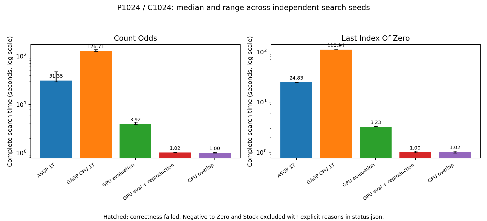
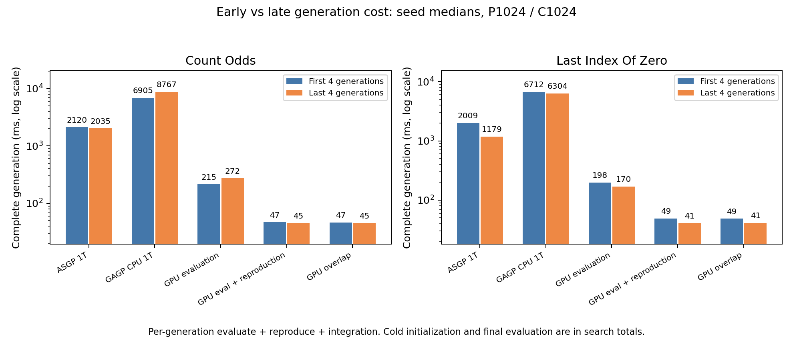
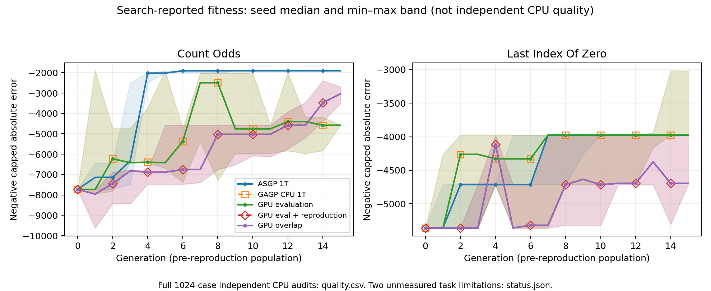
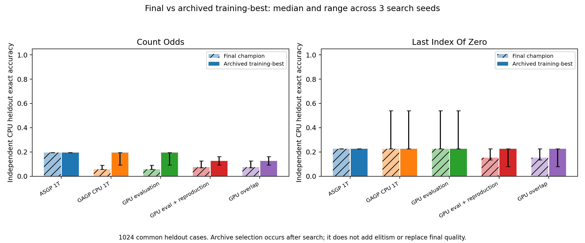

# 擴充題目：原生五模式演化 benchmark（2026-10-14）

完成 Count Odds、Last Index of Zero 的完整五模式比較。Stock With Cooldown 與 Negative to Zero 找到具體支援／資源限制，沒有用替代流程或縮小 cases 假裝完成。這輪新增 benchmark adapter、稽核與報告；**沒有修改 runtime、reproduction 架構或 CPU 執行緒數**。

**主要結論**：GPU-er-o 在共同 fitness 下的完整搜尋加速比為 **31.21×／24.41×**；含讀檔、獨立稽核及輸出的程序加速比為 **13.57×／11.82×**。GAGP CPU 仍慢於 ASGP 約4.0–4.5倍。搜尋品質存在可見落差，不能把吞吐量優勢直接解讀成等品質加速。

**實驗契約與時間口徑**

- Intel i9-10900K、RTX3090；P=1024、完整1024 cases、應用 CPU1T；GPU工作依序執行，未開nsys／ncu。
- 先跑4代pilot，再依預先固定的900秒／題預算選16代。兩題皆16代、seeds0/1/2、五模式，共30個正式搜尋；另有3個原生ASGP評分控制。三個seeds是不同搜尋，不是相同workload的三次計時重複。
- 初始population與cases對五種模式一致；跨代程式分布與operator／RNG可以不同。這是固定搜尋預算的系統比較，不是相同程式序列的純執行器speedup。
- `evolve_wall_ms`包含cold evolution初始化、所有generation的評估／reproduction／必要整合及最後population評估。既有frozen輸入準備、CLI讀檔、輸出與獨立CPU稽核不在這個邊界；另報GNU time量測的完整程序時間，解析度10ms。watchdog輪詢時間另存，沒有混入程序比值。
- 輸入取自本機ASGP task generator，不是原封不動的官方PSB資料域。原始三題、舊frozen inputs、archived binaries與歷史結果全部保留。
- Count Odds原生ASGP已用capped L1；Last Index原生discounted loss在主比較改為共同capped L1（每case上限1000，錯誤同罰）。原生discounted控制另列，不能挑分母。
- ASGP控制保留elite1與其tiebreak；GAGP維持原生replacement，可能丟失當代最佳。沒有偷偷替任一模式加入elitism。

**完整搜尋時間：秒，中位數 [三seed最小–最大]**

| 模式 | Count Odds：16代 | ASGP／此模式 | Last Index：16代 | ASGP／此模式 |
|---|---:|---:|---:|---:|
| ASGP 1T | 31.352 [29.302–47.246] | 1.00× | 24.826 [24.550–24.917] | 1.00× |
| GAGP CPU 1T | 126.710 [124.330–136.148] | 0.25× | 110.941 [110.552–111.719] | 0.22× |
| GPU-e | 3.924 [3.875–4.351] | 7.99× | 3.233 [3.232–3.318] | 7.68× |
| GPU-er | 1.021 [1.018–1.036] | 30.70× | 1.000 [0.985–1.064] | 24.82× |
| GPU-er-o | 1.005 [0.997–1.034] | 31.21× | 1.017 [0.969–1.062] | 24.41× |

以上比值採「各模式中位數之比」；[per-seed.csv](final/per-seed.csv)另保留每個配對seed的比值。最快GPU模式在兩題分別為overlap／ER，但ER與overlap的差距小，三個不同seeds不足以證明排程本身誰穩定更快。



**含讀檔、audit與輸出的程序時間：秒，中位數**

| 模式 | Count Odds | Last Index |
|---|---:|---:|
| ASGP 1T | 31.890 | 25.410 |
| GAGP CPU 1T | 127.930 | 111.940 |
| GPU-e | 5.180 | 4.400 |
| GPU-er | 2.260 | 2.200 |
| GPU-er-o | 2.350 | 2.150 |

GPU搜尋只有約1秒時，程序固定開銷不可忽略；不能把31.21×直接稱作完整CLI命令的加速比。

**單代前後期成本：ms，先取每seed前／後4代中位數，再跨seed取中位數**

| 模式 | Count：前4代→後4代 | Last Index：前4代→後4代 |
|---|---:|---:|
| ASGP 1T | 2119.90 → 2034.80 | 2009.29 → 1178.75 |
| GAGP CPU 1T | 6904.77 → 8766.59 | 6712.35 → 6304.28 |
| GPU-e | 214.80 → 272.44 | 198.29 → 169.59 |
| GPU-er | 46.86 → 45.40 | 48.90 → 40.89 |
| GPU-er-o | 46.52 → 45.27 | 48.68 → 41.23 |

Count 的CPU與GPU-e後期成本上升約27%；GPU-er-o接近持平。Last Index後期反而較快。這是實際演化分布的觀察，不能把較小／較容易的後期population誤報成相同workload執行效率改善。完整逐代best/mean、best_nodes、時間、errors、timeout、fallback、operator counters保存在[generations.csv](final/generations.csv)。changed是operator輸出計數，不是unique新offspring。



**獨立品質：1024個另seed cases，exact accuracy中位數**

| 模式 | Count：最後最佳 | Count：歷史最佳 | Last：最後最佳 | Last：歷史最佳 |
|---|---:|---:|---:|---:|
| ASGP 1T | 19.43% | 19.43% | 22.66% | 22.66% |
| GAGP CPU 1T | 5.66% | 19.43% | 22.66% | 22.66% |
| GPU-e | 5.66% | 19.43% | 22.66% | 22.66% |
| GPU-er | 7.42% | 12.60% | 15.33% | 22.66% |
| GPU-er-o | 7.42% | 12.60% | 15.33% | 22.66% |

最終GAGP程式經獨立grammar membership admission與CPU執行；另稽核gen0／8／15。歷史最佳只依訓練fitness，從已保存的每代最佳及final選取，同分優先final；沒有用測試集選程式，也沒有回灌population。這項分析在搜尋後進行，不宣稱GAGP本來具有elitism。

Count的CPU／GPU-e三個seed全部丟失歷史最佳，GPU-er／o各2/3；Last的GPU-er／o各2/3。具體例子：Count CPU seed0在gen5達−1907，final卻退回−3822。歷史最佳解釋部分品質落差，但GPU reproduction在Count的歷史最佳accuracy中位數仍低於ASGP。

最佳訓練L1不一定帶來最高測試exact accuracy：Last GPU-er/o seed0的歷史最佳測試accuracy為7.91%，final為13.57%。不能用「保存best」保證泛化品質變好。三seed×16代沒有任何模式達到完整解題；不是收斂品質等價證明，也沒有做相同wall-clock品質競賽。

Count的測試inputs全部1024個唯一，其中1個出現在訓練集；Last有996個唯一inputs，35個測試case出現在訓練集。這是獨立抽樣seed，**不是嚴格disjoint heldout**，自然重複保留並揭露。





另有[cumulative best曲線](final/cumulative-best-fitness.png)、[獨立final品質圖](final/heldout-quality.png)、[每checkpoint品質CSV](final/quality.csv)、[歷史最佳逐seed資料](final/best-ever.csv)。

**ASGP原生fitness控制：不要換分母**

Last Index原生discounted scoring三seed搜尋時間為27.652／24.291／27.440秒，中位數27.440秒；共同L1為24.826／24.550／24.917秒，中位數24.826秒。相對同一GPU-er-o中位數1.017秒，原生分母比值約26.97×，共同L1比值24.41×。兩者是不同搜尋目標，主表固定報共同L1，原生結果單列。

原生discounted ASGP的獨立exact accuracy為27.05%／16.11%／30.27%，中位數27.05%；共同L1三seed皆22.66%。fitness設計確實會影響演化結果，不能只改成容易量測的分數而忽略搜尋品質。[原生控制資料](final/native-controls.csv)。

**正確性與支援限制**

- 兩個正式題目的已知正確解在ASGP、CPU、GPU均通過完整1024 cases。30個正式搜尋皆完整完成；所有GPU generation均計入1024² pairs，unscored=0；24個GAGP搜尋的final top16 CPU fitness audit皆零不符。這是有限範圍稽核，不能稱全population完全parity。
- 完整初始1024程式快照：Count有66個ASGP／GAGP CPU fitness差異、1個GAGP CPU／GPU差異；Last分別21／0。保留所有程式對照與錯誤計數。
- 已定位Last parent0：solve=head、divide=n（clamp至n−1）、combine=left²。GAGP generic VM先將Int轉double再轉回，超過2^53會失去位元；ASGP直接做wrap整數運算。training case6的ASGP輸出5478889252096573441，GAGP為0。301個case的差異精確重現該程式loss361146／66976。這是既存數值行為，不是本輪新增或已證明合理的tradeoff；不能宣稱轉換後完全等價。其餘全部差異的原因尚未逐一定位，Count parent992的CPU／GPU差異也未完全定位。[數值診斷](numeric-diagnosis.json)。
- **Stock With Cooldown**：原生ASGP會clamp memo依賴座標；目前memoized coordinate validator要求對應constant-offset constructor。直接clamp encoding被拒絕；額外memo state encoding又缺完整coordinate coverage。保留兩個實際拒絕與positive controls。沒有改成nonmemoized遞迴冒充同一DP benchmark。[probe結果](evidence/stock-capability.json)。
- **Negative to Zero**：list grammar／generic GPU reproduction可表示，不代表eval正確。GPU generic list arena只有128 values／32 entries，view executor拒絕Singleton／Concat。完整known solution CPU／ASGP正確，GPU fitness−789814而應為1024。長度1對照通過；長度50 GPU得−1024000。
- Negative的CPU隨機演化在僅P8、2代測試即達99,987,640KiB RSS（95.36GiB），已停止自己的程序。Concat反覆複製、registry保留及不按payload元素收fuel可造成巨大配置；首次8parents本身有限，但variation可組出放大的recurrence。未捕捉實際停下的offspring，不把推測當成已證明根因。沒有繼續P1024，也沒有報該題的合格速度。[資源中止紀錄](evidence/negative-cpu-memory-stop.json)。

**錯誤、diversity與記憶體**

全部正式GPU generation的timeouts、fallbacks、unscored皆0。初始隨機程式有錯誤並完整受罰；沒有跳過困難程式。GPU-er-o末代錯誤pair比例：Count三seed1.074%／0.879%／0.586%，Last0.278%／0.676%／0%。稽核的final與歷史最佳champions皆無runtime error。CPU與ASGP搜尋沒有同粒度的逐case錯誤counter，不把缺值當零。

| 模式 | Count final unique genomes（中位數） | Last final unique genomes（中位數） | Count peak RSS MiB | Last peak RSS MiB |
|---|---:|---:|---:|---:|
| ASGP 1T | 937 | 484 | 761.5 | 722.4 |
| GAGP CPU 1T | 1020 | 700 | 1032.6 | 888.5 |
| GPU-e | 1020 | 700 | 1158.6 | 1009.5 |
| GPU-er | 1006 | 835 | 1134.0 | 1072.2 |
| GPU-er-o | 1006 | 835 | 1134.4 | 1072.2 |

GPU-er-o genotype device allocation中位數約725.23MiB／723.63MiB，**不是完整device peak memory**，沒有另做Nsight或長跑記憶體趨勢量測。16代結果不能證明長期無洩漏；也沒有量測每代behavioral diversity或最終unique新offspring。

**實際驗證、版本與重現**

原始checkpoint `db1dd55`（runtime最佳來源`2938d69`）；正式量測source checkpoint `41f2566`，benchmark binary SHA256 `b9952b911df5f22f1ed361472663a114994882278bcededfbe3f8efd3d3d7980`。後續commits只有測試／分析／報告，沒有runtime變更。設定完整保存在[settings.json](settings.json)，不要漏開最佳opt-in設定。

Release benchmark build成功；focused native CTest通過。內含5個Python測試：2成功、2個明確expected failure（數值parity與長list GPU）、1個明確skip（unsafe random list evolution）。這些限制沒有被報成支援。原始三題與五模式smoke仍保留且通過。工具測試7、repository24、summary6通過；較早失敗log與資源中止證據全部保留。[驗證記錄](evidence/validation.json)。

正式30個搜尋的程序時間總和約16.2分鐘，含等待鎖的正式stage跨度18.44分鐘；pilot、原生評分控制、品質稽核另列於[evidence/execution-cost.json](evidence/execution-cost.json)。GPU工作未並行。這不是新的timing候選，所以沒有重跑P2048／4096／8192 scaling；本輪只承諾P1024/C1024。

在`/home/hschi1106/.t3/worktrees/gagp/gagp-opt-20261001`執行，使用全新輸出目錄；**不要重新prepare歷史frozen inputs**：

```bash
R=benchmarks/fixed_asgp/optimization/results/expanded-20261014
D=logs/optimization/expanded-rerun-NEW
A=logs/optimization/expanded-20261014/artifacts
python3 "$R/run.py" pilot --out "$D/pilot-supported" --artifacts "$A"
python3 "$R/run.py" formal --out "$D/formal" --artifacts "$A" --pilot "$D/pilot-supported"
python3 "$R/run.py" quality --runs "$D/formal" --out "$D/quality"
python3 "$R/run.py" best-quality --runs "$D/formal" --out "$D/best-quality"
python3 "$R/run.py" native-controls --out "$D/native-controls" --artifacts "$A" --pilot "$D/pilot-supported"
python3 "$R/run.py" quality --runs "$D/native-controls" --out "$D/native-quality"
```

本機原始資料位於`logs/optimization/expanded-20261014/`，每個stage有binary、source/settings/input hashes與commands；每seed有完整generation JSON、final/history exports、GNU time resources及log。已完成資料可重畫：

```bash
python3 "$R/summarize.py" --study logs/optimization/expanded-20261014 --out logs/optimization/expanded-report-NEW
python3 "$R/summarize_best.py" --study logs/optimization/expanded-20261014 --out logs/optimization/expanded-report-NEW
```

對新rerun重畫時，需複用已通過hash檢查的`initial-snapshots/`診斷或重新跑相同snapshot命令；snapshot不是正式計時樣本。原始資料與compact逐seed／逐代CSV均保留。沒有push。

**後續優先順序**

1. 先處理可遺失歷史最佳的品質問題：最小的elite／外部best保存契約，再做相同wall-clock品質比較。這是搜尋語意改變，不能無聲套入本輪結果。
2. 釐清並修正Int運算經double轉換及CPU／GPU罕見差異，建立可宣告的數值profile；不要把意外精度損失當成已獲批准的有損設計。
3. 擴展到list輸出前，先解決有界payload配置、generic GPU list容量與明確fallback；否則增加題目只會量到容量失敗。
4. 若要真正驗證多狀態DP通用性，再補Stock所需的clamped memo transition契約，而非換成不同演算法比較。

這輪證明了另外兩個scalar／window題目有顯著GPU吞吐量優勢，也揭露品質保持與更廣泛型別支援仍有缺口；尚不能把它推廣成所有PSB題目都能同品質加速25–30倍。
