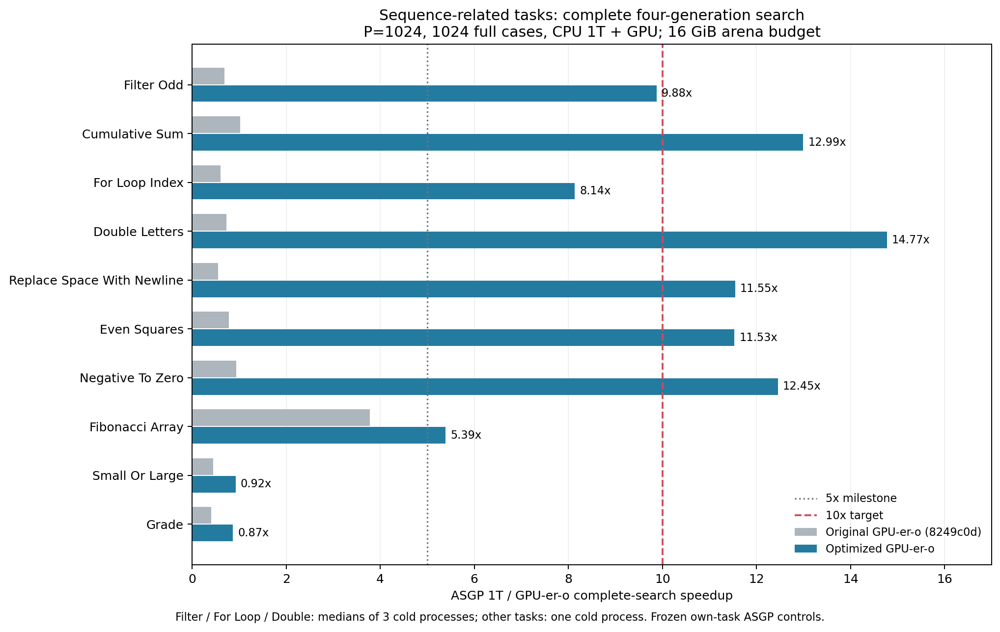

# List／sequence 題目優化實驗（2026-10-15–16）

本輪目標從 5× 提高為 10× 伸展目標。原生 CPU／GPU-e／GPU-er／GPU-er-o 流程保留；量測固定 CPU 1T、P=1024、完整 1024 cases、四代及最終評估。沒有 case sampling、題目專屬 solver 或 CPU fragment reproduction。

## 實驗口徑與目前 checkpoint

最佳 production：`b568c7e`，測試至`b1760de`（原始binary source）；本地branch為`opt/list-output-5x-20261015`。啟用設定以`settings-workspace-pool16.json`為準，完整binary／輸入hash見`logs/list-5x-20261015/pooled16-ten/manifest.json`。16GiB scratch有額外VRAM成本，較省記憶體的`settings-workspace-pool.json`維持8GiB；預設仍512MiB，所有新profile預設關閉。沒有push或修改原始worktree／frozen inputs。

headline 的分母沿用各題凍結的 ASGP 1T 四代控制組，沒有使用 fixed-parent 分母，也不套用到 24 代。完整搜尋時間為既有 `evolve_wall_ms`：包含冷啟動 admission、必要編譯、四個完整 generation、最終評估與內部 materialization／retirement。CLI 輸入 parsing、獨立 CPU audit、JSON 寫出仍在原本邊界之外；process 時間另記於 manifest。新增快取的建立、使用與清理依原本頻率計入。

ASGP／GAGP 已對齊 fitness 設計與 elite=1，搜尋空間仍不是逐位相同：ASGP logical depth 7、native physical depth 24／nodes 1024、crossover 機率與 site／selection／RNG 規則等差異保留於 search contract。Cumulative 等 list-combine-v1 對稱 grammar extension 的既有揭露仍適用。不得將這些數據當成原始論文的精確重現或品質等價證明。

## 未開 profiler 的完整四代結果

五題在初測超過10×；Filter的三次中位數仍為9.88×，不宣稱已達10×。八個較長的sequence相關題目都超過5×；Small／Grade尚未達到1×。Fibonacci Array是scalar-output bounded2D memo，不能稱它輸出list。

| Task | ASGP 1T (s) | GPU-er-o (s) | ASGP / GPU-er-o | Repeats |
| --- | ---: | ---: | ---: | --- |
| filter_odd | 10.973 | 1.111 | 9.88× | 3 cold processes, median |
| cumulative_sum | 16.288 | 1.254 | 12.99× | 1 cold process |
| for_loop_index | 9.372 | 1.152 | 8.14× | 3 cold processes, median |
| double_letters | 39.507 | 2.674 | 14.77× | 3 cold processes, median |
| replace_space_with_newline | 29.321 | 2.539 | 11.55× | 1 cold process |
| even_squares | 18.223 | 1.581 | 11.53× | 1 cold process |
| negative_to_zero | 15.878 | 1.275 | 12.45× | 1 cold process |
| fibonacci_array | 7.863 | 1.459 | 5.39× | 1 cold process |
| small_or_large | 0.385 | 0.418 | 0.92× | 1 cold process |
| grade | 0.355 | 0.409 | 0.87× | 1 cold process |

原始三次repeats（秒）：

- filter_odd: 1.140088421, 1.111133948, 1.110983201
- for_loop_index: 1.152384403, 1.151863184, 1.146925632
- double_letters: 2.674341521, 2.674750884, 2.667273726

其餘七題是一個冷啟動process，僅為低預算screen。不是正式九次／同process暖機的精確矩陣，亦沒有品質等價宣稱。較早的For ASGP同輪control9.041s對凍結9.372s，環境差約3.5%；分母保持原凍結control，沒有挑選有利分母。詳見`final.json`、`pooled16-cold-repeats.csv`及所有raw manifests。



## 哪些工作被消除

- 適用的 private IntList 運算不再每次維護 canonical registry identity／重新掃描 payload；改用經所有權與完整 typeflow 檢查的 content／offset 表示。
- 本地 cells 從 boxed Value 改為完整 int64；外部 payload 保留原本 Value 表示，65536／65537 backing 邊界及 encoded-length 觀察有測試。
- 已證明的 trivial、Measure、compare／add phases，以及兩個 window 的 region，使用既有 executor 的精簡路徑。64-bit typed loop 僅用在完整 normalization 且 phase 資源上限適用時。
- 有界 coordinate memo 用所有座標的直接索引；不是僅以第一個座標當 key。
- Cold scope 的 membership 與 executable artifact 重用省去重複證明／編譯。grammar／request／input order／fuel／decoded identity 與 raw constant seal 都必須匹配，public mutable AST 不能自行宣稱可信。
- 單一session-owned workspace消除重複cudaMalloc／free，initial/replay重分區同一backing。unused retained capacity也計入cap，headroom不足先釋放；非private profile明確decline。完整search的session destructor／最後一次free仍計入`evolve_wall_ms`。
- Warp copy 將同一份必要的全部元素搬移交給 opportunistic active lanes 協同執行；沒有省略元素、fuel 或 case。至少四個參與 lanes、256 cells 才使用，較小或不支援的情況走原路徑。

仍保留每代原生 GPU selection／crossover／mutation、必要 admission／ownership、完整案例評估、AST export 和最終 CPU audit。這次 executor／copy 變更沒有更改 RNG、operator、fuel、數值精度或 grammar language。

## 支援範圍與語意差異

Private profile 是明確 opt-in 的執行 profile，並非宣稱與歷史 hash token 所有極端情況完全相同：生成 list 的 content identity 不再受 canonical hash collision aliasing 與歷史 65536 transport identity 影響。Exact 比較看內容。container equality、IntList memo keys 等不支援組合明確 decline；型別正確不是 grammar membership 的替代品。詳細條件以 `docs/design/payload.md` 為準。

本輪的 compact cells、typed/window executor、memo、cache、warp copy 都保持上述已揭露 profile 的結果。尚未支援的程式照常 generic fallback，不會略過。本次最佳設定16GiB、另保留8GiB設定，預設仍512MiB；device context、immutable input、genotype storage 不混稱為該 scratch 上限。

## 正確性、品質與長跑證據

十題 seed0：全部最終 1024 個 AST、population metrics 與每代語意紀錄對原始 native 控制組相同，CPU top16 audit=0 mismatches，完整 cases／timeouts／errors／fallback／unscored counters 相同。既有 runtime errors 仍存在，沒有把它們隱藏或當成加速來源。

Filter／Negative／Small 額外 seeds1、2 四代，及 seed0 24 代，都與 lossless 控制的完整 AST／fitness／語意 trace 一致。Negative seed2 的最終 training fitness=0，兩個版本都找到。這些短程檢查能排除本輪的明顯品質退化，不能證明一般收斂品質、未見 cases 或所有 grammar 的等價性。

最終16GiB候選24代的時間／記憶體見`pooled-quality-g24-memory.json`：

| Task | Lossless start (s) | Current (s) | Early4 gen median (ms) | Late4 gen median (ms) | Sampled process RSS max (MiB) |
| --- | ---: | ---: | ---: | ---: | ---: |
| filter_odd | 20.134 | 4.823 | 177.02 | 226.82 | 579.7 |
| negative_to_zero | 25.359 | 6.156 | 190.34 | 270.55 | 455.9 |
| small_or_large | 3.796 | 0.809 | 14.99 | 18.55 | 644.0 |


三題均只第一代配置一次，之後23代重用。兩個長序列題目外部nvidia-smi抽樣process GPU memory最高18,664MiB，包含context／genotype／scratch；不是精確device peak。短Small可能完全錯過短暫backing residency，不能把其較低抽樣值當成可靠的峰值比較。RSS包含export／audit，最後generation的樣本混有收尾；較晚階段仍有bloat與額外成本，不能據G24宣稱任意長跑／常數記憶體已解決。

## 已淘汰與仍未知

已移除無效的 global hash index、capacity-scale 與 compact-cell SoA；後者 Even 的固定 evaluator 約退步 15%。錯誤的 untiled shared-score 壓縮已撤回，只有已驗證的 tiled32 slots 保留。歷史失敗 binary／log 留作紀錄，不是可啟用推薦入口。

暫不建立額外 payload-pattern library：靜態覆蓋率與既有 typed-loop 實測無法支持足夠端到端收益。更大的 lazy Concat／rope 設計會改變多處所有權、scoring 與 layout，尚無經最小原型證明的收益，不納入現有成績。

## 重現與原始資料

```bash
PYTHONPATH=tools python3 benchmarks/fixed_asgp/optimization/results/list-5x-20261015/run_search.py \
  --out logs/list-5x-20261015/NEW \
  --binary logs/list-5x-20261015/pooled16-ten/bench \
  --settings benchmarks/fixed_asgp/optimization/results/list-5x-20261015/settings-workspace-pool16.json
```

只消費既有 frozen inputs，不得重新 prepare。每次使用新的輸出目錄。tracked JSON／CSV 保存摘要與設定；完整原始結果、commands、hashes、binary、log 於 `logs/list-5x-20261015/`。未執行高成本全30題／多 population 精確矩陣；目前是低預算的優化與支援證據。

## 原三題回歸觀察

在workspace候選前，同輪交錯三對冷啟動process，P1024／完整1024／四代。Sum 的 lossless→current 中位數484.69→498.86ms，House426.38→441.04ms，Median307.05→346.81ms。分別約3%、3%、13%增加；單筆範圍與完整結果見`original-three-ab.json`。AST／fitness／語意 trace 全部一致。這些是短程 cold-start 回歸，沒有重新精確量測原本32／64代結果；不能宣稱原三題完全沒有性能退化。

## Workspace 重用前的 profiling

Filter 的完整CLI nsys：eval 占GPU kernel總時間97.6%；185次cudaMalloc總API時間469ms，185次cudaFree81ms；GPU H2D／D2H傳輸各約2.55／0.60ms。這些數字包含profiler影響及CLI前後成本，不能和未profile的wall時間相減，也不能把同步等待再加到kernel時間上。四次慢配置的431ms是此次workspace實作的動機，不是已消除的時間或速度上限。

更早的獨立診斷記錄固定population實際copy2.4–17.5b cells，包含rollback／replay；lane-cycle總和不是wall fraction。phase-pattern額外特化覆蓋率不足，暫不擴張pattern library。


## Workspace採用證據與最新瓶頸

同binary完整G4、pool OFF→ON（8GiB）：Filter1.652→1.156s、For1.785→1.165s、Even2.031→1.673s、Double3.563→3.262s、Small0.477→0.413s，完整AST／population／語意trace相同。不是靠重播相同parents的編譯cache命中率宣稱收益。最終cleanup計入wall；單次snapshot eval會把retained backing最終free留到session析構，故未用它宣稱pool端到端加速。

在compact＋warp＋pool的新前提下重測8→16GiB：Double3.309→2.687s、Replace3.144→2.558s、Even1.699→1.588s；另有原始Filter／For波動見`pooled-capacity-screen.json`。這是VRAM換較多replay並行度，不是資源中性的成果。預設沒有提高。

最新Filter nsys：eval仍占GPU kernel總時間97.2%；cudaMalloc／free各166次（先前185），API總時間分別約5.0／21.3ms。trace環境與workspace cap不同，不能把全部時間差單獨歸功於pool；採用依據是上面的同binary未profile完整搜尋A/B。CPU與GPU時間不相加，同步等待不能重複計算。

Small／Grade在同一未profile四代量測中的admission本身已超過各自5×的總時間預算（ASGP wall／5約77／71ms）。繼續只優化eval不足以達標，下一個不同問題是cold ownership／grammar import；目前仍保留必要驗證，沒有搬到計時區外。長序列的剩餘瓶頸仍是完整list運算／搬移與VM執行。未實作較大的rope／DAG payload重寫或再擴張phase pattern庫，現有證據不支持在這輪把它們直接當成可採用收益。


## 最終驗證與repo狀態

Release完整build通過。最終native131/131測試通過（175.64s）；repository24、fixed-ASGP tools31通過。最終P8／完整1024cases／G2，13題×snapshot及原生五種模式=78cells全部通過，CPU／GPU snapshot mismatches=0。原五種模式及CPU controls均保留，沒有啟用application CPU多執行緒。

原始copyhelper在255／256／257、65536／65537、divergent masks、global boxed／localcompact來源、紅區等測例的memcheck／synccheck均零錯誤。這不冒稱覆蓋新的hostpool；pool有額外cap縮減、metadata pressure、dirty storage、callback拒絕與exception recovery、move／reset／fallback、65537 replay及32代fullcase CPU對照測試。

原始資料詳見`validation-final.json`。所有raw logs／binary／inputs／commands保存於`logs/list-5x-20261015/`；tracked結果保存於本目錄。分支`opt/list-output-5x-20261015`，原始worktree／歷史artifacts未改，未push。沒有執行高成本全30題或P1024/2048/4096/8192精確矩陣；本輪數據不可宣稱這些範圍已覆蓋。

本輪停止擴張實作，保存已經可用、通過驗證的候選：多條不同方向已有實測；剩餘runtime成本需要更大payload表示／executor設計，短題則是不同的cold ownership問題，尚沒有下一個有足夠證據、同樣小且值得直接採用的patch。沒有把尚未實作的方向算成收益，也沒有宣稱十題全部達標。
