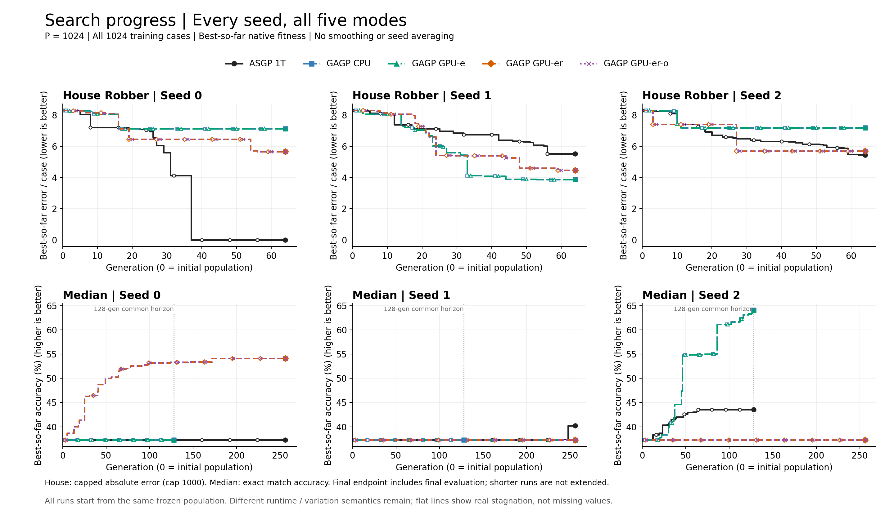
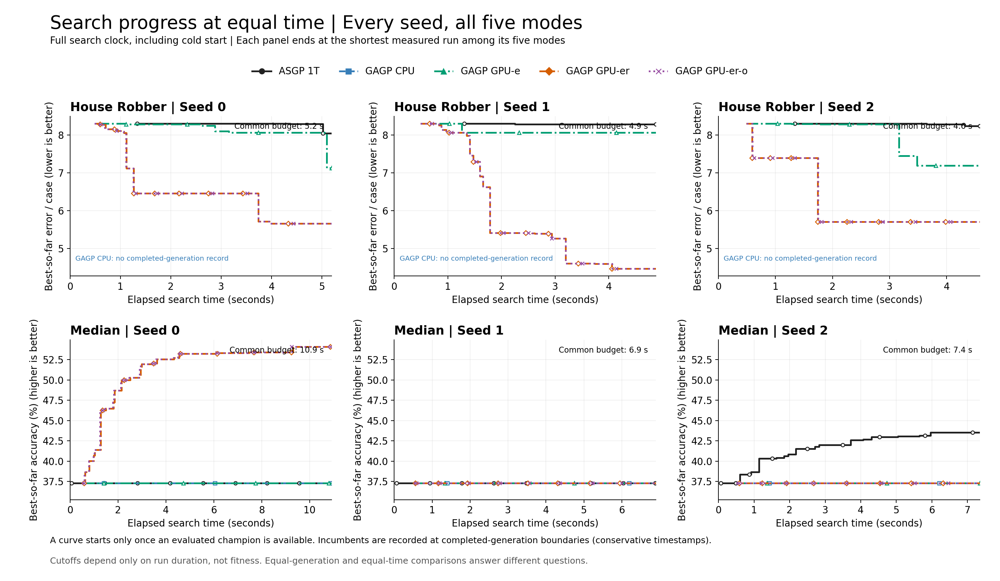
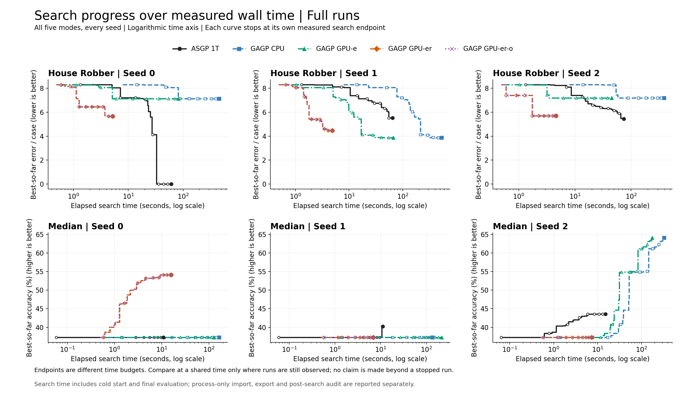
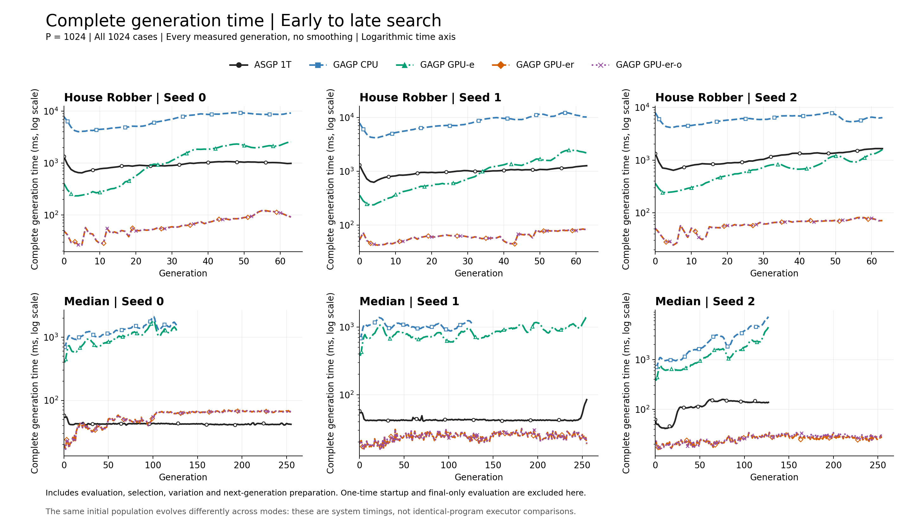
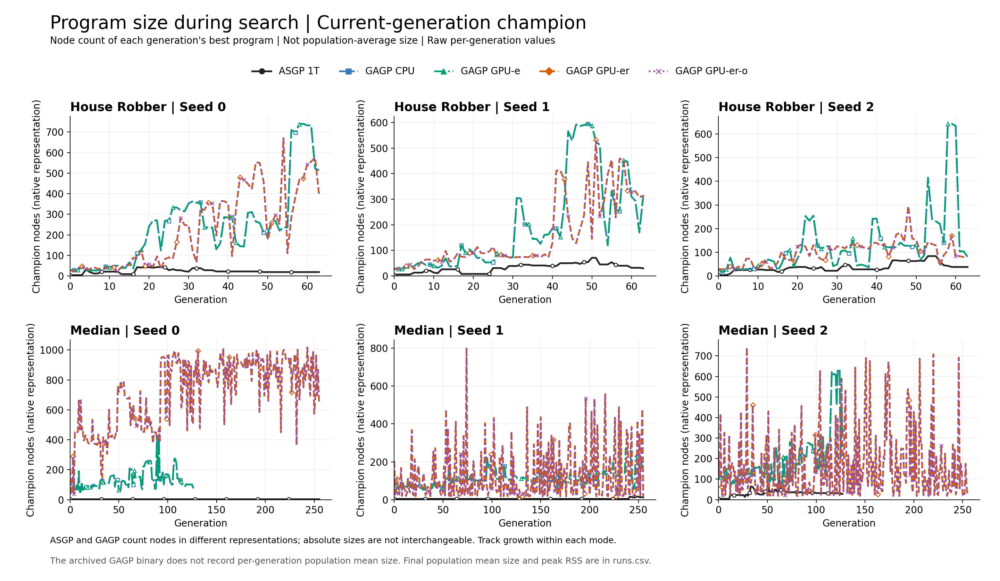
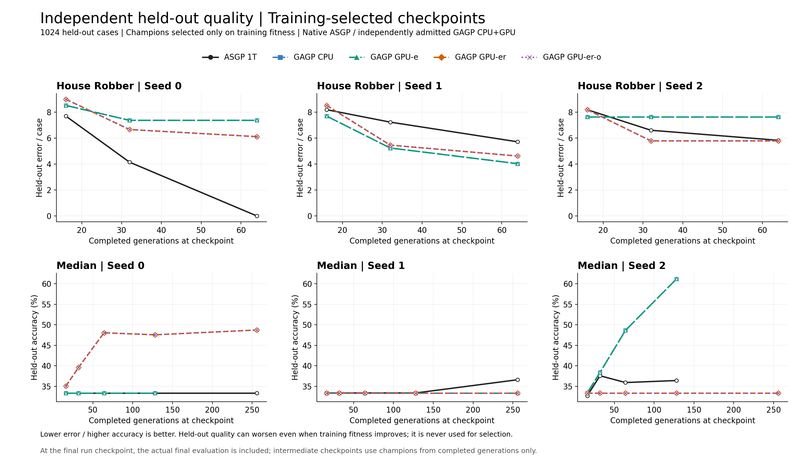

# 長世代搜尋結果

## 本輪結論

39次搜尋（30次完整主矩陣＋9次延長），共5184個完整generations，performance runner耗時54.16分鐘；獨立checkpoint audit另10.53秒，出圖另計。P1024/C1024、CPU1T、無profiler，未修改runtime或演化規則。

### 完成範圍

- House：五模式 × 三seeds全部完成64代。
- Median：五模式 × 三seeds全部完成128代。
- Median256：ASGP seeds0/1、GPU-e seed1、GPU-er及GPU-er-o全部三seeds。其他六個延長設定依預先固定的時間預估門檻略過，沒有失敗或被中途終止的run。
- 主fitness圖畫每格最長的完整run；128代虛線標示Median共同範圍。不得用256代個體與其他模式128代終點宣稱同代數品質勝出。

### 比16代多看到了什麼

- **House seed0：ASGP在generation37找到training零誤差解（約32.84秒），held-out也零誤差。** GAGP四模式到64代都尚未找到零誤差；不能以GPU速度代替搜尋品質。
- **House seed1：CPU／GPU-e到64代的training平均誤差3.87，GPU-er/o為4.47，ASGP為5.52。** 三者held-out平均誤差分別4.03、4.63、5.72，這個seed的改善能反映到獨立cases。seed2又是不同排序，不能只挑一個seed下結論。
- **Median seed0：GPU-er/o在128代training正確率53.32%、held-out47.56%；到256代training54.10%、held-out48.73%。** CPU／GPU-e在128代仍停在training37.30%、held-out33.40%；ASGP seed0延長到256代也未突破。
- **Median seed2：CPU／GPU-e在128代達training64.06%、held-out61.13%。** GPU-er/o即使到256代仍為training37.30%、held-out33.40%；ASGP到128代為training43.55%、held-out36.43%。因此不能宣稱GPU reproduction的新variation在所有seed都有相同搜尋能力，也不能把停滯一概歸因題目太難。
- 這些是保留原生語意與不同operator的系統比較，不是證明哪一項規則造成差異的因果實驗。三個seeds共用同一初始population，亦不足以估計收斂成功率。

### 同代數搜尋速度

Search wall含cold與final evaluation，三seed中位數；process另外含匯入／audit／export。以下只比完整主矩陣，不混入延長組。

| 題目／代數 | ASGP 1T | GAGP CPU | GPU-e | GPU-er | GPU-er-o |
| --- | ---: | ---: | ---: | ---: | ---: |
| House／64 | 64.696 s | 457.386 s | 66.812 s | 4.890 s | 4.877 s |
| Median／128 | 5.534 s | 166.595 s | 128.674 s | 3.726 s | 3.751 s |

最快GPU相對ASGP：House **13.27×**、Median **1.49×**。這是會改變population的完整搜尋，不是原frozen single-generation benchmark的30×口徑。

### 後期成本與檢查

- House GPU-er-o的末16代／前16代時間中位數倍率，seeds0/1/2為2.44／1.64／2.14；Median為2.89／1.33／1.61。Median CPU seed2為5.03，品質改善伴隨明顯後期成本。
- 150筆checkpoint、39個去重程式完成完整1024 training及held-out cases重評；native training全部重現，GAGP grammar admission及CPU/GPU checkpoint結果一致。ASGP採其原生runtime重評。
- 所有39runs的前16代best／mean／best_nodes重現原紀錄；9個延長run前128代也重現對應主run，原final128的fitness與延長run generation128一致。
- CPU／GPU-e的best曲線全相同，但House有10個generation的population mean不同，不能宣稱完整population parity；GPU-er/o主矩陣best／mean全相同。
- GPU runs合計36.91億個generation program/case pairs，timeout／fallback／unscored均0；runtime errors約1.13%，仍計入原fitness懲罰。CPU／ASGP缺少同等counter，不以缺值當0。
- 原始frozen inputs與archived binary hashes未變。沒有新增runtime執行緒、演化架構或operator更動。

同時間圖只在實際觀察的範圍比較；House GPU-er/o在64代就結束，不能以停止後的水平延伸線推論它繼續跑到ASGP同時間的品質。`fitness_vs_time_full`展示完整各自時間範圍，`fitness_vs_time`則限制在五模式共同覆蓋的時間。

圖中文字均為英文。House64、Median128主矩陣各15次搜尋；延長run與完成範圍見下表。圖表使用每格最長的完整run，不拼接不同run。

Performance runner elapsed: 54.16 min. Checkpoint audit: 10.53 s.

主矩陣同代數的三seed時間中位數與ASGP加速比，另見[main_summary.csv](main_summary.csv)；延長組不能混入該比值。

## 完成範圍與時間

| Task | Mode | Seed | Generations | Search s | Process s | Early16 ms | Late16 ms | Late/Early | Training best | Held-out | Final mean nodes | Peak RSS MiB |
| --- | --- | ---: | ---: | ---: | ---: | ---: | ---: | ---: | ---: | ---: | ---: | ---: |
| house_robber | asgp_1t | 0 | 64 | 60.74 | 61.23 | 763.83 | 1029.30 | 1.35 | 0 | 0 | 34.8 | 614.8 |
| house_robber | asgp_1t | 1 | 64 | 64.70 | 65.18 | 812.54 | 1139.22 | 1.40 | -5652 | -5859 | 49.9 | 613.7 |
| house_robber | asgp_1t | 2 | 64 | 73.99 | 74.45 | 776.67 | 1497.83 | 1.93 | -5575 | -5977 | 57.8 | 614.7 |
| house_robber | gagp_cpu | 0 | 64 | 457.39 | 459.44 | 4495.46 | 8793.89 | 1.96 | -7303 | -7555 | 521.8 | 1708.9 |
| house_robber | gagp_cpu | 1 | 64 | 531.45 | 533.44 | 5123.32 | 11032.99 | 2.15 | -3960 | -4131 | 512.5 | 1678.9 |
| house_robber | gagp_cpu | 2 | 64 | 387.53 | 389.17 | 4585.16 | 6312.70 | 1.38 | -7361 | -7830 | 336.4 | 1365.0 |
| house_robber | gpu_eval | 0 | 64 | 82.40 | 84.50 | 278.89 | 2152.61 | 7.72 | -7303 | -7555 | 521.8 | 1839.3 |
| house_robber | gpu_eval | 1 | 64 | 66.81 | 68.82 | 322.23 | 2072.02 | 6.43 | -3960 | -4131 | 512.5 | 1826.0 |
| house_robber | gpu_eval | 2 | 64 | 45.08 | 46.76 | 289.68 | 1140.18 | 3.94 | -7361 | -7830 | 336.4 | 1490.1 |
| house_robber | gpu_repro | 0 | 64 | 5.20 | 7.13 | 42.09 | 102.59 | 2.44 | -5796 | -6266 | 359.0 | 1576.5 |
| house_robber | gpu_repro | 1 | 64 | 4.89 | 6.98 | 48.62 | 79.19 | 1.63 | -4577 | -4736 | 421.7 | 1685.2 |
| house_robber | gpu_repro | 2 | 64 | 4.59 | 6.13 | 34.73 | 73.30 | 2.11 | -5843 | -5933 | 215.9 | 1268.2 |
| house_robber | gpu_overlap | 0 | 64 | 5.19 | 7.08 | 42.32 | 103.23 | 2.44 | -5796 | -6266 | 359.0 | 1577.5 |
| house_robber | gpu_overlap | 1 | 64 | 4.88 | 6.93 | 48.53 | 79.82 | 1.64 | -4577 | -4736 | 421.7 | 1685.0 |
| house_robber | gpu_overlap | 2 | 64 | 4.60 | 6.13 | 34.73 | 74.19 | 2.14 | -5843 | -5933 | 215.9 | 1268.4 |
| median | asgp_1t | 0 | 256 | 10.91 | 11.43 | 42.67 | 42.00 | 0.98 | -642 | -682 | 5.7 | 760.6 |
| median | asgp_1t | 1 | 256 | 11.12 | 11.68 | 42.06 | 44.22 | 1.05 | -612 | -649 | 24.3 | 759.6 |
| median | asgp_1t | 2 | 128 | 15.21 | 15.79 | 42.94 | 138.46 | 3.22 | -578 | -651 | 34.4 | 760.6 |
| median | gagp_cpu | 0 | 128 | 166.59 | 167.97 | 940.19 | 1560.64 | 1.66 | -642 | -682 | 213.8 | 1328.4 |
| median | gagp_cpu | 1 | 128 | 135.47 | 136.78 | 1066.17 | 1140.71 | 1.07 | -642 | -682 | 152.1 | 1206.4 |
| median | gagp_cpu | 2 | 128 | 327.92 | 330.17 | 974.10 | 4900.49 | 5.03 | -368 | -398 | 592.8 | 2055.8 |
| median | gpu_eval | 0 | 128 | 128.67 | 130.09 | 594.91 | 1285.20 | 2.16 | -642 | -682 | 213.8 | 1434.6 |
| median | gpu_eval | 1 | 256 | 217.47 | 219.01 | 689.43 | 1067.53 | 1.55 | -642 | -682 | 238.0 | 1482.1 |
| median | gpu_eval | 2 | 128 | 175.00 | 177.27 | 623.00 | 2507.68 | 4.03 | -368 | -398 | 592.8 | 2167.5 |
| median | gpu_repro | 0 | 256 | 15.81 | 19.15 | 22.12 | 66.96 | 3.03 | -470 | -525 | 835.5 | 2769.4 |
| median | gpu_repro | 1 | 256 | 6.89 | 8.23 | 18.13 | 24.45 | 1.35 | -642 | -682 | 121.6 | 1246.1 |
| median | gpu_repro | 2 | 256 | 7.35 | 8.83 | 17.69 | 26.37 | 1.49 | -642 | -682 | 170.9 | 1357.9 |
| median | gpu_overlap | 0 | 256 | 15.73 | 19.06 | 22.19 | 66.57 | 3.00 | -470 | -525 | 835.5 | 2770.7 |
| median | gpu_overlap | 1 | 256 | 6.92 | 8.28 | 18.12 | 24.30 | 1.34 | -642 | -682 | 121.6 | 1246.2 |
| median | gpu_overlap | 2 | 256 | 7.52 | 9.03 | 17.53 | 28.12 | 1.60 | -642 | -682 | 170.9 | 1355.6 |

## Fitness vs. generation


## 同時間品質


## 完整搜尋時間範圍


## 每代耗時


## 程式大小


## 獨立held-out品質


## 比較限制
- 三個reproduction seeds共用同一初始population；不能當作收斂品質等價證明。Sum初始已有解，本輪不重跑。
- 延長run從初始population重跑，成本包含於performance budget；prefix_checks.json核對之前16代，manifest記錄延長run對128代的前綴。
- GAGP CPU／GPU-e與GPU-er/o保留不同variation規則；ASGP/GAGP原生語意也不同（例如負索引）。只對齊scalar fitness不等於程式語意相同。
- 計時有三種口徑：generation、search（含cold/final eval）、process（另含匯入/audit/export）。不混用。
- GPU error、timeout、fallback、unscored在generations.csv；CPU與ASGP未提供相同細粒度counter，缺值不代表0。changed是operator計數，不代表unique有效offspring。
- 程式大小圖是當代champion，不是整個population平均；不同表示法node數不直接等價。RSS為process峰值，不是逐代memory趨勢。
- 主報告generation endpoint包含final eval；中間checkpoint不額外插入評估。Held-out只用於事後分析。

[實驗契約](CONTRACT.zh-TW.md) · [每代資料](generations.csv) · [每次搜尋](runs.csv) · [Checkpoint品質](checkpoints.csv) · [同時間比較](equal_time.csv)

重現分析：
```bash
python3 benchmarks/fixed_asgp/optimization/long_search_audit.py --out logs/optimization/long-search-NEW
python3 benchmarks/fixed_asgp/optimization/long_search_report.py --out logs/optimization/long-search-NEW --report benchmarks/fixed_asgp/optimization/results/long-search-NEW
```
