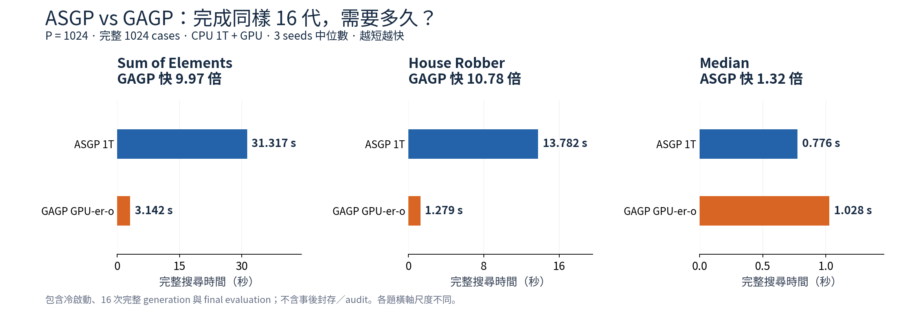
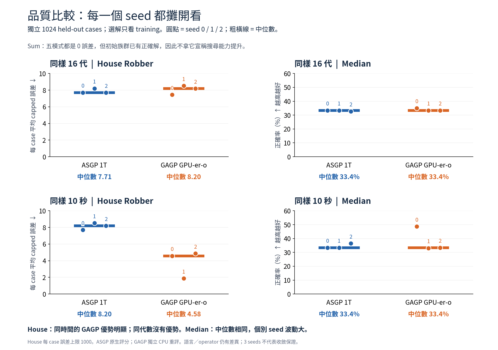
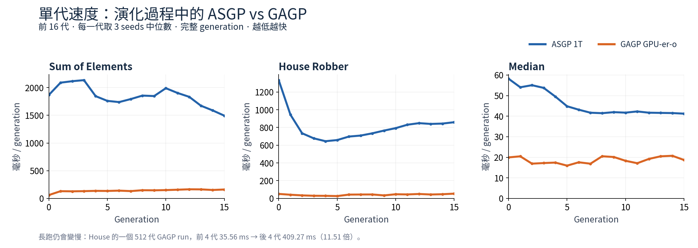

# ASGP vs GAGP：總體比較

主比較固定 **ASGP 1T vs GAGP GPU-er-o**，三題不更換 GAGP 模式、不挑最好 seed。
P=1024、完整1024cases，三個reproduction seeds、相同frozen來源初始族群。

**結論：Sum／House 跑完16代約快10倍；House能把速度轉成同時間更好的解；Median尚無穩定優勢。**

## 1. 速度



- Sum：31.317 → 3.142秒，GAGP快 **9.97倍**。
- House：13.782 → 1.279秒，GAGP快 **10.78倍**。
- Median：0.776 → 1.028秒，**ASGP快1.32倍**；這個短搜尋的GAGP尚未攤平冷啟動等成本。

這些是cold + 16次完整generation + final evaluation的搜尋wall，不是kernel時間。輸入／admission及事後audit另列process wall，不含於此處search wall。
先前frozen-parent的30×不能當作本輪整趟搜尋的加速比。未跨題平均不同工作量／品質的倍數。

## 2. 搜尋品質：同代數與同時間分開



| 題目 | 同樣16代的held-out中位數 | 同樣10秒的held-out中位數 | 判讀 |
| --- | --- | --- | --- |
| Sum | ASGP / GAGP均0誤差 | 均0誤差 | 初始已有正確解，不能判定哪個更會搜尋 |
| House | 平均誤差7.71 → 8.20 | 平均誤差8.20 → 4.58，降低44.1% | 每代搜尋品質沒有優勢，但較快的演化換得更好的同時間結果 |
| Median | 正確率33.4% → 33.4% | 正確率33.4% → 33.4% | 沒有穩定的品質優勢，不能只挑有改善的seed |

箭頭均為ASGP → GAGP GPU-er-o。House同時間三個seed的held-out誤差都較低；
Median同時間一個seed變好、一個略差、一個更差。圖中保留全部觀察，避免只看中位數掩蓋差異。
held-out不參與挑選程式；挑選依training best-so-far，同分採最早完成的champion。

## 3. 單代速度與後期成本



前16代，GPU-er-o的每代時間中位數為Sum143.13ms、House42.13ms、Median18.05ms；
ASGP分別1845.30ms、778.96ms、42.24ms。單代較快不代表短搜尋的整體wall一定較快。

長跑也不維持固定成本：House seed0的512代GAGP run，前4代中位數35.56ms，末4代409.27ms。
這是一個run的觀察，不是三個seed的總體估計；後期populations不同，也不能當作相同程式的VM退化倍數。

## 4. 四種GAGP模式全貌

單位：秒。16代搜尋wall，3 seeds中位數；包含cold與final evaluation。

| 題目 | ASGP 1T | GAGP CPU | GPU-e | GPU-er | GPU-er-o |
| --- | ---: | ---: | ---: | ---: | ---: |
| Sum of Elements | 31.317 | 201.377 | 6.283 | 3.148 | 3.142 |
| House Robber | 13.782 | 83.234 | 4.939 | 1.288 | 1.279 |
| Median | 0.776 | 15.384 | 10.048 | 1.022 | 1.028 |

CPU版仍明顯落後ASGP；只加GPU evaluation也不夠。主要收益出現在GPU evaluation + GPU reproduction。
ER和ER-o的數字接近，這個resident profile使用相同依賴排程；不能把小幅時間差宣稱為overlap的獨立收益。
Median的GPU-er略快於ER-o，但仍慢於ASGP的16代完整搜尋，因此不改變總體結論。

## 5. 比較界線與資料

- ASGP Median採exact，GAGP以Int輸出的cap1對齊；Sum／House用cap1000的absolute error。
- 各自使用原生執行語意：ASGP負索引報錯，GAGP採Python負索引。原生ASGP的品質不能拿翻譯後GAGP分數代替。
- Operator、tie-breaking、語言支援仍有差異；這是系統比較，不是單一RNG變更的因果實驗。
- 3個seeds共用一份初始族群；不能推論收斂等價或普遍泛化優勢。
- 圖表全部來自既有CSV，沒有重跑實驗或更動測量結果。

[完整逐seed報告與限制](REPORT.zh-TW.md) · [每次搜尋](runs.csv) · [逐代資料](generations.csv) · [十秒品質](quality_10s.csv)

重畫命令：

```bash
python3 benchmarks/fixed_asgp/optimization/multigen_overview.py --results benchmarks/fixed_asgp/optimization/results/multigen-20261013
```
