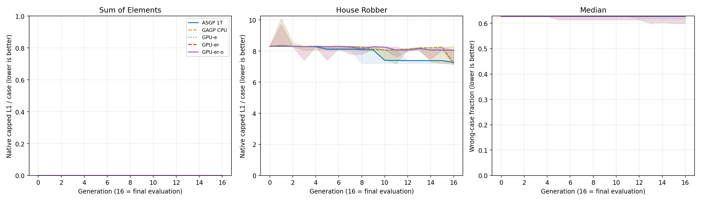
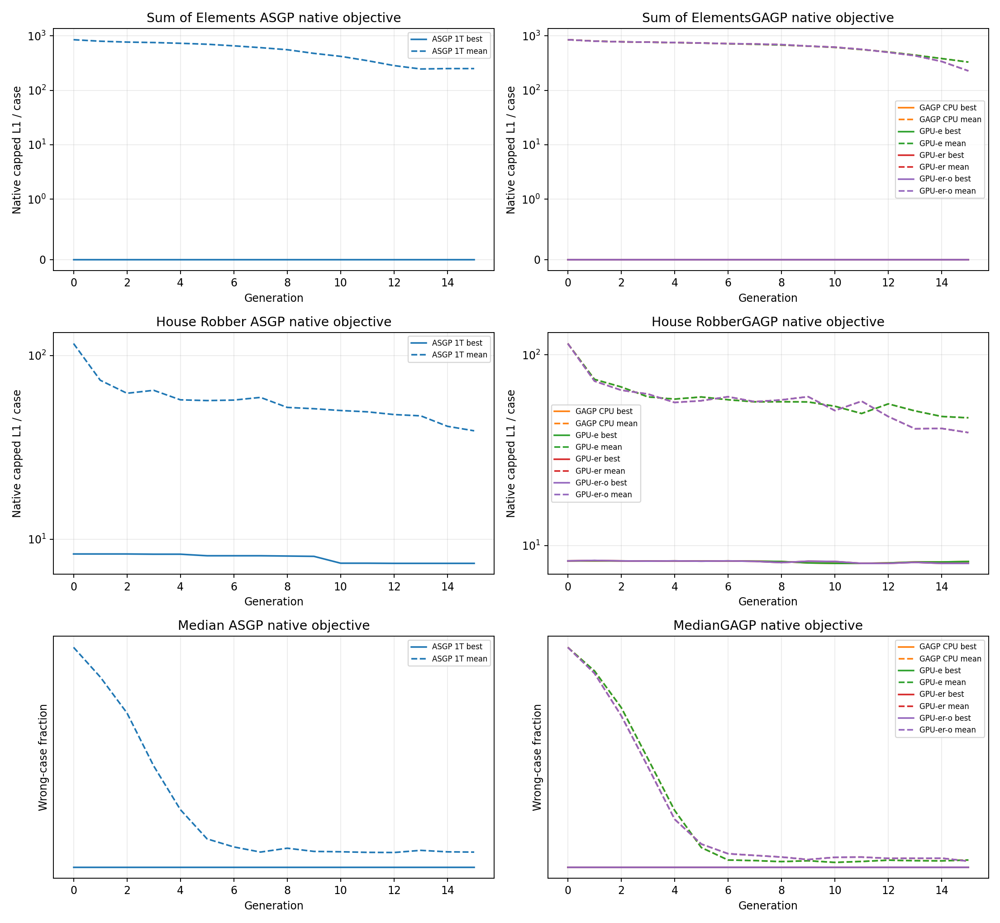
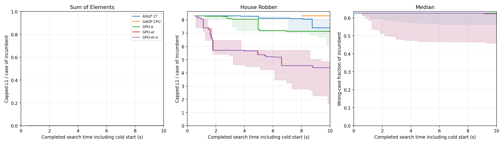
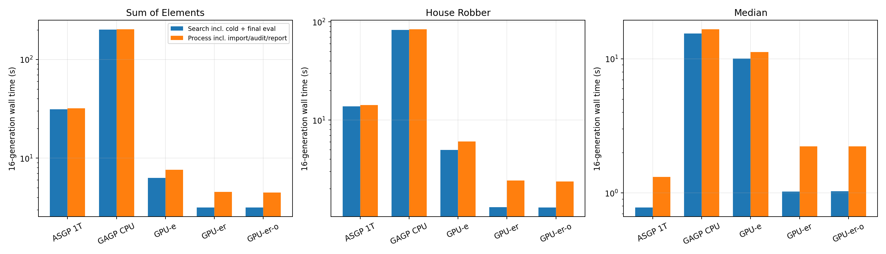
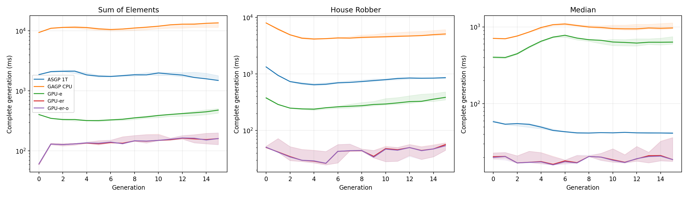
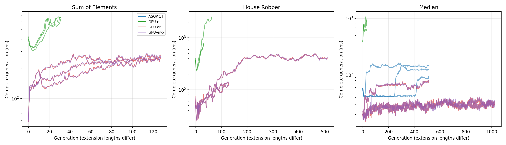

# 多世代演化比較：CPU 1T＋GPU

[全部五模式的六張比較圖（英文）](all-mode-comparison/README.md)：fitness、每代／長跑成本，以及四種GAGP模式逐代加速比。

**先看 [ASGP vs GAGP 總體比較](OVERVIEW.zh-TW.md)**：固定同一 GAGP 模式，分開呈現速度、同代數品質與同時間品質。

## 本輪結論

**新 GPU reproduction 能以速度換取更多搜尋，但不能宣稱多世代品質全面勝過 ASGP，也不能把 frozen-parent 的30×直接套到整趟搜尋。** 90次搜尋 process wall 合計約40.6分鐘；加上設計、build等間隔，性能實驗約50分鐘完成。事後重評與出圖另計。

- **固定16代品質：** Sum 初代就有正確解，五模式均保留 best-so-far，training／held-out皆0。House 的 GPU-er/o seeds 為−7290／−8245／−7574，ASGP為−7376／−7559／−7431，沒有一致優勢。Median（exact）GPU-er/o為−614／−642／−642，ASGP為−642／−642／−631，同樣有seed差異。
- **相同10秒品質：** House 的 GPU-er為−4493／−1751／−4631，ASGP為−7376／−8254／−7574；對應held-out為−4689／−1926／−4829與−7891／−8738／−8394，三個seed都有優勢。GPU-er-o最後一個seed在十秒截止前少完成部分代數，為−4921；同seed時間截止點不保證選到相同代數。Median GPU-er/o為−470／−638／−642，ASGP為−642／−642／−578；改善不穩定，GPU seed1 的小幅training改善也沒有反映在held-out。
- **16代搜尋速度：** 最快GPU的 Sum／House／Median分別3.142／1.279／1.022秒，包含cold與final eval；相對同輪ASGP為9.97×／10.78×／0.76×。Median這個短搜尋仍是ASGP更快。Process包含不完全相同的封存／audit工作，另列，不與Search混用。
- **前後期：** 前16代GPU-er-o的late/early中位數約1.27×／1.01×／0.99×；這不代表長跑穩定。House seed0的512代延長組，前4代中位數35.56ms、末4代409.27ms，相差11.51×。GPU-e同題長跑也明顯變慢。長跑程式大小與成本必須一起看，不能只報前幾代。
- **fitness客製化：** 值得提供，並且應把metric、distance cap、execution-error penalty與secondary ranking分開。這輪只增加benchmark設定、對齊Median的整數exact目標，沒有新增任意callback API，也沒有改reproduction架構。原L1與exact對照並未顯示某個metric對所有seed都更好。

### 必須保留的語意警示

ASGP Median原生分數與其翻譯成GAGP後的分數，有829筆champion紀錄不同（含重複與legacy對照，76個不同翻譯程式）。**正式圖表及表格已使用ASGP原生分數，held-out也重新由ASGP原生執行。** 翻譯後GAGP CPU/GPU一致，不能據此推導ASGP/GAGP執行語意相同。

已確認的一個原因是負索引：ASGP `kIndex`對`at<0`報錯，GAGP `index`依spec採Python負索引。觀察到的seed2 champion在三元素輸入上可化為`xs[trunc(xs[0]/54)]`；對`[-100,20,-50]`，ASGP的−1索引失敗，GAGP取最後一項−50而正確。將這筆輸入重複1024次的獨立診斷，也實測得到ASGP fitness−1024、GAGP CPU/GPU均0（不混入benchmark）。因此不能以翻譯後較好的fitness替ASGP原生成果加分。其他不同程式本輪未逐一分類；沒有趁量測更改既有runtime或frozen inputs。

CPU與GPU-e的16代best曲線一致，但Sum有1個、House有9個generation的mean不同，最大差23.443359375；不能稱為整個population完全parity。既有baseline也記錄過House frozen個體的CPU/GPU差異，本輪未逐一定位所有中間個體。GPU-er/o的16代best／mean則全部一致。所有延長組的前16代記錄與同模式主run一致。

正式品質是「相同task評分公式、各系統各自執行語意」的系統比較，不是跨runtime程式等價證明；也不能把operator、語言、tie-breaking及RNG差異單獨歸因GPU。

### 驗證範圍

記錄的champions共10,330筆，去重後4,109個程式，均完成grammar admission與完整1024 cases的GAGP CPU/GPU重評，0項fitness不一致。ASGP原生training snapshot全部重現其搜尋記錄。每個GAGP run的final top16 CPU audit均0 mismatch。這些檢查不等於每代完整population逐程式CPU/GPU等價。

Native benchmark整合測試通過（含原五模式、五個search入口、Median exact初始分數、snapshot、非法penalty拒絕）；5個fixed-tool及24個repository checks通過。GPU主矩陣timeout／fallback／unscored皆0，Sum及Median仍有約4%的真實runtime-error pairs並已扣分；CPU／ASGP沒有對應counter，不填成0。

實驗日期：2026-10-13。主矩陣為 P=1024、完整 1024 cases、三題、五模式、seeds 0/1/2、16 次完整 generation 加 final evaluation，比較矩陣共 45 次搜尋。另保留先執行的15次未對齊 Median 比較（12次GAGP L1、3次ASGP exact）作對照；延長組30次，總共90次搜尋。以下是本輪重新量測，沒有沿用 frozen single-generation 分母。

## 實驗設計與解讀界線

- 三題沿用相同 frozen 初始 population 與 cases；seed 改變 reproduction RNG，不改變初始族群。資料是 ASGP 生成資料，不是官方 PSB dataset；Median 是三個整數中位數。
- ASGP 保留既定 elite1、crossover0.7、mutation0.3、phase depth7。GAGP 保留其 grammar budgets、crossover→mutation0.3、subtree probability1；GPU-er/o 啟用最佳新 profile。所有模式均 CPU1T，無 early-stop 或漏評。ASGP 保留 error→wrong-case count→nodes 的同分排序；GAGP CPU/e 保留 program-key tie-break，新 GPU profile 在 tournament 同分時保留先抽到者。對齊 scalar fitness 不等於把這些 selection 規則一併改成 ASGP。
- 五模式 fitness 目標已對齊：Sum／House 為每 case 上限1000的 absolute error；Median 為錯誤 case 數。Median 的 GAGP search penalty 設1：在 admitted Int 輸出／Int 目標條件下，min(abs(error),1) 等價 exact mismatch；不宣稱這個技巧適用浮點輸出。ASGP 原生分數越低越好，紀錄統一取負值、越高越好。正式品質使用各系統原生執行的分數，ASGP held-out 也用 ASGP 重評。GAGP champions 用獨立 CPU／GPU 完整重評。ASGP→GAGP 翻譯後重評另列語意診斷，不能代替 ASGP 原生品質。
- 主矩陣固定16代；時間延長組只按實測速度選代數，供十秒品質與後期速度觀察。未覆蓋時間不外推。重評、匯出與報告另外計時；主搜尋每個 program/case pair 均實際評估。
- 搜尋 wall 包含冷啟動與 final evaluation；process wall 再包含輸入／admission、audit、輸出。每代 trace 寫出成本含於 search wall、在單代計時之外。ASGP 每代最佳程式編碼位於其 generation 計時內；GAGP 每代 history-best materialization 亦在其 generation 內，但事後 JSON export 在搜尋外。
- 圖中線為3 seeds 中位數、陰影為 min/max，不是信賴區間。初始 population 只有一份，結論不可外推為隨機初始化族群的收斂保證。

## 1. 固定 generation 的品質演變



橫軸16為 final evaluation；縱軸 Sum／House 是各系統原生 capped L1 除以1024；Median 是錯誤 case 比例，均越低越好。每代 native champion 可能退步：GAGP 沒有 ASGP 的 elite1 保證。Sum 初代已有正確解，這題主要觀察保留解與成本，不能證明新方法更會找解。



實線為當代 best、虛線為 population mean。Median 左右均為錯誤 case 比例；Sum／House 均為 capped L1 / case。

16代內（含 final）依原 native objective 選出的 best-so-far 程式，各自原生 training／held-out fitness 如下；均越接近0越好。同分取最早完成的 champion，held-out 不參與選擇。

| 題目 | 模式 | Training seeds0/1/2 | Held-out seeds0/1/2 |
| --- | --- | --- | --- |
| Sum of Elements | ASGP 1T | 0/0/0 | 0/0/0 |
| Sum of Elements | GAGP CPU | 0/0/0 | 0/0/0 |
| Sum of Elements | GPU-e | 0/0/0 | 0/0/0 |
| Sum of Elements | GPU-er | 0/0/0 | 0/0/0 |
| Sum of Elements | GPU-er-o | 0/0/0 | 0/0/0 |
| House Robber | ASGP 1T | -7376/-7559/-7431 | -7891/-8398/-7887 |
| House Robber | GAGP CPU | -7303/-7376/-7361 | -7555/-7891/-7830 |
| House Robber | GPU-e | -7303/-7376/-7361 | -7555/-7891/-7830 |
| House Robber | GPU-er | -7290/-8245/-7574 | -7631/-8728/-8394 |
| House Robber | GPU-er-o | -7290/-8245/-7574 | -7631/-8728/-8394 |
| Median | ASGP 1T | -642/-642/-631 | -682/-682/-689 |
| Median | GAGP CPU | -642/-642/-642 | -682/-682/-682 |
| Median | GPU-e | -642/-642/-642 | -682/-682/-682 |
| Median | GPU-er | -614/-642/-642 | -665/-682/-682 |
| Median | GPU-er-o | -614/-642/-642 | -665/-682/-682 |


Held-out 沿用已封存的獨立1024 cases，排除與 training 完全相同輸入；與原 task 範圍相同，不是域外泛化證明。ASGP held-out 直接由 ASGP 評分。翻譯／admission 與 GAGP 重評結果保留為獨立診斷。

## 2. 相同十秒搜尋預算



縱軸為依已對齊的 task objective 保留的 best-so-far champion，以其原生執行語意評分；GAGP 另經獨立 CPU 重評。曲線只畫三個 seeds 都已有完成紀錄的時間範圍，不把未完成 generation 算進成果。

| 題目 | 模式 | 十秒training fitness：seeds0/1/2 | 十秒held-out fitness | 完整覆蓋10秒 |
| --- | --- | --- | --- | --- |
| Sum of Elements | ASGP 1T | 0/0/0 | 0/0/0 | 3/3 |
| Sum of Elements | GAGP CPU | 0/0/0 | 0/0/0 | 3/3 |
| Sum of Elements | GPU-e | 0/0/0 | 0/0/0 | 3/3 |
| Sum of Elements | GPU-er | 0/0/0 | 0/0/0 | 3/3 |
| Sum of Elements | GPU-er-o | 0/0/0 | 0/0/0 | 3/3 |
| House Robber | ASGP 1T | -7376/-8254/-7574 | -7891/-8738/-8394 | 3/3 |
| House Robber | GAGP CPU | -8503/-8503/-8503 | -9040/-9040/-9040 | 3/3 |
| House Robber | GPU-e | -7303/-6187/-7361 | -7555/-6140/-7830 | 3/3 |
| House Robber | GPU-er | -4493/-1751/-4631 | -4689/-1926/-4829 | 3/3 |
| House Robber | GPU-er-o | -4493/-1751/-4921 | -4689/-1926/-4987 | 3/3 |
| Median | ASGP 1T | -642/-642/-578 | -682/-682/-651 | 3/3 |
| Median | GAGP CPU | -642/-642/-642 | -682/-682/-682 | 3/3 |
| Median | GPU-e | -642/-642/-642 | -682/-682/-682 | 3/3 |
| Median | GPU-er | -470/-638/-642 | -525/-685/-682 | 3/3 |
| Median | GPU-er-o | -470/-638/-642 | -525/-685/-682 | 3/3 |


完整選中 generation、來源 run 與覆蓋標記見 [quality_10s.csv](quality_10s.csv)。

## 3. 端到端時間



以下為3 seeds 中位數。加速比為同輪 ASGP 的16代搜尋 wall 中位數除以對應模式中位數；包含 cold／final eval，不等於先前 frozen-parent single-gen headline。Process 欄額外包含實驗封存／獨立 audit：GAGP 匯出完整 final AST population並重評top16，ASGP匯出其champion；兩者封存工作不完全相同，應以 Search 作主要搜尋速度比較，Process 用來揭露實驗實際成本。

| 題目 | 模式 | Search（s） | Process（s） | ASGP/Search |
| --- | --- | --- | --- | --- |
| Sum of Elements | ASGP 1T | 31.317 | 31.873 | 1.00× |
| Sum of Elements | GAGP CPU | 201.377 | 202.634 | 0.16× |
| Sum of Elements | GPU-e | 6.283 | 7.630 | 4.98× |
| Sum of Elements | GPU-er | 3.148 | 4.523 | 9.95× |
| Sum of Elements | GPU-er-o | 3.142 | 4.473 | 9.97× |
| House Robber | ASGP 1T | 13.782 | 14.241 | 1.00× |
| House Robber | GAGP CPU | 83.234 | 84.267 | 0.17× |
| House Robber | GPU-e | 4.939 | 6.028 | 2.79× |
| House Robber | GPU-er | 1.288 | 2.419 | 10.70× |
| House Robber | GPU-er-o | 1.279 | 2.370 | 10.78× |
| Median | ASGP 1T | 0.776 | 1.316 | 1.00× |
| Median | GAGP CPU | 15.384 | 16.596 | 0.05× |
| Median | GPU-e | 10.048 | 11.239 | 0.08× |
| Median | GPU-er | 1.022 | 2.219 | 0.76× |
| Median | GPU-er-o | 1.028 | 2.219 | 0.75× |


## 4. 前後期 generation 速度



Early／late 分別取每個 seed 的前4代／後4代中位數，再跨 seeds 取中位數；late/early 是各 seed 比值的中位數。各模式後期 populations 不同，這些是實際演化成本，不是 identical-workload evaluator speedup。

| 題目 | 模式 | 全程gen中位數（ms） | Early4（ms） | Late4（ms） | Late/Early | Final平均nodes |
| --- | --- | --- | --- | --- | --- | --- |
| Sum of Elements | ASGP 1T | 1845.300 | 2102.331 | 1630.609 | 0.78× | 19.1 |
| Sum of Elements | GAGP CPU | 11447.074 | 11223.090 | 13145.517 | 1.17× | 66.6 |
| Sum of Elements | GPU-e | 366.494 | 341.733 | 440.206 | 1.29× | 66.6 |
| Sum of Elements | GPU-er | 140.796 | 127.329 | 159.676 | 1.25× | 92.8 |
| Sum of Elements | GPU-er-o | 143.128 | 127.408 | 161.706 | 1.27× | 92.8 |
| House Robber | ASGP 1T | 778.962 | 834.928 | 842.202 | 1.01× | 31.2 |
| House Robber | GAGP CPU | 4598.480 | 5510.514 | 4861.248 | 0.88× | 79.3 |
| House Robber | GPU-e | 288.650 | 268.876 | 343.366 | 1.28× | 79.3 |
| House Robber | GPU-er | 42.343 | 37.940 | 45.925 | 1.03× | 86.4 |
| House Robber | GPU-er-o | 42.126 | 37.659 | 45.893 | 1.01× | 86.4 |
| Median | ASGP 1T | 42.239 | 54.586 | 41.547 | 0.76× | 6.1 |
| Median | GAGP CPU | 965.640 | 734.803 | 965.640 | 1.30× | 131.3 |
| Median | GPU-e | 633.508 | 425.355 | 632.182 | 1.46× | 131.3 |
| Median | GPU-er | 18.236 | 19.918 | 20.043 | 1.00× | 104.7 |
| Median | GPU-er-o | 18.050 | 19.681 | 19.841 | 0.99× | 104.7 |


ASGP node 數是 phases 內的 nodes，GAGP 是完整 AST，不能直接比較絕對大小。



延長組每條線是一個 seed；代數依性能分配，不同長度的總成本不可直接相除。詳見 [runs.csv](runs.csv) 中 extended rows 的 cold、final、RSS、final nodes 與 early/late。

## 5. 正確性、可重現性與限制

- Primary completed: 45/45；翻譯後 GAGP CPU／GPU 重評不一致的 champion 紀錄數：{'sum_of_elements': 0, 'house_robber': 0, 'median': 0}。這是記錄數，重複 champion 可能多次出現；詳細 row 保留於 audit。

- 已對齊 objective 的 native fitness 與共同 CPU 重評不一致紀錄：{'sum_of_elements': 0, 'house_robber': 0, 'median': 829}；原 L1 Median 不混入此檢查。

- 延長組前16代 best／mean／best_nodes 與原run不一致：0/30 runs。這只驗證已記錄欄位，不等同完整 population identity 證明。

- CPU／ASGP 目前未提供每對 case 的 error／timeout counters；CSV 留空，不將缺值當零。GPU counters、rejection、operator fallback、changed／unchanged 等保留原始定義；不能把 attempted operator changes 當成最終 unique offspring。
- 本輪沒有更改 runtime 數值、fuel、grammar 或 operators；擴充 benchmark search入口、明確設定其 penalty 與 opt-in progress trace。Median 改 fitness 目標是本輪揭露的唯一搜尋設定變更，原 L1 紀錄另保留。前一輪已知的 lossy／grammar profile 差異仍存在。
- 3 seeds 只做有限品質篩查；雖已對齊題目評分，ASGP與GAGP的elitism、mutation粒度及搜尋空間仍不同，不能把品質差異單獨歸因GPU或RNG。

## 6. 原始資料與重現

- [summary.json](summary.json)：彙整、十秒品質、延長組prefix與模式間trajectory檢查。
- [runs.csv](runs.csv)：每個獨立 process 的完整時間、記憶體與品質。
- [generations.csv](generations.csv)：每代時間、fitness、原生／翻譯診斷、錯誤與operators計數。
- [quality_16gen.csv](quality_16gen.csv)、[quality_10s.csv](quality_10s.csv)：逐seed品質。

本機 raw JSON、逐代 trace、history AST、final populations、RSS、commands、flags 與 frozen SHA 由下列目錄的manifest索引；原始檔保留於base／exact來源archives： `/home/hschi1106/.t3/worktrees/gagp/gagp-opt-20261001/logs/optimization/multigen-20261013-analysis`。Binary SHA-256：`fa177377f0b0cffb8e74a26f887e01eecf0361286371394182a3ce945dfca0a1`。每張圖另有同名 SVG。

```bash
python3 benchmarks/fixed_asgp/optimization/multigen.py --out logs/optimization/multigen-NEW-base --stage main --budget-seconds 2700
python3 benchmarks/fixed_asgp/optimization/multigen.py --out logs/optimization/multigen-NEW-exact --stage main --tasks median --case-penalty 1 --budget-seconds 300
python3 benchmarks/fixed_asgp/optimization/multigen.py --out logs/optimization/multigen-NEW-exact --stage extended --tasks median --case-penalty 1 --budget-seconds 600
python3 benchmarks/fixed_asgp/optimization/multigen.py --out logs/optimization/multigen-NEW-base --stage extended --tasks sum_of_elements house_robber --budget-seconds 600
python3 benchmarks/fixed_asgp/optimization/multigen.py --out logs/optimization/multigen-NEW-base --stage extended --tasks sum_of_elements house_robber --extension-observed-timing --budget-seconds 450
python3 benchmarks/fixed_asgp/optimization/multigen_audit.py --out logs/optimization/multigen-NEW-analysis --base logs/optimization/multigen-NEW-base --aligned-median logs/optimization/multigen-NEW-exact
python3 benchmarks/fixed_asgp/optimization/multigen_native_audit.py --out logs/optimization/multigen-NEW-analysis
python3 benchmarks/fixed_asgp/optimization/multigen_report.py --out logs/optimization/multigen-NEW-analysis --report benchmarks/fixed_asgp/optimization/results/multigen-NEW
```

執行前先 build 此版 `gagp_fixed_asgp_bench`；需要既有 frozen artifacts 與本機封存 jemalloc。使用新輸出目錄，不對原始輸入重跑 prepare。整體一小時預算需自行合併各階段的實際時間，不是每階段各可跑一小時。

## 7. Fitness 設計對照與可客製化範圍

本輪實作的是 benchmark search／snapshot 的 penalty 設定，尚未新增通用 custom-fitness API。Median 採 Int 專用的等價實作完成 exact 目標對齊；不能據此宣稱支援任意輸出型別的 exact metric。

原 Median L1 與新 exact 各跑16代，使用同一批初始程式與同一組 seed。下表均把各 run 依自己目標選出的 best-so-far 程式，用共同 exact metric 重評；比較的是更換選擇壓力後的結果，不是相同演化軌跡。

| 模式 | 搜尋目標 | Training 錯誤cases，seeds0/1/2 | Held-out 錯誤cases |
| --- | --- | --- | --- |
| GAGP CPU | L1 cap1000 | 1015/610/565 | 1013/628/574 |
| GAGP CPU | Exact (Int cap1) | 642/642/642 | 682/682/682 |
| GPU-e | L1 cap1000 | 1015/610/565 | 1013/628/574 |
| GPU-e | Exact (Int cap1) | 642/642/642 | 682/682/682 |
| GPU-er | L1 cap1000 | 828/828/595 | 844/844/614 |
| GPU-er | Exact (Int cap1) | 614/642/642 | 665/682/682 |
| GPU-er-o | L1 cap1000 | 828/828/595 | 844/844/614 |
| GPU-er-o | Exact (Int cap1) | 614/642/642 | 665/682/682 |


建議後續以小型、可驗證的 fitness descriptor 指定 metric、distance cap、error penalty、type compatibility 與 aggregation；CPU/GPU 共用同一份設定並做 parity 測試。Secondary ranking（例如 ASGP 的 wrong count／size）應另外明確配置；它會影響 bloat 與 RNG tie 軌跡，不能只換 metric 就宣稱完整複製 ASGP selection。保持現有預設 spec，新增模式明確 opt-in。完整 cases 的評估與錯誤懲罰不能因客製化而略過。避免每 case 呼叫 Python／host callback，否則增加資料搬移與同步，也讓 GPU 成本難以比較。這是下一步介面建議，本輪沒有變更 runtime fitness contract。

## 8. 錯誤、族群多樣性與記憶體

| 題目 | 模式 | 16代 error pairs | Timeout pairs | Final unique seeds0/1/2 | Peak RSS max (MiB) |
| --- | --- | --- | --- | --- | --- |
| Sum of Elements | ASGP 1T | 未提供 | 未提供 | 739/708/753 | 757.9 |
| Sum of Elements | GAGP CPU | 未提供 | 未提供 | 1022/1018/1019 | 1026.6 |
| Sum of Elements | GPU-e | 3.935% | 0 | 1022/1018/1019 | 1135.7 |
| Sum of Elements | GPU-er | 3.771% | 0 | 998/1011/1016 | 1452.2 |
| Sum of Elements | GPU-er-o | 3.771% | 0 | 998/1011/1016 | 1452.9 |
| House Robber | ASGP 1T | 未提供 | 未提供 | 963/948/962 | 614.7 |
| House Robber | GAGP CPU | 未提供 | 未提供 | 1010/1018/1021 | 926.4 |
| House Robber | GPU-e | 0.000% | 0 | 1010/1018/1021 | 1038.6 |
| House Robber | GPU-er | 0.000% | 0 | 1009/1006/959 | 1078.7 |
| House Robber | GPU-er-o | 0.000% | 0 | 1009/1006/959 | 1078.8 |
| Median | ASGP 1T | 未提供 | 未提供 | 257/254/288 | 760.7 |
| Median | GAGP CPU | 未提供 | 未提供 | 1022/1021/1023 | 1201.9 |
| Median | GPU-e | 3.902% | 0 | 1022/1021/1023 | 1311.3 |
| Median | GPU-er | 4.144% | 0 | 1022/969/1004 | 1783.5 |
| Median | GPU-er-o | 4.144% | 0 | 1022/969/1004 | 1783.2 |


錯誤是已評估後的實際懲罰結果，不是跳過的 pairs。CPU／ASGP counters 未提供；GPU fallback／unscored 與完整原始 counters 在 CSV。Final unique 是序列化 genotype identity 數，不能當成行為多樣性或有效新 offspring 數；runs.csv 另有 final distinct fitness、mean／median，仍不是行為等價分類。本輪沒有每代全族群 unique／behavior census，也沒有逐代 RSS/device memory 採樣；peak RSS 含輸出與事後 audit，不能用來證明記憶體無洩漏。resident genotype 配置量另存 runs.csv。

## 9. 品質門檻

主矩陣前定義 Sum=0、House>=-8000；Median 改 exact 後、執行 aligned runs 前定義>=-512（至少一半 cases 正確）。這些是本輪觀察門檻，不是三題難度等價的標準。Held-out 不參與選擇。十秒欄只計完整覆蓋十秒的 runs；0/0 表示沒有可用觀察。

| 題目 | 模式 | Fitness門檻 | 16代training | 16代held-out | 十秒training |
| --- | --- | --- | --- | --- | --- |
| Sum of Elements | ASGP 1T | 0 | 3/3 | 3/3 | 3/3 |
| Sum of Elements | GAGP CPU | 0 | 3/3 | 3/3 | 3/3 |
| Sum of Elements | GPU-e | 0 | 3/3 | 3/3 | 3/3 |
| Sum of Elements | GPU-er | 0 | 3/3 | 3/3 | 3/3 |
| Sum of Elements | GPU-er-o | 0 | 3/3 | 3/3 | 3/3 |
| House Robber | ASGP 1T | -8000 | 3/3 | 2/3 | 2/3 |
| House Robber | GAGP CPU | -8000 | 3/3 | 3/3 | 0/3 |
| House Robber | GPU-e | -8000 | 3/3 | 3/3 | 3/3 |
| House Robber | GPU-er | -8000 | 2/3 | 1/3 | 3/3 |
| House Robber | GPU-er-o | -8000 | 2/3 | 1/3 | 3/3 |
| Median | ASGP 1T | -512 | 0/3 | 0/3 | 0/3 |
| Median | GAGP CPU | -512 | 0/3 | 0/3 | 0/3 |
| Median | GPU-e | -512 | 0/3 | 0/3 | 0/3 |
| Median | GPU-er | -512 | 0/3 | 0/3 | 1/3 |
| Median | GPU-er-o | -512 | 0/3 | 0/3 | 1/3 |
