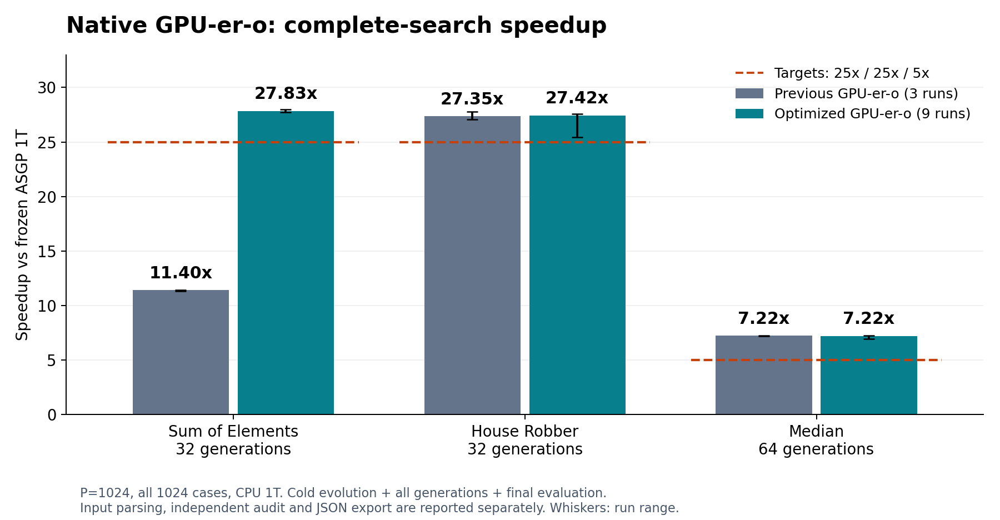
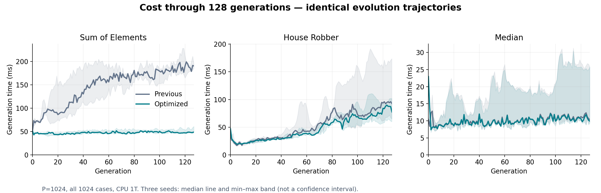

# Sum25／House25／Median5：原生 GPU 優化結果

本輪保留原生 CPU／GPU-e／GPU-er／GPU-er-o 的架構與 pipeline，應用程式 CPU 維持單執行緒。三位 Astra-medium subagents 在獨立 worktree 探索 phase execution、window execution、scheduling；主 agent 依逐步實測整合與淘汰。所有 GPU 性能工作依序執行。本輪沒有修改 RNG、variation、grammar language、數值精度、fuel、case 數或搜尋資源限制。

## 正式結果與計時邊界

P=1024、完整 1024 cases。Sum／House 為 32 代、seed0；Median 為 64 代、seed2。每題九次**獨立 process、完整 cold search**，無外部 profiler，另交錯跑三次舊 binary 控制。這不是九次不同品質 seed，也不是重播 frozen parents。

| 完整搜尋 | Sum of Elements | House Robber | Median |
| --- | ---: | ---: | ---: |
| 固定 ASGP 1T 分母 | 49.055552 s | 27.669071 s | 5.826117 s |
| 新 GPU-er-o 中位數 | **1.762552 s** | **1.009139 s** | **0.807146 s** |
| 九次範圍 | 1.753885–1.770065 s | 1.004083–1.087962 s | 0.803103–0.838859 s |
| ASGP／GPU-er-o | **27.83×** | **27.42×** | **7.22×** |
| 目標 | 25× | 25× | 5× |
| 同輪舊 binary 中位數（3 次） | 4.303359 s | 1.011774 s | 0.806421 s |
| 相對同輪舊版耗時變化 | **−59.04%** | −0.26% | +0.09% |

每題九次結果均個別達標。**本輪可確認的主要改善是 Sum 約 2.44 倍；House、Median 的短程改善未超過噪音。** 不能把上輪表格 26.48×／6.79× 與本輪 27.42×／7.22× 的差異全歸功於程式修改。

沿用既有 `evolve_wall_ms`：包含 cold evolution setup、全部 generation、最後完整 evaluation，以及該邊界內原有的 materialization 工作；不包含 CLI 的輸入解析、額外獨立 CPU audit、JSON 序列化輸出。**上述 27.83×／27.42×／7.22× 不是從 process 啟動到結束的倍率。** 沒有搬移本輪新增的必要工作到計時外。

| 完整 CLI process（含 audit／輸出） | Sum | House | Median |
| --- | ---: | ---: | ---: |
| 新 GPU-er-o 九次中位數 | 3.507 s | 2.237 s | 1.980 s |
| 同輪 ASGP 單次 process control | 49.574 s | 28.152 s | 6.540 s |
| process 比值，僅供邊界比較 | 14.14× | 12.59× | 3.30× |

這組 ASGP drift control 的 search 時間分別為 49.063874／27.707215／5.982172 秒，只用來觀察環境，不替換 headline 的固定分母。process control 只有一次，不宣稱與九次 search headline 同等精度。

### 九次原始 search 時間（毫秒）

```text
Sum:    1767.106979 1758.775390 1756.690849 1762.733614 1762.552080
        1753.884873 1768.854495 1761.388556 1770.064550
House:  1087.962184 1019.367168 1013.603341 1010.987336 1004.082583
        1004.490439 1008.485484 1009.139088 1007.205263
Median:  807.017740  838.858879  807.146462  811.581322  806.063038
         803.103319  832.487007  803.662736  820.041478
```

### 全部原生模式

| 模式：完整搜尋秒數 | Sum 32 代 | House 32 代 | Median 64 代 | 證據 |
| --- | ---: | ---: | ---: | --- |
| ASGP 1T | 49.056 | 27.669 | 5.826 | 固定的前輪三次控制 |
| GAGP CPU 1T | 250.991 | 82.200 | 42.051 | 沿用未修改的 CPU 實作／前輪三次控制 |
| GPU-e | 9.128 | 8.255 | 23.946 | 本輪新三次 |
| GPU-er | 1.769 | 1.014 | 0.830 | 本輪新三次 |
| GPU-er-o | **1.763** | **1.009** | **0.807** | 本輪新九次 |

CPU 控制不是本輪重新跑完整搜尋；本輪所有五種模式另有新 smoke 與 fixed-parent scaling 控制。GPU-e／GPU-er 的 18 次新搜尋均與對應歷史模式的完整語意紀錄、最終與歷史 AST 相同。GPU-er 與 GPU-er-o 的細小差距不足以單獨判定 overlap 的效益。CPU 接近 ASGP 並未達成，也不是本輪 GPU 結果可替代的成果。



## 保留了哪些改動

1. **逐 phase 的已驗證 stack bound。** 原先把整個 program 的最大值套給所有 phase，導致一個深 phase 使其他簡單 phase 也走重型 executor。固定 phase 沿用 cold import 的合法上界；變動 phase 使用當代 GPU compiler certificate 的上界。整體 admission 仍保留 program 最大值；不是降低 capacity 或重寫程式。
2. **純 Measure phase 的精確結果重用。** 在正常 evaluation block 內，先確認 preparation 只依賴 sequence measure、純 scalar constants 與允許的 forward-only 指令；再用原 executor 預計算 length 2–64 的結果、error、精確 fuel 費用。同一 program／block 後續命中可重用。表格建置成本完整計入；fuel 不足、超出範圍、條件不符或 shared memory 不足即執行原 VM。64 是快取範圍，不是新的輸入長度限制；不按題名或答案特化。
3. **Hybrid phase executor。** 符合原有型別／結構證明的 region 可繼續使用簡單 frames；stack bound >16 的 phase 單獨使用原 tagged view VM，其他 phase 保留 compact execution。不是讓所有 phase 都付最大 VM 成本，也沒有省掉深 phase 的執行。`GAGP_GENERIC_PHASE_VM` 仍能強制參考路徑。
4. **Window leaf-direct。** intrinsic length≤1 的 child 可在呼叫處執行演化出的 base expression，省掉 child frame 寫回／讀回；carried expression、depth check、entry fuel、base 的順序不變。沒有注入 Sum 的手寫解答。
5. **Unboxed window frame SoA。** 保留相同 frame footprint、capacity、生命週期，只改 field 對 case lanes 的排列以改善記憶體存取。lazy proxy 不讀尚未初始化的 field；不適用的 bucket 沿用原布局。
6. **Block-level dynamic program queue。** block 完成原 program 後取得下一個 program，緩解不同 program 成本造成的尾端負載。workspace 始終屬於 block，輸出 index、cases、reduction order 不變。queue 初始化成本計入；broadcast 重用 reduction slot，不侵占原 shared-memory 容量邊界。

因此，真正省掉的是不必要的重型執行選擇、已證明純函數的重複解譯、leaf frame 存取與排程空轉。快取表格建立、完整 reproduction、必要 lowering／validation 都仍存在；**沒有宣稱移除了 AST 往返、把 reproduction 搬回 CPU，或完成新 genotype 架構。**

設計、安全邊界與 fallback 詳見 [GPU reproduction 契約](../../../../../docs/design/gpu-reproduction.md)。新 helper 的信任源是現有私有 host verification／typed-view proof，再加更窄的依賴檢查；不是公開的 `verified=true`。

## 性能假設與取捨

逐步 screen 的用途是選路線，不把單次 screen 當正式 headline：

| 方向 | Sum 完整搜尋觀察 | 決策 |
| --- | --- | --- |
| 逐 phase stack metadata 單獨 | 4345→3755 ms | 保留，避免把簡單 phase 判為重型 |
| 精確 Measure 重用，含 generic phase | 約 4399→3047 ms | 保留 |
| Measure＋metadata＋hybrid | 約 2260 ms | 保留組合後再驗證 |
| leaf／queue／SoA 與上述組合 | 初次約 1804 ms，正式中位數 1763 ms | 保留 |
| operand top cache | 約 4417→4711 ms | 退步，移除程式與入口 |
| entry-direct | 約 4290→4296 ms | 無收益，移除程式與入口 |

這些不是可相加的獨立效益，也不是相同 run 的時間分解。原始 screen、失敗證據與 patches 均保留；直接 Index 特化只做程式碼分析，達標後沒有再開始實作。沒有保留 CPU fragment 原型。

## 品質、正確性與後期成本

正式 27 次新 GPU-er-o search 對三次同輪舊控制、九組 128-generation search 前後對照、18 次 GPU-e／ER 對歷史模式，合計 **54 組完整語意與 AST 比對**。比較完整 result dictionary 與 final/history exports，只排除時間、memory bytes 與 execution-profile 診斷欄；fitness、errors、timeouts、rejections、cases、AST 均逐項一致。

128 代、seeds 0／1／2 的結果如下。數字順序均為 seed0、seed1、seed2：

| 題目 | 舊版→新版完整搜尋秒數 | 最終 best fitness（前後一致） | 最終 unique genotype（前後一致） |
| --- | --- | --- | --- |
| Sum | 22.542→6.263；19.257→7.057；17.133→6.290 | 0／0／0 | 1016／1021／1019 |
| House | 11.328→7.329；6.221→5.784；6.909→6.196 | −4427／−865／−4535 | 1022／1022／1022 |
| Median | 2.797→2.709；1.480→1.473；1.460→1.458 | −478／−642／−642 | 1019／957／999 |

Sum seed0 最後 16 代的單代中位數 **202.04→46.91 ms**，第一個 16 代為 75.75→47.66 ms。House seed0 最後 16 代 **168.42→98.09 ms**；Median seed0 為 26.58→25.62 ms。程式大小與演化軌跡相同，因而這些是相同工作改善，不是靠 smaller offspring 或不同 workload 換來的數字。



每組 128 代記錄完整 134,217,728 個 program/case 評估，unscored／timeout／operator fallback 均為 0。仍有本來就存在的 runtime errors：Sum 三 seed 為 654,886／685,000／2,446,779，Median 為 3,657,603／1,099,800／1,051,331；House 為 0。這些數量前後完全一致，沒有靠新增 error 跳過計算。contract rejections、changed／unchanged 與最終大小都留在 JSON／CSV；attempted changes 不視為 unique offspring。

初始固定 population 每題 1024 程式×1024 cases 的逐程式 snapshot 前後一致。House 原本有 **4 個 CPU／GPU fitness 不同的個體**，本輪原樣保留，未宣稱 CPU／GPU 全語意等價。長程 CPU audit 覆蓋每次最終 top16、全部 cases，mismatch=0；不是全 population 的獨立 CPU 重評。

**品質證據的限制：** Sum generation0 已經解出 fitness0，不能用它證明新方法更會收斂；三 seed×128 代只能支持此次 exact optimization 沒有觀察到退化，不能證明所有 grammar 的收斂等價，更不是品質超過 ASGP。unique genotype 也不是行為多樣性量測。本輪沒有改搜尋規則，因此沒有用不同 wall-clock 品質實驗來包裝語意差異。

### 記憶體

新版本 128 代 process peak RSS：Sum 約 1.61–1.79 GiB，House 約 1.84–2.10 GiB，Median 約 1.18–2.29 GiB。Sum 舊版約 1.59–1.78 GiB，新增 overhead 小；history／JSON 與 bloat 的長跑成本仍存在。genotype device allocation 記錄約 0.58–0.80 GB，但不是全 GPU peak。沒有增加持久快取；Measure table 為 block-local 1044 bytes。128 代證據不能證明無限長跑的來源／history 保留有界。

## 最新成本來源

下面是正式九次 search 內既有階段計時的中位數，單位毫秒；階段有包含與 overlap 關係，**不能加總成精確 wall-time 分解**。

| 階段 | Sum 32 | House 32 | Median 64 |
| --- | ---: | ---: | ---: |
| initial admission | 93.26 | 101.94 | 96.11 |
| generation evaluation 累計 | 1237.55 | 610.48 | 221.71 |
| eval kernel 累計 | 1174.99 | 559.30 | 136.60 |
| reproduction 累計 | 231.67 | 124.49 | 335.12 |
| reproduction kernel 累計 | 148.24 | 76.16 | 217.75 |
| reproduction decode 累計 | 52.33 | 32.45 | 79.42 |
| packing 累計 | 26.59 | 16.25 | 24.76 |
| upload 累計 | 26.21 | 23.70 | 45.90 |
| final eval | 59.61 | 35.68 | 14.10 |

另用 **Nsight Systems** 診斷 Sum32，沒有使用 NCU。開 profiler 後 search 為 1931.85 ms，不能代入未開 profiler 的正式加速比。GPU kernel aggregate：eval 33 calls、1196.15 ms（含 final eval），占 GPU kernel time 89.0%；mutation 70.48 ms、compile 38.78 ms、crossover 27.99 ms、offspring comparison 9.44 ms。

`cudaDeviceSynchronize` 約 1196.87 ms 是等待中的 host API 時間，與 GPU kernel 重疊，不能再加一次；`cudaEventSynchronize` 約 147.61 ms、`cudaMemcpy` 約 46.40 ms。同理，local-memory 或 register-spilling 的硬體原因不能從這份 nsys trace 推定。

剩餘方向：Sum／House 仍由 evaluator 主導；Median 主要是 reproduction／lowering 與共同 cold admission。下一輪若要再提高門檻，應先確認哪類演化 phase 主導後期 eval，或量測 Median mutation／compile 的重複工作；本輪目標達成後沒有任意換 architecture 或啟動新大改。

## Scaling 與測試

| P | Sum GPU-er-o ms／同格倍率 | House GPU-er-o ms／同格倍率 | Median GPU-er-o ms／同格倍率 |
| --- | ---: | ---: | ---: |
| 1024 | 36.557／50.99× | 31.199／42.25× | 6.461／8.80× |
| 2048 | 67.854／55.56× | 53.367／48.34× | 14.053／8.24× |
| 4096 | 131.455／61.48× | 99.018／52.56× | 23.057／9.79× |
| 8192 | 257.829／65.15× | 188.248／56.18× | 47.770／9.66× |

Scaling 是原本的 **fixed-parent 完整 generation**：每格 warmup 一次、正式三次；P=1024／2048／4096／8192，cases 固定 1024，三題×五模式共 60 格，控制全部同輪重跑。不是上面的 changing-population search，倍率分母使用各格自己的 ASGP，不混用。

- Release 全 targets build 完成。Native suite 首輪 126／127 通過；新 shared-capacity fixture 的預期值忽略既有 alignment reserve，修正 fixture 後重新編譯、該測試通過。相同 runtime 的 127 個測試均已覆蓋通過；不是刪除失敗測試。
- Repository checks 24／24、fixed benchmark tool tests 5／5。
- 主 worktree 最終 test binary 經 CUDA12.6 memcheck：0 errors；racecheck：0 hazards／0 errors／0 warnings。
- 新測試涵蓋 7007 組 raw phase result／error／remaining-fuel、20／21-slot deep phase、>2^53 數值、低 fuel／zero-cost error、cache miss／timeout、不適用 bindings、mixed compact/generic populations、private Slice→Index、1／2 states、depth／capacity，以及強制 generic fallback。
- Queue／SoA fixture 為合法的 97 programs×65 cases、128 frames，含 block32／1024與 shared-memory 邊界，會確實重用 program queue。五種原生模式另有三題 smoke checks。

一項驗證更正：agent 曾因編譯時編輯 fixture，產生 stale object，掩蓋不合法的 4096-frame 新測試設定。該舊 coverage claim 已撤回，主 agent 從新 source 編譯，保留 capacity rejection 並修正為合法的 128-frame fixture，再跑最終 memcheck／racecheck。測試 log 完整保留，沒有把舊結果冒充新 source 驗證。

## 最佳版本、設定、重現與原始資料

- 分支 `opt/gpu-generation-20261001`；runtime source commit **2938d6938b65240286a06d9f9c2153bd005ee4d4**；最終測試修正 `c0d24a9`。之後的 report commits 不改 runtime。
- 新 benchmark SHA256：`e4c8e8ebebab92a6cc81be1e8df31d0a43d9dc9fb6f9dacc12e0f302c36e519b`。
- 舊 runtime `be455a4`，保護 checkpoint `checkpoint/pre-sum25-20261014`=`320d8bf`；舊 binary SHA256：`764ab8df9dbea4b2cb9e439a8e2608f7b1bd7fd9aa9f7ecd8bf4c4a6e09b53a0`。
- 使用 [contract.json](contract.json) 的 `baseline_manifest.flags` **全部 64 個設定**，另加下列六個。不是只切 commit 或只開六個旗標。runner 會組合完整設定，保留 `GAGP_HOST_THREADS=1` 與原 allocator 設定。

```text
GAGP_MEASURE_PHASE_CACHE=1
GAGP_PER_PHASE_STACK_BOUND=1
GAGP_HYBRID_PHASE_EXECUTOR=1
GAGP_GPU_WINDOW_LEAF_DIRECT=1
GAGP_WINDOW_SOA=1
GAGP_DYNAMIC_PROGRAM_QUEUE=1
```

從 `/home/hschi1106/.t3/worktrees/gagp/gagp-opt-20261001` 執行；每次使用不存在的新輸出目錄，**不執行 prepare、不覆蓋 frozen inputs**：

```bash
python3 benchmarks/fixed_asgp/optimization/results/sum25-20261014/run_validation.py timing --out logs/optimization/sum25-rerun-NEW/timing
python3 benchmarks/fixed_asgp/optimization/results/sum25-20261014/run_validation.py quality --out logs/optimization/sum25-rerun-NEW/quality
python3 benchmarks/fixed_asgp/optimization/results/sum25-20261014/run_validation.py other-modes --out logs/optimization/sum25-rerun-NEW/other-modes
python3 benchmarks/fixed_asgp/optimization/results/sum25-20261014/run_validation.py snapshot --out logs/optimization/sum25-rerun-NEW/snapshot
python3 benchmarks/fixed_asgp/optimization/results/sum25-20261014/run_validation.py scaling --out logs/optimization/sum25-rerun-NEW/scaling
python3 benchmarks/fixed_asgp/optimization/results/sum25-20261014/summarize.py --runs logs/optimization/sum25-rerun-NEW --out logs/optimization/sum25-report-NEW
```

已有結果：

- [完整 summary、manifest 與品質資料](final/summary.json)
- [正式 search 摘要與原始 repeats](final/search-summary.csv)、[每 process 資料](final/search-samples.csv)
- [逐代資料](final/generations.csv)、[54 組 exact comparisons](final/exact-comparisons.csv)
- [Scaling 每格原始三次與同輪比值](final/scaling.csv)
- [Nsight 診斷摘要](profile.json)、[測試證據與 log hashes](validation.json)
- 原始 logs／binary／AST：`logs/optimization/sum25-20261014/validation/`；nsys report：`logs/optimization/sum25-20261014/profile-final/`；測試 log：`logs/optimization/sum25-20261014/final-*.log`。

Manifest 的 `source_head` 是 runner 當下 checkout，不一定是 archived executable 的編譯 commit；binary 身分以 SHA256 與本報告 runtime source 對應為準。主實驗 worktree 已保存 checkpoints；原始聊天 worktree、既有未提交修改、歷史結果與 frozen inputs 未覆寫，本輪沒有 push。
