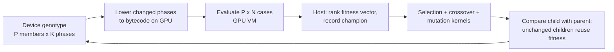

# Research Mainline: Exact GPU Grammar-Guided GP

This page is the map of the research system. It explains what the mainline
is, which files own each part, what "exact" means and how it is checked, and
which explored designs were retired. Normative details stay in the linked
specifications and design contracts.

## Claim

GAGP is a grammar-guided genetic programming (GGGP) system for program
synthesis whose whole search loop runs on the GPU:

- **User-definable grammars.** The search space is a compiled grammar
  definition ([grammar_definition.md](../../spec/grammar_definition.md)), not
  a hard-coded instruction set. ASGP-style "phase" programs are one grammar
  family among others.
- **GPU evaluation and GPU reproduction.** Selection, crossover, mutation,
  lowering of changed children to bytecode and fitness evaluation all run on
  the device. The host only ranks fitness vectors and records history.
- **Semantically verifiable.** A plain C++ CPU reference engine runs the same
  operators and draws. For the same inputs and seed, the GPU engine publishes
  bit-identical genotypes, fitness values, champions and final populations.
  Every speed optimization is checked against this reference, so speed gains
  never silently change the search.
- **Distortion only by declaration.** Any change of search dynamics (for
  example the steady-state schedule) is a named member of the search
  configuration ([search_config.md](../../spec/search_config.md)), implemented
  identically by both engines, and evaluated as an ablation.

## Two representations

| Representation | Where used | Notes |
| --- | --- | --- |
| Native AST (`representation: native_ast`) | `gagp_evolve_cli` default, general grammars | Typed AST population, CPU or GPU evaluation, CPU or GPU reproduction ([gpu-reproduction.md](gpu-reproduction.md)). |
| Phase population (`representation: phase_population`) | Research mainline, fixed ASGP benchmark | A fixed root template with up to 8 independently varied phases; the genotype stays resident on the device for the whole run. |

The rest of this page is about the phase population.

## Components and owners

| Part | File(s) | Role |
| --- | --- | --- |
| Search configuration | `spec/search_config.md`, `src/cli/search_config.cpp`, `include/gagp/evolution/search_policy.hpp` | Every member that changes search semantics: selection, elitism, crossover/mutation probabilities, site draw and scope, depth limit, tie break, schedule. Recorded in every result as `search_config`. |
| Shared generation loops | `src/evolution/evolve.cpp` (`run_phase_population`, `run_phase_population_steady`) | Ranking, selection fitness, history, verification and export; common to both engines. |
| Per-child operators | `src/evolution/repro/gpu/phase_operators.cuh` | `__host__ __device__` bodies of tournament, site draw, crossover, mutation, child comparison and lowering. Compiled into the GPU kernels and into the CPU reference. |
| GPU engine | `src/evolution/repro/gpu/phase_population.cu` (`NativePhasePopulation`) | Device-resident genotype, operator kernels, phase compiler, stage storage. |
| GPU evaluation | `src/runtime/gpu/fitness_gpu.cu` | Bytecode VM over (program, case) lanes, payload arena for list values, replay of overflowing cases, fitness reduction. |
| CPU reference engine | `src/evolution/repro/gpu/phase_population_cpu.cpp` (`HostPhasePopulation`), `src/runtime/cpu/fitness_cpu.cpp` | Same operators on the host, CPU bytecode evaluator. Never touches CUDA. |
| Engine profile | `include/gagp/core/engine_profile.hpp` | Defaults of all exact engine switches (see below). |
| Fixed ASGP benchmark | `src/bench/fixed_asgp/` (`gagp_fixed_asgp_bench`) | Freezes ASGP-initialized populations and cases, translates them into the task grammar, and runs GAGP GPU, GAGP CPU reference and ASGP-1T on identical inputs ([guide](../guides/fixed-asgp-benchmark.md)). |

## One generation on the GPU

Only the fitness vector and per-generation champion cross the PCIe bus.
Children identical to their parent (or to any parent) reuse the parent's
completed result instead of being evaluated again.

Measured cost split on the formal cohort: GPU evaluation is about three
quarters of search time, reproduction about 2%. The long tail of evaluation is
single-lane recursive list work (concatenation, list builders) replayed for
the few cases whose intermediate lists overflow the per-lane workspace; it is
inherent to interpreting variable-length programs in SIMT lanes.

## Schedules

Both engines implement both schedules and publish identical results.

- `generational` (default): every generation creates `P` children, keeps
  `elitism` elites, evaluates every changed child and ends with a final
  evaluation.
- `steady_state` (synchronous batch steady state): each round creates `batch`
  children with the same per-child operators, evaluates them together, then
  places them one by one; each child replaces the loser of an inverse
  tournament of `replacement_size` members, never the current best. With the
  default `batch = P` one round is one generation-equivalent, so the GPU
  launch shape is unchanged while the population dynamics change. This is the
  final GAGP search profile
  ([`configs/search/gagp_final_asgp.json`](../../configs/search/gagp_final_asgp.json)).
  A smaller `batch` pays the evaluation launch floor more often and was slower
  in every measured setting.

## Exactness and how it is checked

"Exact" means: the GPU engine, any exact engine switch and any host worker
count produce the same published values as the CPU reference.

- `gagp_test_phase_population_cpu_reference`: CPU reference vs GPU engine,
  several search policies, both schedules, host thread counts and every GPU
  engine variant; final populations, fitness, wrong counts and champions must
  be identical.
- `gagp_test_fitness_cpu_gpu_parity`, `gagp_test_evolution_cpu_gpu_parity`:
  evaluator and native-AST parity.
- The `*_mainline` CTest entries rerun those tests with the default engine
  profile; the others pin `GAGP_ENGINE_PROFILE=legacy`.
- Experiments additionally compare exported champions and history byte for
  byte between engines and builds.

## Engine switches and the engine profile

Each optimization of the engine was introduced behind an environment switch
so that it could be validated against the reference before becoming the
default. All of these switches are exact. `engine_profile.hpp` lists the
mainline value of every switch; an unset switch takes that value, an
explicitly set one wins, and `GAGP_ENGINE_PROFILE=legacy` restores the
historical "all unset" behavior for ablations. Ordinary runs therefore need no
switch at all. Search semantics are never engine switches: they are search
configuration members.

Settings that remain explicit per run:

| Setting | Meaning |
| --- | --- |
| `GAGP_HOST_THREADS` | Host worker threads (default 1; the ASGP-1T comparison uses 1). |
| `GAGP_CUDA_DEVICE` | Pin a visible CUDA device (default: least-used). |
| `GAGP_GPU_DIAGNOSTICS`, `GAGP_SEARCH_TRACE` | Extra counters and per-generation trace. |
| `GAGP_SEARCH_CONFIG` | Search configuration file for the fixed benchmark. |

## Retired designs

The following were implemented, measured and removed from the mainline; the
final report summarizes the evidence and git history keeps the code.

| Design | Outcome |
| --- | --- |
| Islands with ring migration | CPU-reference simulation, formal 300-run protocol: 8 islands +3.0 pp (not significant), 32 islands failed non-inferiority, no simulated speed gain. |
| Asynchronous (barrier-free) evolution | Same quality at equal children; measured GPU speedup bound about 1.08 to 1.3x; loses determinism and therefore CPU-reference parity. Its workload saving comes from steady-state replacement, which the synchronous steady state keeps. |
| Small steady-state batches (`batch < P`) | Each evaluation launch has a latency floor of about 25 to 30 ms, so `batch = 256` was 0.65x the speed of `batch = P`. |
| Population-wide phase sharing (cross-program memoization) | 70 to 84% of phase fuel belongs to phases used by a single program; no-go as a main direction. |
| CPU worker reproduction, LPT scheduling, CPU fragment/phase banks | Not GPU mainline speedups; retired records only. |

## Where to go next

- [Fixed ASGP benchmark guide](../guides/fixed-asgp-benchmark.md): inputs,
  modes and the scale experiment.
- [GPU reproduction contract](gpu-reproduction.md) and
  [payload design](payload.md): implementation contracts.
- [Search configuration](../../spec/search_config.md): every semantic member.
