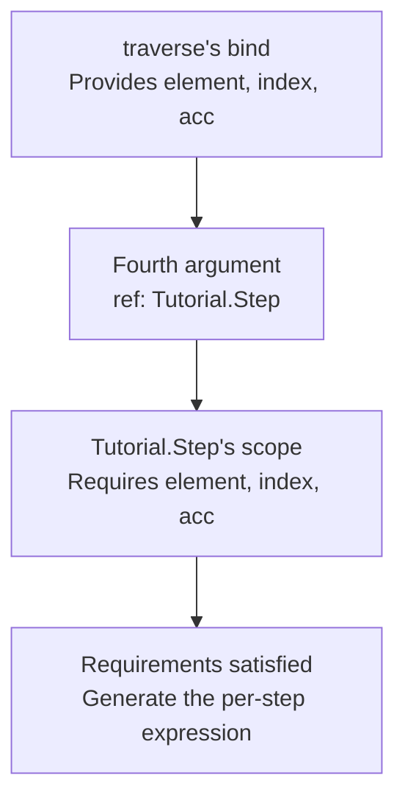
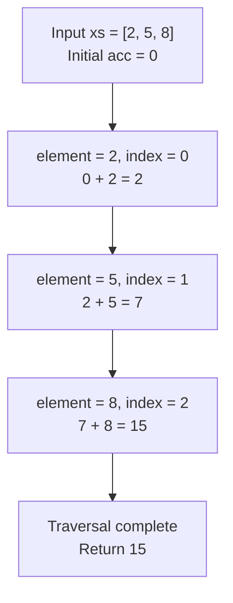
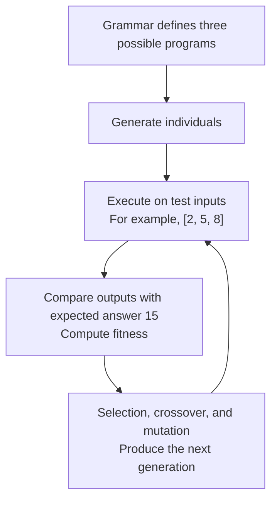

# Understanding GAGP Grammars Through List Summation

This tutorial uses one complete example to explain how `alternatives`, `weight`, `signature`, `args`, `ref`, `bind`, `scope`, and `bound` fit together in a GAGP grammar.

Our task is simple:

```text
Input:  [2, 5, 8]
Compute: 0 + 2 + 5 + 8
Output: 15
```

We will first look at the program we want to generate, then read its complete grammar, and finally give GP a choice of programs to search through.

This is a tutorial. The [grammar definition specification](../../spec/grammar_definition.md) and [runtime builtins specification](../../spec/builtins_runtime.md) define the authoritative behavior.

## 1. What program do we want to generate?

Here is the intended behavior, written in Python-like code:

```python
def sum_list(xs):
    acc = 0

    for index in range(0, len(xs)):
        element = xs[index]
        acc = acc + element

    return acc
```

This code explains the behavior; it is not the content of the grammar file.

| Name | Meaning | Example for `[2, 5, 8]` |
| --- | --- | --- |
| `xs` | The entire input list | `[2, 5, 8]` |
| `index` | The current position, starting at 0 | `0`, `1`, `2` |
| `element` | The element at the current position | `2`, `5`, `8` |
| `acc` | The accumulated result so far | Starts at `0`, then becomes `2`, `7`, and `15` |

The grammar splits this program into two parts:

```text
Tutorial.Sum
  Defines the overall traversal:
  Read xs → start at position 0 → start with accumulator 0 → process each element

Tutorial.Step
  Defines the calculation performed at each step:
  acc + element
```

`Tutorial.Sum` and `Tutorial.Step` are names we choose for grammar rules.

## 2. The complete grammar

The following is a complete JSON grammar. Read it once for its overall structure; the next sections explain each part.

```json
{
  "format_version": "grammar-definition-v2",
  "entry": {
    "nonterminal": "Tutorial.Sum",
    "type": "Int"
  },
  "inputs": [
    {
      "name": "xs",
      "type": "IntList"
    }
  ],
  "search_limits": {
    "max_nodes": 32,
    "max_depth": 12
  },
  "execution_limits": {
    "fuel": 512
  },
  "nonterminals": [
    {
      "id": "Tutorial.Sum",
      "type": "Int",
      "scope": [],
      "alternatives": [
        {
          "id": "fold",
          "weight": 1,
          "expression": {
            "signature": "traverse(IntList,Int,Int,Int)->Int",
            "args": [
              {
                "input": "xs"
              },
              {
                "constant": {
                  "type": "Int",
                  "values": ["0"]
                }
              },
              {
                "constant": {
                  "type": "Int",
                  "values": ["0"]
                }
              },
              {
                "ref": "Tutorial.Step"
              }
            ],
            "bind": {
              "3": ["element", "index", "acc"]
            }
          }
        }
      ]
    },
    {
      "id": "Tutorial.Step",
      "type": "Int",
      "scope": [
        {
          "name": "element",
          "type": "Int"
        },
        {
          "name": "index",
          "type": "Int"
        },
        {
          "name": "acc",
          "type": "Int"
        }
      ],
      "alternatives": [
        {
          "id": "add_element",
          "weight": 1,
          "expression": {
            "signature": "add(Int,Int)->Int",
            "args": [
              {
                "bound": "acc"
              },
              {
                "bound": "element"
              }
            ]
          }
        }
      ]
    }
  ]
}
```

## 3. The outer structure: inputs and the starting rule

This section declares the input:

```text
"inputs": [
  {
    "name": "xs",
    "type": "IntList"
  }
]
```

It means: **the generated program receives an input called `xs`, which is a list of integers.**

For example, one execution might receive:

```text
xs = [2, 5, 8]
```

The grammar declares the input's name and type. It does not hardcode `[2, 5, 8]` into the program. The same program can also receive `[-3, 1]` or an empty list `[]`.

The entry point is:

```text
"entry": {
  "nonterminal": "Tutorial.Sum",
  "type": "Int"
}
```

It means: **to generate a program, start from the rule named `Tutorial.Sum`. The resulting program returns an integer.**

`nonterminals` is the list of named grammar rules. This example has just two: `Tutorial.Sum` and `Tutorial.Step`. For now, think of a nonterminal as a named rule that can generate a piece of a program.

`format_version` tells the reader that the file uses the `grammar-definition-v2` format.

Two sets of limits control program size and execution:

```text
"search_limits": {
  "max_nodes": 32,
  "max_depth": 12
}
```

These limit the number of nodes and the depth of the generated program tree. They do not limit the number of lines in the JSON file.

```text
"execution_limits": {
  "fuel": 512
}
```

This limits the computation budget for one execution. It prevents a program from continuing indefinitely. A fuel value of `512` does not mean that the program can process 512 elements: processing one element takes multiple execution steps.

Except for the complete grammar above, the JSON snippets in the following explanations are excerpts to locate inside that grammar, not standalone grammar files.

## 4. Tutorial.Sum: define the overall traversal

The rule begins with:

```text
"id": "Tutorial.Sum",
"type": "Int",
"scope": []
```

This says that the rule is named `Tutorial.Sum`, produces an integer result, and does not require additional bindings from an enclosing expression.

At this point, we have not entered a traversal, so there is no current `element`, `index`, or `acc` to read. We can still use `xs`, because it was declared separately in `inputs`.

**`scope: []` means there are no additional requirements for enclosing bindings. It does not mean that inputs are unavailable.**

Next comes the list of choices. This is a structural sketch; the ellipsis is not valid JSON:

```text
"alternatives": [
  {
    "id": "fold",
    "weight": 1,
    "expression": { ... }
  }
]
```

It says: when generating a program from `Tutorial.Sum`, choose one of the alternatives in this list.

There is currently only one alternative, named `fold`. With just one feasible alternative, its weight does not change which alternative is chosen.

`fold` is the identifier we give this alternative. The contents of `expression` determine what it actually does.

## 5. The four arguments of traverse

This line selects the project's built-in `traverse` operation:

```text
"signature": "traverse(IntList,Int,Int,Int)->Int"
```

Read it as:

```text
traverse(
    list to process,
    starting position,
    initial accumulator value,
    expression to evaluate at each step
)
→ final accumulator value
```

The signature identifies the operation and the types of its arguments and result:

| Position in the signature | Type | Meaning in this example |
| --- | --- | --- |
| First argument | `IntList` | List to process |
| Second argument | `Int` | Starting position |
| Third argument | `Int` | Initial accumulator value |
| Fourth argument | `Int` | Result of the expression evaluated at each step |
| Result after `->` | `Int` | Final accumulator value |

The fourth argument deserves special attention: **it is an expression evaluated again at each traversal step.** Here, that expression is `acc + element`. Each evaluation produces an integer, so its type is `Int`.

`args` supplies the four arguments in order:

| JSON position | Supplied expression | Meaning |
| --- | --- | --- |
| `args[0]` | `{"input": "xs"}` | Process the input list `xs` |
| `args[1]` | Integer constant `0` | Start at position 0 |
| `args[2]` | Integer constant `0` | Start with accumulator 0 |
| `args[3]` | `{"ref": "Tutorial.Step"}` | Use `Tutorial.Step` to generate the per-step expression |

The two zeros serve different purposes:

```text
First 0:  At which position should we start reading the list?
Second 0: What is the accumulated result before reading any elements?
```

A constant is written as:

```json
{
  "constant": {
    "type": "Int",
    "values": ["0"]
  }
}
```

This allows only the integer constant `0` at that position. The format represents the integer constant using the string `"0"`; `"type": "Int"` specifies its type.

## 6. bind: name the three values supplied at each step

This section names the values supplied by the traversal:

```text
"bind": {
  "3": ["element", "index", "acc"]
}
```

First, look at `"3"`. It refers to `args[3]`, the fourth argument, because argument numbering starts at zero:

```text
args[0]: xs
args[1]: starting position 0
args[2]: initial accumulator 0
args[3]: per-step expression  ← bind applies here
```

Now look at the three names:

```json
["element", "index", "acc"]
```

They mean: **inside the fourth argument's expression, call the current element `element`, the current position `index`, and the current accumulator `acc`.**

Their order matters: the first name denotes the element, the second denotes the position, and the third denotes the accumulator.

For input `[2, 5, 8]`, when the per-step expression is `acc + element`:

| Step | `element` | `index` | `acc` when this step begins |
| --- | ---: | ---: | ---: |
| First | 2 | 0 | 0 |
| Second | 5 | 1 | 2 |
| Third | 8 | 2 | 7 |

`traverse` supplies these values during execution.

**`bind` establishes the names. The progress of the traversal determines their actual values.** It does not fix `element` at 2 or `acc` at 0.

## 7. ref and scope: connect the per-step expression

The fourth argument is:

```json
{
  "ref": "Tutorial.Step"
}
```

It means: **while generating the program, use the grammar rule `Tutorial.Step` to generate the expression placed here.**

We therefore look at that rule:

```text
"id": "Tutorial.Step",
"type": "Int",
"scope": [
  {"name": "element", "type": "Int"},
  {"name": "index", "type": "Int"},
  {"name": "acc", "type": "Int"}
]
```

Its `scope` says that a location using this rule must provide these three integer bindings: `element`, `index`, and `acc`.

The preceding `bind` supplies exactly those names inside the fourth argument, so the pieces fit together:



Keep the two roles separate:

| Field | What it says |
| --- | --- |
| `bind` | These are the names I provide at this position |
| `scope` | These are the bindings this rule requires |

`scope` includes `index`, even though the addition does not use it. That is allowed: making a name available does not force the expression to read it.

If we instead tried to use `Tutorial.Step` at the program root without those bindings, it would not fit. There would be no current element or accumulator to read. Checking these requirements is one purpose of `scope`.

## 8. bound: read the values supplied by the traversal

`Tutorial.Step` has one alternative:

```json
{
  "id": "add_element",
  "weight": 1,
  "expression": {
    "signature": "add(Int,Int)->Int",
    "args": [
      {"bound": "acc"},
      {"bound": "element"}
    ]
  }
}
```

Read it piece by piece:

```text
add(Int,Int)->Int
    Add two integers and produce an integer.

{"bound": "acc"}
    Read the current accumulator value.

{"bound": "element"}
    Read the current element.
```

Together, this expresses:

```python
acc + element
```

`traverse` uses the result as the next step's accumulator. The addition computes the value; `traverse` carries that value into the next step.

| Step | Incoming `acc` | `element` | Calculation | Next accumulator |
| --- | ---: | ---: | --- | ---: |
| First | 0 | 2 | `0 + 2` | 2 |
| Second | 2 | 5 | `2 + 5` | 7 |
| Third | 7 | 8 | `7 + 8` | 15 |

Once the list is exhausted, the traversal returns the final accumulator, `15`.



For an empty input list `[]`, there are no steps to execute. The result is the initial accumulator value, `0`.

## 9. What can GP search for in this grammar?

**The grammar above fixes the summation algorithm: it can generate only one program.** Its purpose is to make the connections between the fields easy to see.

To let GP search for the calculation performed at each step, replace `Tutorial.Step`'s `alternatives` with the following list. Keep the rest of the complete grammar unchanged:

```text
"alternatives": [
  {
    "id": "add_element",
    "weight": 1,
    "expression": {
      "signature": "add(Int,Int)->Int",
      "args": [
        {"bound": "acc"},
        {"bound": "element"}
      ]
    }
  },
  {
    "id": "keep_acc",
    "weight": 1,
    "expression": {
      "bound": "acc"
    }
  },
  {
    "id": "take_element",
    "weight": 1,
    "expression": {
      "bound": "element"
    }
  }
]
```

This is a replacement field to insert into the complete grammar, not a separate grammar file.

The per-step expression now has three possibilities:

| Alternative chosen during generation | Calculation at each step | Final result for `[2, 5, 8]` |
| --- | --- | ---: |
| `add_element` | `acc + element` | 15 |
| `keep_acc` | `acc` | 0 |
| `take_element` | `element` | 8 |

Why do the last two produce 0 and 8?

- `keep_acc`: the accumulator starts at 0, and every step returns its existing value. It therefore stays at 0.
- `take_element`: each step returns the current element. The accumulator becomes 2, then 5, then 8. The last value is returned.

All three weights are `1`. When all three alternatives are feasible under the applicable limits, they have equal chances of being sampled. Weight controls sampling during generation; fitness evaluates how well the generated program performs after execution.

**The alternative is chosen when the program is generated.** If an individual uses `add_element`, every step of its traversal uses `acc + element`. It does not draw a new grammar alternative every time it reads an element.

```text
Individual A: always uses acc + element → final result 15
Individual B: always uses acc           → final result 0
Individual C: always uses element       → final result 8
```

This connects to the familiar GP loop:



The search space is deliberately small to illustrate how grammar choices define what GP can explore. Here, `Tutorial.Sum` fixes how to traverse the list, while `Tutorial.Step` determines the calculation performed at each step. Designing a custom grammar means deciding which parts to fix and which parts to let GP search over.

## 10. Run it

[`examples/list-sum`](../../examples/list-sum) is the grammar of this tutorial
with the three `Tutorial.Step` alternatives of section 9, plus random training
and test lists:

```bash
cpp/build/gagp run examples/list-sum/task.json
```

```text
program: (traverse xs 0 0 [v6 v7 v8] (add v8 v6))
test: 50 of 50 correct (solved)
```

The program text lists the traversal's arguments in order: the list, the start
position, the initial accumulator, then the per-step expression after the
variables it binds. `v6`, `v7` and `v8` are `element`, `index` and `acc`, in the
order of the `bind` list, so `(add v8 v6)` is `acc + element`.

## 11. Field reference for this example

| Field | Plain-language meaning | Role in this example |
| --- | --- | --- |
| `inputs` | External inputs the program receives | Declares integer list `xs` |
| `entry` | Rule from which program generation starts | Starts from `Tutorial.Sum` |
| `nonterminals` | All named grammar rules | Contains Sum and Step |
| `alternatives` | Possible choices for a rule | Step can allow just addition or offer three choices |
| `weight` | Relative sampling weight among feasible alternatives | Three weights of 1 give equal chances when all are feasible |
| `signature` | Operation and its argument and result types | `add(Int,Int)->Int` |
| `args` | Expressions supplied as arguments, in order | Addition receives `acc` and `element` |
| `ref` | Use another grammar rule to generate this part | Uses `Tutorial.Step` for the per-step expression |
| `bind` | Name values supplied within a particular argument | Provides three traversal names in `args[3]` |
| `scope` | Bindings a rule requires from its surrounding context | Step requires `element`, `index`, and `acc` |
| `bound` | Read the value associated with a bound name | Reads the current `acc` or `element` |
| `input` | Read an external input | Reads the entire list `xs` |
| `constant` | Specify a constant and its allowed values | Fixes both the starting position and initial accumulator at 0 |
