# GAGP 完整導讀：從 GP 搜尋空間到 C++／CUDA 執行系統

> 對象：理解 GA／GP 的 population、fitness、selection、crossover、mutation，但第一次接觸本專案的讀者。  
> 範圍：release 2.0.0、2026-09-30 工作目錄中的現行程式與文件。  
> 目的：建立足以使用、自訂文法、追蹤執行流程與修改專案的完整心智模型。本文不包含效能實驗數據或加速比比較。

本文是中文教學與跨模組導讀，不是另一份獨立規格。遇到精確欄位、邊界語意或版本問題，應沿各章連結查閱 [`spec/`](../../spec/README.md)、對應設計文件及實作。本文特別區分「規格要求」、「目前實作容量」和「仍存在的限制」，避免把設計目標誤認為已經全面實現的保證。

閱讀時不需要先背完所有名詞。先把每個模組理解成在回答一個問題：**能產生什麼程式？這個程式合法嗎？怎麼執行？如何評分？怎麼產生合法的下一代？**

## 閱讀路線與目錄

第一次閱讀建議按順序；想先動手可讀第 1–7 章後執行例子，再回來讀進階設定。熟悉實作的人可直接跳到 GPU、artifact 或模組索引。

- [1. 先用你熟悉的 GP 理解這個專案](#c01)
- [2. 全專案的大圖：資料怎麼流動](#c02)
- [3. Repository 與模組責任](#c03)
- [4. 一個「程式」有三種表示](#c04)
- [5. 型別系統：哪些零件可以接在一起](#c05)
- [6. 基礎語法與 builtin 能做哪些事](#c06)
- [7. 自訂 grammar：先完成一個能跑的例子](#c07)
- [8. 如何把小 grammar 擴充成自己的搜尋空間](#c08)
- [9. 常數 domain、抽樣與常數突變](#c09)
- [10. Scope、binding 與 traversal：為什麼不能隨便換 subtree](#c10)
- [11. Templates 與 packages：把演算法知識放進搜尋空間](#c11)
- [12. Grammar 載入與編譯：從 JSON 到 immutable tables](#c12)
- [13. 進階搜尋政策：不只開關某個 operator](#c13)
- [14. Membership：比「型別合法」更強的一道門](#c14)
- [15. BoundedRegion：共同表達遞迴、分治與 DP](#c15)
- [16. AST verification、lowering 與 VM](#c16)
- [17. Fuel、錯誤與 fitness：演化到底在最大化什麼](#c17)
- [18. 完整 evolution loop 與結果的真正意義](#c18)
- [19. CPU reproduction：怎麼安全地交配與突變](#c19)
- [20. GPU evaluation：程式與 cases 如何映射到 CUDA](#c20)
- [21. GPU 上的 bounded recursion 與 memo workspace](#c21)
- [22. GPU reproduction：哪些事情在 host，哪些在 device](#c22)
- [23. Overlap：可以提早做什麼，不能提早做什麼](#c23)
- [24. Payload：字串和串列真正住在哪裡](#c24)
- [25. 所有重要容量放在同一張表看](#c25)
- [26. Identity、cache 與 RNG：可重現性到底保證什麼](#c26)
- [27. Artifacts、serialization、replay 與 migration](#c27)
- [28. CLI：把設定對應到執行行為](#c28)
- [29. Build、安裝、CUDA 裝置與本機開發](#c29)
- [30. Python tools、PSB、fixtures 與資料管理](#c30)
- [31. 測試系統：什麼證據能支持什麼結論](#c31)
- [32. 故障排查：從症狀找到正確層](#c32)
- [33. 想改某個功能時，從哪裡讀程式](#c33)
- [34. 三個常被漏掉的系統工程細節](#c34)
- [35. 再做兩個完整練習：Traversal 與 Template](#c35)
- [36. 名詞對照與第一次讀完後的自我檢查](#c36)
- [附錄：本文的範例與驗證邊界](#validation)

<a id="c01"></a>
## 1. 先用你熟悉的 GP 理解這個專案

### 1.1 GAGP 在做什麼

GAGP 是一套以 C++／CUDA 實作的 genetic programming 系統。它搜尋的是程式；程式可以包含數值運算、條件、變數、字串、型別化串列、遍歷，以及受到明確限制的遞迴和 memoization。

最簡單的任務是：給定輸入 `n`，找出輸出 `2n` 的程式。

| 輸入 n | 期待答案 | 候選 A：n | 候選 B：n + 0 | 候選 C：n + n |
| ---: | ---: | ---: | ---: | ---: |
| 2 | 4 | 2 | 2 | 4 |
| 5 | 10 | 5 | 5 | 10 |
| -3 | -6 | -3 | -3 | -6 |

你已經知道 GP 會評分、選親代、交配、突變。這個專案的特色在於：**程式的生成和變異都必須遵守同一份可自訂文法，而且同一套程式語意能交給 CPU 或 GPU 執行。**

### 1.2 與一般 GP 術語的對照

| 你熟悉的概念 | 本專案中的具體形式 |
| --- | --- |
| Individual／genome | `ProgramGenome`，核心是 prefix AST，而不是一條固定長度 bit string |
| Function set／terminal set | 基礎 primitive catalog，加上自訂 grammar 中啟用的規則、輸入和常數 domain |
| Strongly typed GP | 精確型別、語法 category、scope、template hole 契約一起約束組合 |
| Initialization | 從 compiled grammar 依型別、scope、budget 和權重生成個體 |
| Fitness evaluation | AST 編譯成 bytecode，再在 cases 上執行與評分 |
| Subtree crossover | 交換符合 replacement contract 的邏輯位置，可能同時涉及多個實體 subtree |
| Subtree mutation | 從目的位置的文法與作用域生成 donor subtree |
| Constant mutation | 按該常數自己的 domain／mutation policy 更新值 |
| Bloat control | 實體節點／深度限制；進階 native API 另支援投影資源預算 |
| Parallel evaluation | GPU 在多個程式和多個 case 上進行評估 |
| Parallel reproduction | 另一個 GPU 後端；與 GPU evaluation 分開設定 |

### 1.3 不要帶入的預設印象

- 它不是把任意 Python 程式丟到 GPU 執行。
- 它不是靠修改 JSON 就能新增任意 native 函式。
- 這裡的 grammar 不只是初始化器；也決定之後哪些孩子能被接受。
- GPU evaluation 和 GPU reproduction 是兩條不同路徑。
- 一樣的 seed 不代表 CPU／GPU reproduction 一定生出逐個完全相同的孩子。
- 有 history best 記錄，不等於每代具有 elitism。
- CPU 執行成功，不代表 GPU 的容量一定足夠。

來源：[架構](../design/architecture.md)、[演化資料流](../design/dataflow.md)。

<a id="c02"></a>
## 2. 全專案的大圖：資料怎麼流動

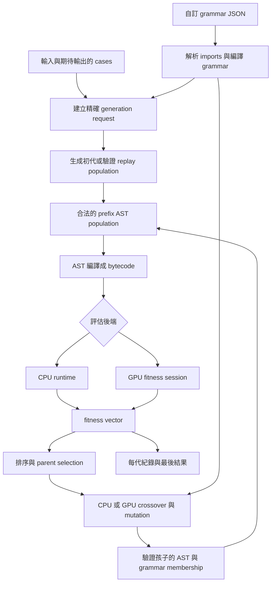

這張圖最重要的是兩條連線：

1. **Grammar 不只連到初始化，也連到 reproduction 和 child admission。** 否則初代雖然符合限制，幾代後就可能跑出原本不允許的程式。
2. **Runtime 接收的是具體程式，不是 grammar package。** 程式一旦 materialize 並編譯完成，runtime 不需要知道它原先來自哪個 package。

可以把整個系統分成三個世界：

| 世界 | 關心的問題 | 典型資料 |
| --- | --- | --- |
| 搜尋空間 | 哪些結構能被建構、替換與接受？ | grammar、production、scope、domain、request |
| 具體程式 | 這個個體到底長什麼樣？ | AST、names、constants、region metadata |
| 執行 | 對某組輸入，結果、錯誤與 fuel 是什麼？ | bytecode、VM state、payload、fitness |

同一個具體程式可能由不同文法導出；同一份文法也可以導出很多不同程式。因此「grammar identity」和「program identity」不能混為一談。

<a id="c03"></a>
## 3. Repository 與模組責任

### 3.1 目錄不是按 CPU／GPU 一刀切開

```text
gagp/
├── cpp/
│   ├── include/gagp/       公開 C++ 型別與 API
│   ├── src/
│   │   ├── evolution/     grammar、AST、compiler、selection、reproduction
│   │   ├── runtime/       共用核心、CPU、GPU、payload
│   │   ├── cli/           JSON、CLI、artifact 與命令邊界
│   │   ├── serialization/ 共用 RegionPlan codec
│   │   ├── migration/     離線舊版資料轉換
│   │   ├── transition/    遷移與 oracle 用的轉接支援
│   │   ├── bench/         選配 benchmark 工具
│   │   └── experiments/   選配診斷 probe
│   └── tests/             native unit、contract、GPU、parity、fuzz
├── configs/               grammar、PSB schema、回歸政策
├── data/fixtures/         runtime 可直接讀取的案例
├── tools/                 Python 作業流程工具與測試
├── tests/repository/      文件、路徑、規格與核心邊界檢查
├── spec/                  正式行為契約
├── docs/                  設計、指南、參考與歷史紀錄
└── benchmarks/            精簡證據與 freeze manifest
```

`cpp/src/evolution/grammar/` 有些檔案編入 `gagp_grammar`，有些編入 `gagp_evolution`。**檔案放在哪個目錄，不一定等於它屬於哪個 library target**；精確依賴以 [CMakeLists.txt](../../cpp/CMakeLists.txt) 為準。

### 3.2 主要 native library

| Library | 責任 | 不應承擔的工作 |
| --- | --- | --- |
| `gagp_core` | Value、opcode、bytecode verification、RegionPlan、progress／fuel 基礎契約 | 不根據 package 檔名選演算法 |
| `gagp_runtime_cpu` | CPU bytecode execution、fitness、host payload registry | 不決定 GP 哪個 production 被選到 |
| `gagp_grammar` | grammar 載入、identity、catalog、compile、budget 等共用模型 | 不偷偷執行使用者 JSON 中的程式碼 |
| `gagp_evolution` | generation、membership、AST 驗證與編譯、variation、evolution orchestration | 不把 Python 當作 runtime fallback |
| `gagp_gpu` | CUDA fitness 與 GPU reproduction 的 device 支援 | 不取代所有 host validation |
| `gagp_cli_support` | option parsing、cases／artifact codecs、命令組裝與輸出 | 不另定一套 fitness semantics |
| `gagp_json`／`gagp_region_plan_json` | 共用 JSON 與 region plan 編解碼 | 不執行演化 |

`gagp_cpu` 是相容用 aggregate interface target。新嵌入程式應依實際 API 需求選擇較精確的 target。

### 3.3 Python 的位置

Python `gagp_tools` 處理資料下載、轉檔、命令 orchestration、回歸執行、彙整與報告。它不是第二套 GP／VM 語意實作。比如 `gagp-tools grammar validate` 會委派 native grammar 工具，而不是用 Python 再解釋一遍 grammar。

來源：[repository 路徑與責任](../reference/repository-layout.md)、[工具 inventory](../reference/tooling.md)。

<a id="c04"></a>
## 4. 一個「程式」有三種表示

### 4.1 作者寫的是 grammar

作者描述的是一個集合：

```text
E : Int → n | 0 | add(E, E)
```

這表示 `E` 可以是輸入、零，或兩個 `E` 的加法。它不是某一個候選程式，也不是供 VM 直接執行的 bytecode。

### 4.2 演化操作的是 AST

一個實際候選可以是 `add(n,0)`：

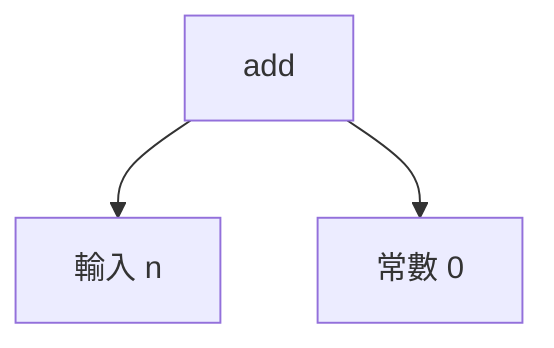

原生資料用 prefix／前序形式儲存，概念上先記錄父節點，再記錄孩子：

```text
[ADD, INPUT(n), CONST(0)]
```

這只是表達式部分的教學表示。真正的 `AstProgram` 還包含 program／block／return 結構、name table、constant table 和需要的 metadata。

Prefix array 的優點是 subtree 通常對應一段連續範圍，方便計算長度、搬移、打包與 GPU splice。代價是不能只把一段 array 任意剪貼：names、constants、binder IDs 和 metadata 都要一起修正。

### 4.3 Runtime 執行的是 bytecode

`return add(n,0)` 可概念性降低成：

```text
LOAD input_n
PUSH_CONST zero
ADD
RETURN
```

VM 的 operand stack 會依序經過 `[n]`、`[n,0]`、`[n+0]`。這種指令表示讓 CPU 與 GPU 可以執行共同語意，而不必為每個 grammar template 寫一個 interpreter。

### 4.4 Materialization 與 lowering 的差異

- **Materialization**：把 grammar choices、template holes 變成一個完整 AST。
- **Lowering／程式編譯**：把 AST 變成 VM 可以執行的 bytecode。
- **Grammar compilation**：更早的一步，把規則本身變成適合生成與查詢的 immutable tables。

所以專案裡有兩種容易混淆的「編譯」：**編譯文法**與**編譯候選程式**。

來源：[AST header](../../cpp/include/gagp/evolution/ast_program.hpp)、[node descriptor](../../cpp/src/evolution/node_descriptor.cpp)、[compiler](../../cpp/src/evolution/compiler.cpp)。

<a id="c05"></a>
## 5. 型別系統：哪些零件可以接在一起

### 5.1 八個公開型別

| Grammar 型別 | Cases tag | 意義 | 注意事項 |
| --- | --- | --- | --- |
| `Int` | `int` | 有號 64-bit 整數 | 不是任意精度整數 |
| `Float` | `float` | binary64 浮點數 | authoring domain 與輸入格式拒絕非有限數值 |
| `Bool` | `bool` | true／false | 不是數字 |
| `Char` | `char` | 一個字元的純量值 | 與單字元 String 是不同 tag |
| `String` | `string` | 字串 | 真實內容由 payload 管理 |
| `IntList` | `int_list` | Int 元素串列 | 不接受 Float 元素 |
| `FloatList` | `float_list` | Float 元素串列 | 不隱式提升 Int 元素 |
| `StringList` | `string_list` | String 元素串列 | 可以含字串，但不是任意巢狀 list |

沒有公開 `None`、`Any`、generic list、tuple、product value、`CharList` 或異質 list。

### 5.2 Exact typing 比一般「都是 numeric」更嚴格

```text
add(Int, Int) -> Int          可用
add(Float, Float) -> Float    可用
add(Int, Float)               不自動轉型
append(FloatList, Int)        不因元素看似能轉成 Float 就接受
```

但要分清楚兩種層次：**運算子的參數型別規則**與**fitness 比較規則**不同。數值 fitness 可比較 actual Int／Float 和 numeric expected，這不代表程式內允許混合型別的加法。

### 5.3 值型別和語法 category 不是同一件事

Grammar 還有四種 category：`Expression`、`Statement`、`Block`、`Program`。

`Expression:Int` 表示會算出 Int；`Statement` 的 `type:Int` 則表示它位於回傳 Int 的程式契約中，不表示每個 statement 自己回傳一個 Int。

因此，兩個位置都標示 Int，也不代表能把一整個 Block 換進加法的參數位置。合法替換至少要同時考慮 **category + exact type + scope + grammar contract**。

### 5.4 Unicode 的規格與現況要分開讀

規格將 Char 定義為 Unicode scalar，`len(String)` 應計算字元而非 bytes。但目前文件記錄了既有 CPU string 路徑以 UTF-8 bytes 儲存／索引的差異；例如 `é` 可能呈現兩個 byte 的行為。Authoring guide 也指出目前 fitness-case Char codec 有一 byte 的限制。

因此，ASCII 教學例子不能作為完整 Unicode 支援的證明；CPU 與舊版一致，也不等於符合 Unicode 規格，更不等於已證明 GPU Unicode parity。

來源：[grammar 規格](../../spec/grammar.md)、[typed cases](../../spec/fitness_cases.md)、[已知 UTF-8 差異](../reference/grammar-migration/semantic-coverage.md#inherited-utf-8-string-discrepancy)。

<a id="c06"></a>
## 6. 基礎語法與 builtin 能做哪些事

### 6.1 純量與邏輯

| 類別 | 可用概念 | 使用上的意義 |
| --- | --- | --- |
| 常數與變數 | Const、input、local、bound／RegionVar | 決定資料從哪裡來 |
| 算術 | neg、add、sub、mul、div、mod | DIV 回傳 Float；其他算術保留精確 numeric type |
| 比較 | lt、le、gt、ge、eq、ne | equality 要求相同 runtime tag |
| 布林 | not、布林組合、條件式 | 條件值必須是 Bool |
| 數值 builtin | abs、min、max、clip、idiv0、imod0 | 只啟用你在 grammar 引用的 exact signature |
| 字元 | ord、chr、is_letter、is_digit、is_space、is_vowel、to_lower、to_upper | 字元判定遵守實作支援的表，不要假定完整 Unicode 分類 |
| 轉換 | char_to_string、string_to_char、to_string | to_string 接受 Int 或 Float，不接受 Char |

`clip(x,lo,hi)` 定義為 `min(max(x,lo),hi)`。若 `lo > hi`，結果是 hi，不會自動交換邊界。

`idiv0`／`imod0` 是明確的 protected integer operations，除數為 0 時回傳 0。一般除法的零除不是因此都被保護。

有限 Float 的 `to_string` 使用固定六位小數後移除尾零與小數點，並把負零正規化成 `0`。它不是任意精度 round-trip serializer。

### 6.2 字串與 typed list

| 函式 | 適用對象 | 範例或規則 |
| --- | --- | --- |
| `len` | 四種 sequence | `len([2,5,8]) = 3` |
| `concat` | 兩個相同 tag 的 sequence | IntList 不能與 FloatList 串接 |
| `slice` | sequence + 兩個 Int | Python-like 負索引與 clamping，半開區間 |
| `index` | sequence + Int | IntList→Int、FloatList→Float、StringList→String、String→Char |
| `append`／`prepend` | typed list + exact element | 建立新 list，不原地修改 |
| `reverse` | sequence | 保留容器 tag |
| `find` | String + String | 找不到回傳 -1 |
| `contains` | String + String | 回傳 Bool |
| `singleton` | Int／Float／String／Char | 分別產生 IntList／FloatList／StringList／String |

`append(String,Char)` 不存在。要做字串後接字元，組合 `concat(s,char_to_string(c))`。

空 list 必須帶型別。`IntList([])` 與 `FloatList([])` 雖然看起來都空，仍是不同值類型。slice 出空結果也必須保留原本 tag。

### 6.3 一般 statement

```text
Program → Block
Block   → 一串 Statement
Statement → Assign | IfStmt | ForRange | Return
```

- Assign 更新 ordinary local；也可明確指定 input slot 作為寫入目標。
- IfStmt 依 Bool 執行其中一個 block。
- ForRange 先算一次非負 Int 上限，從 0 走到上限減 1。
- Return 回傳符合程式 result contract 的值。

讀未初始化變數會有 `NameError`。沒有執行到 Return 而結束會有 `ValueError`。寫入 input slot 只影響本次執行的 local state，不會改掉外部 cases 資料。

來源：[scalar builtins](../../spec/builtins_base.md)、[sequence builtins](../../spec/builtins_runtime.md)、[grammar](../../spec/grammar.md)。

<a id="c07"></a>
## 7. 自訂 grammar：先完成一個能跑的例子

### 7.1 設計前先寫三件事

以 `n → 2n` 為例：

1. **介面**：一個 Int 輸入 n，回傳 Int。
2. **允許的解法**：輸入 n、常數 0、加法的有限組合。
3. **資源**：完整 AST 最多 9 個節點、深度 5；每個 case 有 32 fuel。

這三件事應先於 production weights。若你的語言根本無法表達答案，調權重沒有用。

### 7.2 完整 grammar JSON

以下與 repository 的 [scalar.json](../../configs/grammar/examples/authoring/scalar.json) 一致，可另存後修改。

```json
{
  "format_version": "grammar-definition-v2",
  "entry": {"nonterminal": "Authoring.Scalar", "type": "Int"},
  "inputs": [{"name": "n", "type": "Int"}],
  "search_limits": {"max_nodes": 9, "max_depth": 5},
  "execution_limits": {"fuel": 32},
  "nonterminals": [{
    "id": "Authoring.Scalar",
    "type": "Int",
    "scope": [],
    "alternatives": [
      {"id": "input", "weight": 3, "expression": {"input": "n"}},
      {"id": "zero", "weight": 1,
       "expression": {"constant": {"type": "Int", "values": ["0"]}}},
      {"id": "sum", "weight": 1, "expression": {
        "signature": "add(Int,Int)->Int",
        "args": [{"ref": "Authoring.Scalar"}, {"ref": "Authoring.Scalar"}]
      }}
    ]
  }]
}
```

### 7.3 逐欄位解釋

| 欄位 | 在這個例子中的意義 | 常見誤解 |
| --- | --- | --- |
| `format_version` | 宣告使用 v2 grammar schema | 不是任意註解；舊版本不會被當成新格式解讀 |
| `entry` | 從哪個 rule 開始，預期什麼 result type | 不是直接指定答案程式 |
| `inputs` | 可以使用的外部輸入名稱與型別 | 與 cases 必須相容，不會自動改型別 |
| `search_limits` | 完整 materialized AST 的實體預算 | 不是只算你手畫的 expression |
| `execution_limits` | 每次程式／case 的執行 fuel | 不是整個 evolution run 的總 fuel |
| `id` | 穩定 rule 名稱 | 改名可能改 grammar identity |
| `scope: []` | 不要求外層 lexical bindings | 不表示沒有 input 可用；input 是另一個命名空間 |
| `alternatives` | 這個 rule 允許的各種構造 | 不必每個個體都用到每一種 |
| `weight` | feasible choices 之間的相對抽樣偏好 | 不保證 population 中的比例 |
| `signature` | 精確 operation/type overload | 不是自由輸入的 C++ 函式名稱 |
| `ref` | 在此位置再次使用某個 rule | 不會自動建立 runtime function call |

### 7.4 對應 cases

原本的 scalar cases 是 identity 任務。要示範倍增，請使用下列自己的 cases；不要以為 grammar 檔名決定了任務。

```json
{
  "format_version": "fitness-cases",
  "cases": [
    {"inputs": {"n": {"type": "int", "value": 2}},
     "expected": {"type": "int", "value": 4}},
    {"inputs": {"n": {"type": "int", "value": 5}},
     "expected": {"type": "int", "value": 10}},
    {"inputs": {"n": {"type": "int", "value": -3}},
     "expected": {"type": "int", "value": -6}},
    {"inputs": {"n": {"type": "int", "value": 0}},
     "expected": {"type": "int", "value": 0}}
  ]
}
```

Grammar 的 Int constants 用字串，是為了保存完整 int64 精度。Cases 的 `int.value` 則使用整數 JSON number。兩種 JSON 格式的欄位慣例不同，不能直接互換。

各 case 的 input 名稱集合與對應型別必須一致。Grammar 的 inputs array 有其順序意義，但 cases 中 JSON object 的鍵排列不必與它逐字相同；轉接層按名稱建立對應。

### 7.5 第一個可執行 workflow

從 repository root 執行，先按第 29 章建好 binaries。以下 `/tmp` 路徑是教學輸出，grammar 直接引用 checked example。

```bash
B=cpp/build/release
G=configs/grammar/examples/authoring/scalar.json
C=docs/presentations/customizable-grammar/double.cases.json

"$B/gagp_grammar_cli" validate --grammar-definition "$G"
"$B/gagp_grammar_cli" inspect --grammar-definition "$G"

"$B/gagp_generate_cli" \
  --grammar-definition "$G" --cases "$C" \
  --population-size 16 --seed 7 --out-json /tmp/gagp-guide.population.json

"$B/gagp_evolve_cli" \
  --grammar-definition "$G" --cases "$C" \
  --population-json /tmp/gagp-guide.population.json \
  --engine cpu --repro-backend cpu --repro-overlap off \
  --seed 7 --generations 2 --show-program ast \
  --out-json /tmp/gagp-guide.cpu.json
```

`validate` 回答規則是否可接受；`inspect` 顯示規則編譯後的型別、context、成本等資訊；`generate` 產生可重播初代；`evolve` 才開始評估與變異。這四件事最好分開理解。

來源：[authoring guide](grammar-authoring.md)、[native CLI](../reference/cli.md)。

<a id="c08"></a>
## 8. 如何把小 grammar 擴充成自己的搜尋空間

### 8.1 先分清楚「新增選擇」與「替換選擇」

把 `sum` 的 signature 從 add 改成 mul，是把加法選項拿掉並換成乘法。若希望保留加法，應新增另一個 alternative，使用不同 id。

例如下列是可放進 alternatives array 的**片段**：

```json
{
  "id": "product",
  "weight": 1,
  "expression": {
    "signature": "mul(Int,Int)->Int",
    "args": [{"ref": "Authoring.Scalar"}, {"ref": "Authoring.Scalar"}]
  }
}
```

若加入 `1`，可以表達 `n+1`；若加入乘法，可以表達 `n*n`。新增 operator 會放大搜尋空間；是否值得，應根據任務與可能解法決定。

### 8.2 多 nonterminal 是用來表達不同角色

你可以區分：

```text
Value     → input | constant | add(Value,Value)
Condition → less_than(Value,Value)
Answer    → Value | if(Condition,Value,Value)
```

這是概念文法，不是完整 JSON。它表示不是每個位置都能放任何東西。`Condition` 必須給出 Bool，而 `Value` 給出 Int。

即使兩個 rule 都回傳 Int，也可以讓它們有不同角色，例如 Index 只允許小範圍常數，ArithmeticValue 允許加法。這種 distinction 會影響 membership 和預設 crossover compatibility。

### 8.3 生得出來、跑得起來、屬於語言，是三個問題

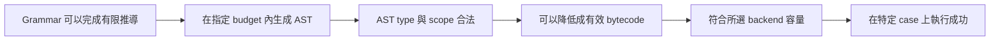

每個箭頭都可能失敗。型別正確的 `index(xs,i)` 仍可能在某個 case 上越界；finite recursion 仍可能在宣告 frame limit 內放不下；語法簡單的 concatenation 仍可能耗盡 payload scratch。

### 8.4 實用的設計節奏

先做「能表達已知手寫解」的小 grammar，接著生成少量個體看分布，再讓 mutation／crossover 跑幾代，最後測最大預期輸入和 GPU 路徑。不要先把所有 primitive 打開，再期待權重自己解決結構問題。

<a id="c09"></a>
## 9. 常數 domain、抽樣與常數突變

### 9.1 三種 domain

| 形式 | 用途 | 範例 |
| --- | --- | --- |
| `values` | 明確有限集合 | Int 的 `"0"`、`"1"`、`"2"` |
| `range` | 數值範圍 | Int `[-8,8]` 或 Float `[-8,8]` |
| `sequence` | 不枚舉每一個容器值 | 長度 0–5，每個元素從某 domain 取樣 |

每個 domain 恰好使用一種主形式。以下是 domain 片段，不是完整 grammar：

```json
{"type":"Int","range":["-8","8"]}
```

```json
{"type":"IntList","sequence":{
  "length":[0,5],
  "element":{"type":"Int","values":["0","1"]}
}}
```

Sequence 先均勻選長度，再獨立抽元素。String 的元素是 Char；StringList 的元素 domain 是 String，可以進一步描述字串長度，但不能因此宣告一般 list-of-list。

Sequence length endpoints 是 inclusive，建構格式允許 0–65536。編譯器另以 16 MiB bound 估算單次取樣的展開容量。這是**建構時**的限制，與 runtime token length、GPU scratch 都是不同層次，不能拿來保證某個長度的容器能完整運算。

### 9.2 Int range 與 Float range 不同

- Int membership 和抽樣都含兩端，支援整個 int64 範圍。
- Float membership 含兩端；一般連續抽樣用 `[min,max)`。
- Float singleton range 回傳那個 endpoint。
- Float `values` 對 signed zero 的 identity 有精確規則；range 包含零時可接受兩種零。
- `quantization_scale:1000` 是連續抽樣後四捨五入到千分位，不是均勻選每個離散格點。

因此 quantized endpoints 的機率和中間格點不一定一樣。這對熟悉 ERC 的讀者很重要：domain 描述不只有合法集合，也明確定義抽樣分布。

### 9.3 Membership support 與 sampling support 分離

```json
{
  "type":"Float",
  "range":[-100,100],
  "sample_from":{
    "type":"Float",
    "range":[-8,8],
    "quantization_scale":1000
  }
}
```

這表示允許值在 `[-100,100]`，但 construction 與 resampling 從較窄的 sampler 取得值。已有合法值 42.125 不會因為 sampler 只有 `[-8,8]` 就失去 membership。

`sample_from` 必須同型別、包含於外層 domain，而且不能再次巢狀 `sample_from`。它也不會自動產生「加一點 noise」的行為。

### 9.4 四種常數 mutation 意圖

| Policy | 被選中後發生什麼 | 是否表示 subtree mutation？ |
| --- | --- | --- |
| `resample` 或省略 | 從對應 sampling domain 重新取值 | 否 |
| `keep` | 保留目前值，視為已套用且未改變 | 否，也不算失敗 fallback |
| `flip` | Bool false／true 互換；domain 必須兩者皆含 | 否 |
| `{"kind":"add",...}` | 從 delta range 抽增量，加到原值 | 否 |

```json
{
  "type":"Float",
  "range":[-100,100],
  "sample_from":{"type":"Float","range":[-8,8],"quantization_scale":1000},
  "mutation":{"kind":"add","range":[-1,1]}
}
```

加法後若 overflow、變成不合法值或超出 membership，保留舊值，不是 retry 到成功，也不是改做 subtree mutation。加法不重新套用 construction quantization。

進階 Float `gpu_grid_steps` 可以讓 GPU delta 使用包含兩端的離散格點，而 CPU 仍用連續 sampler。這是**刻意不同的 sampling law**，不能再宣稱 CPU／GPU mutation 分布完全一樣。

來源：[constant domains](../../spec/grammar_definition.md#constant-domains)、[numeric sampling](../../cpp/include/gagp/evolution/grammar/numeric_sampling.hpp)。

<a id="c10"></a>
## 10. Scope、binding 與 traversal：為什麼不能隨便換 subtree

### 10.1 三種名字來源

| JSON 表達方式 | 來源 | 能否直接被 Assign 修改 |
| --- | --- | --- |
| `{"input":"n"}` | Cases 宣告的輸入 | 可經明確 input target 改本次 execution slot |
| `{"local":"total"}` | Grammar 宣告的 ordinary local | 可以，但先要有合法初始化 |
| `{"bound":"x"}` | Let／traversal／phase 引入的 lexical binding | 不可以；binding immutable |

Scope 是「這個位置目前允許看見哪些 lexical names，以及它們各是什麼型別」。它不是一個裝任意變數的全域字典。

### 10.2 Let 的完整 expression 片段

```json
{
  "signature":"let(Int,Int)->Int",
  "args":[
    {"input":"n"},
    {"signature":"add(Int,Int)->Int",
     "args":[{"bound":"x"},{"bound":"x"}]}
  ],
  "bind":{"1":["x"]}
}
```

概念是 `let x = n in x+x`。`bind` 的 `"1"` 指零起算的第 1 個參數，也就是 body。Initializer 看不到新建立的 x，body 才看得到。

若 body 改用某個 helper nonterminal，那個 rule 必須宣告所需 scope，例如 `[{"name":"x","type":"Int"}]`。需要較窄 scope 的 rule 可以在較寬環境使用，但所需名字和型別都必須能映射。

### 10.3 Traverse 是 fold，而不是任意 callback

```text
Traverse([2,5,8], start_index=0, seed=0,
         step(element, index, acc) = add(acc,element))
```

| 次序 | element | index | 進入 step 的 acc | step 結果 |
| ---: | ---: | ---: | ---: | ---: |
| 1 | 2 | 0 | 0 | 2 |
| 2 | 5 | 1 | 2 | 7 |
| 3 | 8 | 2 | 7 | 15 |

Sequence、索引 operands、seed 按規定順序各求值一次。空範圍仍會求 seed；最後結果為 seed。Traversal 有正向、反向、完整 sequence 和 clamped half-open range 版本。

step 的 element 型別由 sequence 決定；accumulator 可是八種公開型別之一。Whole-sequence step 在 argument 3 綁定；range 版在 argument 5 綁定。

### 10.4 Crossover 為什麼要 care scope

把 `acc + element` 從 traversal step 搬到程式根部，即使回傳型別仍是 Int，也不合法：根部沒有 acc 和 element。

另一方面，兩個不同 traversal 各自使用 `element` 這個顯示名稱，實體 binder ID 不一定一樣。合法交換需要 **capture remapping／alpha-renaming**，不能只比較字串，也不能直接保留來源 ID。

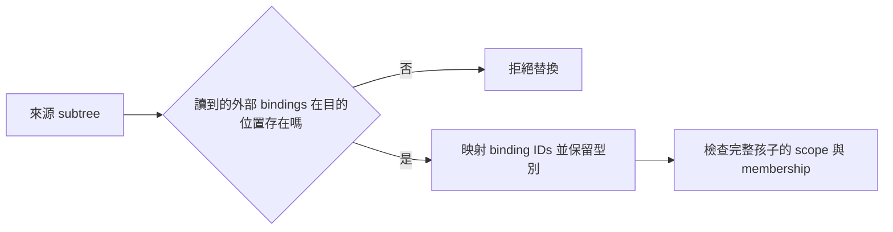

這些 body 是靜態 AST region，不是可在 runtime 任意建立或傳遞的 closure。

<a id="c11"></a>
## 11. Templates 與 packages：把演算法知識放進搜尋空間

### 11.1 固定骨架與演化位置

假設希望固定程式形狀為「同一個計算做兩次再相加」：

```text
Twice(H) = add(H,H)
```

H 是 hole。它不是兩個彼此獨立的變數；同一 template instance 中重複使用同一 hole 代表**同一個邏輯選擇**。

若 H 選 `add(n,1)`，結果必須是：

```text
add(add(n,1), add(n,1))
```

不能只把右邊改成 `0`，因為那不再符合 repeated-hole 契約。

### 11.2 Template 定義的關鍵欄位

| 欄位 | 作用 |
| --- | --- |
| template `id` | 可供其他 expression 引用的名稱 |
| `type`／`category` | 整體替換後的語法／型別契約 |
| `scope` | 固定 body 可看見的外部 lexical bindings |
| `holes` | 每個開放位置的 id、type、scope、category |
| `body` | 固定形狀，用 `{"hole":"..."}` 標示開口 |

完整可執行例子：[authoring/template.json](../../configs/grammar/examples/authoring/template.json)。

Template fixed body 的 constant 必須是 singleton。希望常數能變化，就把 domain 放進可演化的 hole。Nonterminal reference 也必須經 declared hole 進入固定 body，不能把「固定區」偷偷寫成自由展開。

### 11.3 一個邏輯 hole，多份實體成本

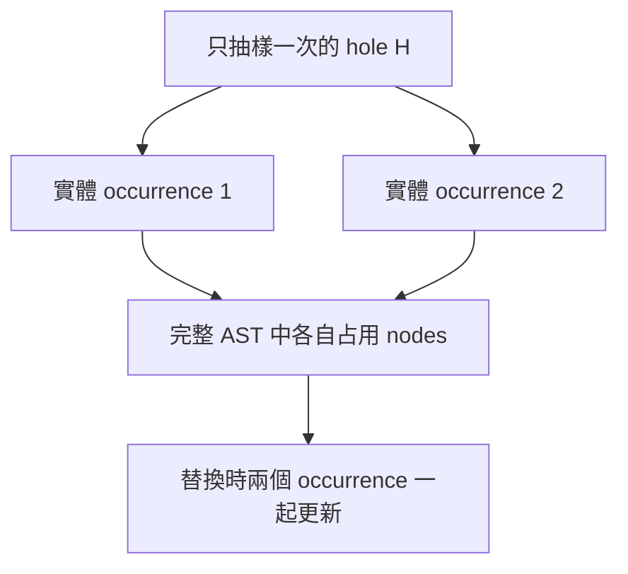

Hole wrapper 本身不算 materialized AST node，但展開的每一份 subtree 都算。深度 budget 要以所有 occurrence 中最嚴格的位置為準，不能只看第一個 occurrence。

### 11.4 Import 與 override

`imports` 是相對於**宣告 imports 的檔案**解析的本地相對路徑。禁止 network URL、absolute import path、cycle 和不明確衝突。

- `define`：一般定義，預設模式。
- `extend`：只能對 nonterminal 追加 alternatives，不改既有 type／scope。
- `replace`：完整覆寫已匯入的資源。

不同 writer 的先後不能靠 sibling traversal 的偶然順序；覆寫者要在 dependency graph 中明確依賴前一個 writer。

### 11.5 Divide-and-conquer 範例

[restricted_combine.json](../../configs/grammar/examples/restricted_combine.json) 匯入 [dc_intlist_int.json](../../configs/grammar/packages/dc_intlist_int.json)，填入 source、solve、divide、combine 四個 holes。

Combine 的環境只提供 `left:Int` 與 `right:Int`。你可以讓它選 `add(left,right)` 或 `max(left,right)`，讓 GP 搜尋合併方法，而不是搜尋整套遞迴 machinery。

Package 名稱沒有 runtime 特權。即使檔名保留 DC／DP／LinearRec 等歷史名稱，最終仍展開成共用的 v2 AST／RegionPlan；不會呼叫一個依檔名選擇的專用 interpreter。

<a id="c12"></a>
## 12. Grammar 載入與編譯：從 JSON 到 immutable tables

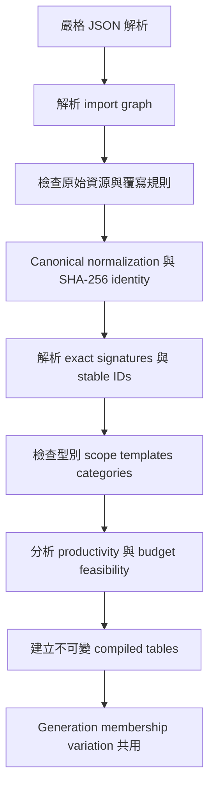

### 12.1 為什麼嚴格解析

Duplicate keys、unknown fields、invalid Unicode、non-finite numbers 和不相容 version 都會被拒絕。被 override 蓋掉的舊定義也不能藏非法欄位；原始 shape 會先檢查。

這能避免拼錯欄位名稱後系統默默忽略，卻讓你以為政策已生效。

### 12.2 Identity 算的是什麼

Grammar identity 是完整 canonical resolved representation 的 SHA-256，包含版本、catalog、normalization 和來源內容等語意資訊。

重新命名 package 檔案並只改 import path，不會因路徑本身改變 identity；修改權重、domain、policy 或 transitive source content 則可能改變 identity。Resolved representation 保留 overridden source content，因此不要只把 hash 理解成「最後表面 alternatives 的 hash」。

### 12.3 Stable ID 與 numeric ID

`Authoring.Scalar/sum` 這類 stable production ID 便於人類辨識。Compiled tables 用排序後的 numeric IDs 做查詢和傳輸。

Numeric ID 只在所屬 grammar identity 下有意義。「某個 production 是 7」如果不帶 grammar identity，不能當作跨 grammar 的證據或 cache key。

### 12.4 Productivity 與可行成本

Productive rule 必須有有限推導。對某個 request，還要能同時滿足 nodes、depth、scope、stage 等限制。

Generator 給孩子預算時，會先替兄弟節點保留最低可行成本，再分配剩餘 allowance。Unused allowance 可以回到後續兄弟；因此最終大小不是對 max_nodes 的均勻抽樣。

透明 alias 或 template/hole wrapper 不產生 node。若不防止 zero-node alias cycle，就可能無限繞圈又完全不消耗 AST budget，因此此類循環會被限制。

### 12.5 Expression entry 的 envelope

Expression root 生成時要預留四個實體 nodes：PROGRAM、BLOCK_CONS、RETURN、BLOCK_NIL，以及三層 prefix depth。

所以教學畫的 `add(n,n)` 有三個 expression nodes，不代表完整個體只有三個 nodes。設定極小 budget 時，這是常見的失敗原因。

來源：[definition loader](../../cpp/src/evolution/grammar/definition.cpp)、[compiled tables](../../cpp/src/evolution/grammar/compiled.cpp)、[generation](../../cpp/src/evolution/grammar/generate.cpp)。

<a id="c13"></a>
## 13. 進階搜尋政策：不只開關某個 operator

### 13.1 variation 只在 nonterminal 層級

- Nonterminal `variation:false`：不把該 occurrence 當作 subtree replacement site。
- Descendant rules 仍保有自己的 variation policy。
- Constant mutation 是另一套 domain policy，不會自動一起關閉。

「固定根部」不是「整棵樹永遠不動」。要凍結哪些部分，需明確設計 template、descendant eligibility 和常數政策。

### 13.2 Semantic fuel 與 projected resource

`fuel_events` 修改具體 AST node 的語意事件計費。它不能掛在純 wrapper 的 `ref`／template invocation／hole 上，也不能創造 zero-cost cycle。

`resource_charge` 則是另一種「建構成本投影」：

```json
{"nodes":0,"depth":0,"resets_depth":false}
```

例如一個 high-level source operation 展開成多個 helper nodes，可以讓行政展開的 projected cost 為零。但 physical nodes 仍存在，也仍受實體上限約束。

Native `initial_resource_budget` 與 `offspring_resource_budget` 可分別限制初代和孩子的 projected resources；目前它們不是一般 CLI flags。`joint_resource_frontier` 可分析 physical／projected 成本組合，但 capacity exhaustion 不等於語言不可行。

同一 AST 若有多種 derivation，canonical membership 可能選到不同 charge 路徑，所以 admission 不能只信附帶的 resource metadata。能證明 charges 具有 context independence 時才可安全使用局部剪枝；否則要檢查完整孩子。

<a id="c14"></a>
## 14. Membership：比「型別合法」更強的一道門

考慮 grammar 只允許 `n`、`0`、`add`。`mul(n,n)` 是 GAGP 原生語言的合法 Int expression，也可能成功編譯執行，但它不是這份 grammar 的 member。

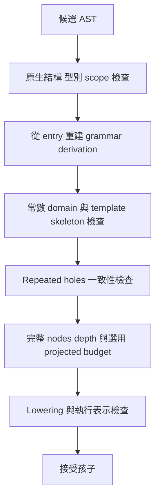

檢查項目包含：

- 每個 production 是否屬於指定 nonterminal。
- Constant 真正的 decoded value 是否在 domain 中；只有 payload token 不夠。
- Input／local／bound reference 是否對應正確名稱與型別。
- Template 固定骨架是否仍相同。
- Repeated 或 forwarded hole 是否仍代表相同 subtree。
- 完整 program envelope、node／depth budget 是否滿足。

### 14.1 Derivation witness 是證據，不是免驗證通行證

Witness 描述「這個 AST 是怎麼符合文法的」，包含 grammar identity、production、scope mapping、AST span、template instance 和 logical hole identity。

輸入 artifact 自己宣稱有這些 metadata，不代表可以相信。Admission 會以實際 AST 重建或驗證，不能讓 stale provenance 掩蓋已被修改的 nodes。

### 14.2 沒有原始 seed 還能檢查 member 嗎

可以。重建 derivation 能證明它屬於 grammar，但不能證明原始 RNG 歷史。因此 reconstructed witness 會區分為 `seed_replayable=false`。

這正好對應兩種問題：

- 「此程式屬於這個搜尋空間嗎？」是 membership。
- 「指定 seed／request 在相同版本會生成同一個程式嗎？」是 replay。

來源：[membership](../../cpp/src/evolution/grammar/membership.cpp)、[variation contract](../../cpp/src/evolution/grammar/variation_contract.cpp)、[membership spec](../../spec/grammar_definition.md#membership-derivation-and-cache-contracts)。

<a id="c15"></a>
## 15. BoundedRegion：共同表達遞迴、分治與 DP

### 15.1 為什麼不直接讓程式呼叫自己

一般遞迴牽涉 call stack、終止條件、參數生命週期和 memo storage。若讓演化任意生成呼叫關係，合法性與資源上限很難提前判斷。

GAGP 改用明確的 `RegionPlan`：先宣告狀態、怎麼產生子問題、怎麼證明進展、各階段能讀什麼，以及最多使用多少 frames／memo cells。

可以把它想成一個「受驗證的遞迴執行框架」。GP 可以搜尋裡面的表達式或模板開口，但不能繞過框架契約。

### 15.2 Plan 的零件

| 零件 | 白話意義 | 例子 |
| --- | --- | --- |
| States | 目前子問題的身分與資料 | 座標 `(i,j)`，或當前子串列 |
| Parameters／captures | 從外部帶入且型別已知的值 | 固定輸入、外層 lexical binding |
| Boundary | 進入定義域外時的答案 | 超出表格範圍回傳 0 |
| Predicate／base | 是否已小到可以直接解 | 長度 0／1，或座標等於基底位置 |
| Preparations | 該 frame 在 miss 時先算一次的值 | 分割點 |
| Requests | 要先解的子問題，順序固定 | `(i-1,j)`、`(i,j-1)` |
| Combine | 用 child answers 組出本題答案 | 加總、取最大值、組 sequence |
| Progress | 每次請求都有進展的靜態證明 | 座標 rank 下降或 proper subwindow |
| Limits | frame、memo-cell、entry fuel | GPU profile 內的有限容量 |

Plan version 1 支援 1–4 state slots、最多 8 requests、4 preparations、32 parameters、8 額外 bound operands。這些是 descriptor 格式能力，不是說作者應把每個欄位都用滿。

### 15.3 座標 progress：lexicographic rank

用二維狀態 `(i,j)`，rank 順序為「先比較 i，再比較 j」，方向都為 +1：

```text
request (-1,+2)：先看 i，i 減少，因此有進展；j 可以增加。
request ( 0,-1)：i 不變，接著 j 減少，因此有進展。
request ( 0, 0)：完全沒進展，拒絕。
request (+1,-5)：第一個有變化的 i 增加，拒絕。
```

Rank 必須覆蓋所有指定座標軸且不重複。有限 domain 加上嚴格下降，才支撐無循環的保證。Request offsets 的加法還需要 overflow-safe；「數學上下降」不能掩蓋 int64 overflow。

Memo key 要包含所有 changing state，否則兩個不同子問題可能錯誤共用答案。Sparse memo capacity 計算成功存入的結果數，不是直接要求整個 Cartesian domain 都配置成 dense table。

### 15.4 Sequence progress：proper window

分治一個 list 時，子問題以 ranked source 的半開 windows 描述。Interior cut 會 clamp 到 `[1,n-1]`；長度 0／1 先進 base，不去建立不合理切點。

整段 source 原封不動再請求一次不合法。不同 proper windows 可以重疊；duplicate requests 要明確允許。它不是只支援「平均切兩半」這一種分治。

### 15.5 執行順序不是任意的

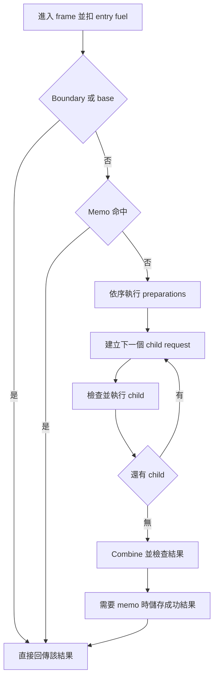

重要細節：

- Boundary／base 在 memo lookup 前，因此這些結果不是一般 nonterminal combine cache。
- Request construction 的錯誤先於 child frame capacity 檢查。
- 無法進入的 child 不扣它的 entry charge。
- Combine 與結果檢查先於 memo capacity failure。
- 每個 phase 共用本次 invocation 剩餘 fuel；第一個錯誤向外傳播。

這些順序會影響錯誤碼與 remaining fuel，因此 CPU／GPU parity 不能只看最後數值。

### 15.6 Phase 是隔離的小程式

每個 phase 用明確 bank／slot 建立 inputs：`state`、`parameter`、`prepared`、`result`、`measure`。Prepared values 只對後面的相應 phase 可見，child results 只對 combine 可見。

Phase 不會偷偷看見所有 global inputs。需要資料就要經 capture 和 phase bindings 帶入。Captured local 的 set／unset 狀態會保存；沒讀到的 unset capture 不應提早報 NameError。

Phase bodies 可以使用允許的普通 lexical operations，但不能再嵌套 structured recursive call。抽象 `family:recur`／`family:memo` 的 shape declaration 也不等於已可執行；現行 executable 路徑是具有完整驗證 plan 的 `family:bounded`。

可從 [memo.json](../../configs/grammar/examples/authoring/memo.json) 看完整序列化範例。它主要展示 rank、requests、phase bindings 與 bounded contract；不要僅憑檔名就認定它代表某個特定最佳化 DP 問題。

來源：[RegionPlan 格式](../../spec/bytecode_format.md#bounded-region-segment)、[general structured contracts](../../spec/grammar_definition.md#general-structured-contracts)、[runtime plan](../../cpp/include/gagp/core/region_plan.hpp)。

<a id="c16"></a>
## 16. AST verification、lowering 與 VM

### 16.1 驗證分成幾層

| 檢查 | 回答的問題 | 典型錯誤 |
| --- | --- | --- |
| Codec／結構 | 這份資料能表示完整 AST 嗎？ | unknown kind、arity 不符、缺 metadata |
| Exact typing | 每個 child 的型別適合 parent 嗎？ | Int 運算收到 String |
| Scope | 所有讀取都有合法 declaration／binding 嗎？ | 把 traversal element 移到外面 |
| Grammar membership | 是否由目前規則允許？ | 型別正確但 operator 被 grammar 禁用 |
| Bytecode verification | 降低後 stack／jump／phase contract 是否一致？ | 跳入非法位置、stack join 不相容 |
| Backend capability | 這個執行表示能放進後端嗎？ | GPU locals／frame 容量超出 |

Malformed 外部資料與「合法程式在某 case 上執行失敗」要分開。前者是 decode／validation 問題；後者才是 runtime error 與 fitness penalty。

### 16.2 Node descriptor 的角色

Node descriptor 集中描述 serialized name、numeric kind、arity、index 欄位、typing 和 metadata ownership。這可避免 AST codec、verifier、compiler 各自保有不一致的 node 清單。

Release-2 AST 的 53–70 是保留空洞；一般 region forms 從 71 開始。不能為了支援舊資料而把這些數字偷偷重新解釋。

### 16.3 Lowering 如何處理高階結構

- Let：initializer 求值一次，存入隱藏 local，body 從該 slot 讀值。
- Traversal：sequence／index／accumulator 變成 hidden locals 與普通 jumps。
- If／ForRange：降低成條件跳轉與順序指令。
- BoundedRegion：一個 `BOUNDED_REGION` opcode 加上 segment／phase tables。

Compiler 會在 lexical scope／loop 結束後重用可釋放的 hidden local slots。它保留仍活著的外層 captures 與 loop state；ordinary named locals 則保有整個程式期間的各自 slot。

### 16.4 VM state

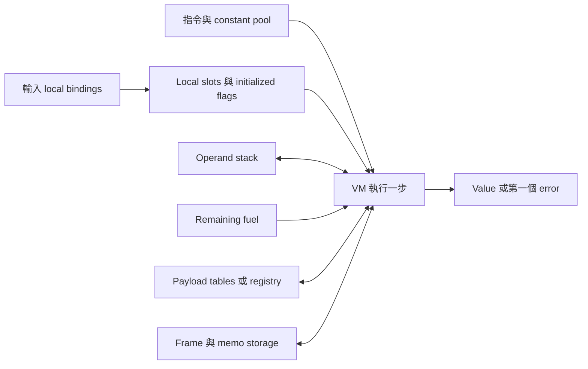

Instruction pointer 指向當前 opcode；stack 保存運算中的暫存值；locals 保存變數且另記是否初始化；fuel 控制可執行工作。容器的 compact Value 不直接持有完整內容，會透過 payload 查詢。

### 16.5 ISA 概覽

| Opcode 類別 | 用途 |
| --- | --- |
| PUSH_CONST／LOAD／STORE | 搬移常數與變數 |
| NEG／NOT／算術／比較 | 純量運算 |
| JMP／JMP_IF_FALSE／JMP_IF_TRUE | 控制流程 |
| CALL_BUILTIN | 呼叫 whitelist builtin |
| RETURN | 結束本次程式並回傳值 |
| CHECK_INT／CHECK_LIST | 檢查 tag 並保留原值 |
| EMPTY_LIST／EMPTY_LIST_LIKE | 建立正確 typed empty value |
| BOUNDED_REGION，數值 28 | 執行共用 recursive／memoized plan |

Opcode 25–27 是保留空洞，不能當成 alias。`is_int` 雖存在 builtin ID 表中，屬於 compiler-internal，不是新增給 grammar 作者自由使用的 source builtin。

來源：[AST verifier](../../cpp/src/evolution/ast_verify.cpp)、[type verifier](../../cpp/src/evolution/ast_type_verify.cpp)、[ISA](../../spec/bytecode_isa.md)、[bytecode verifier](../../cpp/src/runtime/bytecode_verify.cpp)。

<a id="c17"></a>
## 17. Fuel、錯誤與 fitness：演化到底在最大化什麼

### 17.1 Fuel 不是 timeout 毫秒數

預設每執行一條 instruction 扣 1。若有 explicit instruction schedule／semantic event profile，按宣告成本扣除。檢查與扣款發生在該操作的驗證或副作用之前。

成本可以是 0，但任何 control-flow cycle 都必須包含正成本，連不可達的 zero-cost cycle 也會被 verifier 拒絕。Region entry 另要求正成本。

AST 小不代表 fuel 用量小。例如一個 traversal node 可能走過一萬個元素。Nodes、bytecode 指令數和實際執行步數是三個不同量。

### 17.2 Runtime error

| 錯誤 | 大致原因 |
| --- | --- |
| `NameError` | 讀取未初始化／不可用的普通 local |
| `TypeError` | Runtime value tag 不符合操作要求 |
| `ZeroDiv` | 非 protected 的零除路徑 |
| `ValueError` | 索引、參數值、某些 payload 或 invocation 條件不合法 |
| `Timeout` | Fuel 不足、bounded frame／memo exhaustion 等 |

第一個錯誤終止當前 case，不是讓整個 population 都立即停止。另一方面，非法 grammar、無法打包的 device profile、CUDA allocation failure 等屬於命令／session 層問題，不能一概當作普通 bad fitness。

### 17.3 Numeric case

當 expected 是 Int 或 Float，且 actual 是 numeric：

```text
score_case = -min(abs(actual - expected), penalty)
```

若 actual 不可作 numeric 比較，或執行錯誤，得到 `-penalty`。

假設 expected=10、penalty=1：actual=10 得 0，actual=9.8 得 -0.2，actual=8 與 actual=100 都得 -1。這是**有上限的絕對誤差負值**，不是 MSE。

對 GP 的含意是：penalty 太小時，差很遠的數值候選可能全部同分；想知道 fitness landscape，應先理解公式。

### 17.4 Exact-match case

Bool、Char、String 和三種 typed list：

```text
exact tag 相同且 value 相等：+1
exact tag 相同但 value 不同： 0
tag 不同或 runtime error：  -penalty
```

IntList 與 FloatList 不會因為裡面的數字看起來一樣就視為同型別。Container 的實際 equality／fallback 邊界還要看第 24 章。

### 17.5 Program fitness 與 solved

Fitness 是所有 case scores 的**總和**，越大越好，不是平均。

| Case 組成 | 一般 solved target |
| --- | --- |
| 全 numeric | 0 |
| 全 exact-match，共 N 個 | N |
| 混合 | exact-match case 的數量 |

這些 target 搭配正常正 penalty 最容易解讀。`penalty=0` 雖合法，會令某些 numeric mismatch／error 也得到 0；此時不能只憑 target score 宣稱每個 case 都正確，應直接檢查 outputs／errors。

### 17.6 浮點 canonicalization 與排序

目前 fitness accumulation 使用 48-bit mantissa canonicalization；ranking 比較前再使用 40-bit mantissa canonicalization。這是為了讓小的浮點累加差異不輕易改變 ranking。

Fitness tie 以 `program_key` 字典序決定，而不是隨便使用容器走訪順序。CPU fitness 也依 reduction lanes 分塊累計，但仍是 CPU 序列執行；不能把 lane 數誤認為 CPU thread 數。

來源：[fitness 規格](../../spec/fitness.md)、[CPU fitness](../../cpp/src/runtime/cpu/fitness_cpu.cpp)、[selection](../../cpp/src/evolution/selection.cpp)。

<a id="c18"></a>
## 18. 完整 evolution loop 與結果的真正意義

### 18.1 一次呼叫的順序

```text
1. 檢查 EvolutionConfig、cases、grammar requests。
2. 建立 GPU session／reproduction run resources（若需要）。
3. 生成或驗證初代 population。
4. 重複 generations 次：
   a. 評估目前 population。
   b. 排序，記錄本代 best／mean。
   c. Selection。
   d. Crossover。
   e. 依 mutation_rate 做 mutation。
   f. Admission，形成下一代。
   g. 更新 payload roots。
5. 預設再評估最後產生的 population。
6. 輸出結果、history 與所選資訊。
```

主函式是 [`evolve_population`](../../cpp/src/evolution/evolve.cpp)，輸入設定由 [`EvolutionConfig`](../../cpp/include/gagp/evolution/evolve.hpp) 表達。

### 18.2 Generation 數與 final evaluation

`generations=2` 表示兩次「評估 → reproduction」，所以最後還有一個新 population 沒在那兩次評估中被看過。預設的 final evaluation 就是在評估它。

`--skip-final-eval on` 會跳過這一步。這適合某些明確界定範圍的工作，但不能把未評分的最後 population 當作已評估成果。

### 18.3 Best 的幾種含義

- `history_best[i]`：第 i 次 generation evaluation 的最佳個體。
- `history_mean_fitness[i]`：那一代的平均分數。
- 正常 final evaluation 後的 `result.best`：最後 population 的最佳個體。
- 它不等於「永遠保存在 population 裡的跨代 champion」。

目前 loop 沒有自動把每代 best 插回下一代，也沒有 CLI early-stop-on-solved 選項。若你需要 global best-ever，應在 history 與 final result 中明確選取，或在 native 邏輯中設計該政策。

### 18.4 Selection 是 round-based tournament

CPU 的 selection 將 population indices shuffle，按 tournament size 分組取勝者；不足指定 parent 數時進行下一 round。

「without replacement」描述的是一 round 的分組方式，不代表同一 parent 在整個 selection 結果中最多出現一次。不同 round 仍可能重複勝出。

`selection_pressure` 是 tournament size，會限制到 population 可用範圍。不是 rank selection 的 exponent，也不是 mutation 強度。

### 18.5 每代內避免不必要的 genome 複製

排序常使用 `ScoredGenomeRef`，即 genome pointer/reference 配 fitness；需要保存 history／best／final population 時才 materialize 成擁有資料的物件。

這個優化不改 population 大小，也不表示重複個體不再被評估。Cache、reference 和去除 fitness 工作是不同事情。

### 18.6 多 root population

`--population-roots RootInt,RootFloat` 可以選同一 grammar 中最多八個 closed、executable 且 result types 互異的 roots。初代按 ordered roots 輪流生成，但後續 selection 在整個 population 上進行，型別比例可改變。

每個孩子仍保持它原 parent 的 root contract；兩種 root 內共享的相容 rule sites 可以交流。這不是公開 `Any` 或 union type，也不是自動 multi-objective GP。

Cases 的 expected types 必須被所選 roots 接納；原本 scoring 公式不因此改變。某種 root 對其他 expected type 的 case 可能得到 mismatch penalty，設計混合任務時要先理解這個效果。

<a id="c19"></a>
## 19. CPU reproduction：怎麼安全地交配與突變

### 19.1 Replacement contract 的內容

只比較 subtree 的輸出 type 不夠。系統還考慮：

- 所屬 grammar／semantic identity。
- Exact type 與語法 category。
- 目的位置可見的 lexical scope 和 ordinary locals。
- Nonterminal 與 template instance／slot。
- Repeated-hole 的所有 occurrences。
- 目的位置可承受的 node、depth、template nesting 預算。
- 選用 projected resource budget 時的完整成本。

例如 A 與 B 都回傳 Int，但 A 只能是 `left`／`right`／`max(left,right)`，B 是任意整數算術；單靠 Int 交換會破壞 A 的語言。

### 19.2 Typed-subtree crossover


Repeated hole 是一個 logical site，交換時所有 copies 原子性更新。完整 AST 的 subtree span、side metadata 與 indices 都要重建。

### 19.3 Subtree mutation

選一個允許 mutation 的 site，建立帶目的環境的 generation request，從 active compiled grammar 生成 donor。Donor 不是任意另一棵回傳同型別的樹。

Contextual donor 會帶入目的地可用的 bindings、role 和 replacement budgets。它通常不具有 standalone initial artifact 的 seed replay 意義，也不應誤把 standalone program envelope 算進 donor payload 的局部成本。

### 19.4 Constant mutation 與 fallback

Mutation 發生機率由 `mutation_rate` 決定；發生後選 subtree 或 constant 分支的偏好由 `mutation_subtree_prob` 控制。

Constant mutation 以邏輯 constant group 為單位，fixed template constants 不被當作自由突變點。沒有 eligible constant group 時，相關路徑可改走 subtree；`keep` 或超界 additive 保留原值則不是這種 NoGroups fallback。

不合法 operator proposal 不應被半套發布。系統保留可驗證的 parent／child 並記錄拒絕或 fallback；具體 fallback 與計數由共用 variation contract 決定。

### 19.5 為什麼要區分幾種拒絕

| 計數 | 所代表的問題 |
| --- | --- |
| contract_rejections | 型別、scope、role 等替換契約不符 |
| budget_rejections | physical 或選用 projected 成本超限 |
| generation_rejections | 無法在指定條件下產出可接受 donor |
| acceptance_rejections | 組合後孩子未通過完整 admission |
| fallback_children | proposal 失敗後採用保底個體 |
| unchanged_children／changed_children | 該 operator output 是否真的改變 |

還有 crossover_attempts、mutation_attempts。這些是 **operator outputs** 的分類，不是最終 population 個數；一個孩子可能先經 crossover 再經 mutation，被不同階段記錄。

來源：[CPU backend](../../cpp/src/evolution/repro/backend.cpp)、[crossover](../../cpp/src/evolution/grammar/crossover.cpp)、[mutation](../../cpp/src/evolution/grammar/mutation.cpp)、[variation](../../cpp/src/evolution/grammar/variation.cpp)。

<a id="c20"></a>
## 20. GPU evaluation：程式與 cases 如何映射到 CUDA

### 20.1 GPU evaluation 的計算單位

假設 population 有 P 個程式，cases 有 C 組。需要的邏輯工作是 P×C 次 execution，最後每個程式得到一個 fitness。

目前一般路徑以一個 block 處理一個 program；block 內各 thread 負責該 program 的一段 cases。不是一個 thread 只算一個 AST node，也不是整個 population 同時共用一個 VM stack。

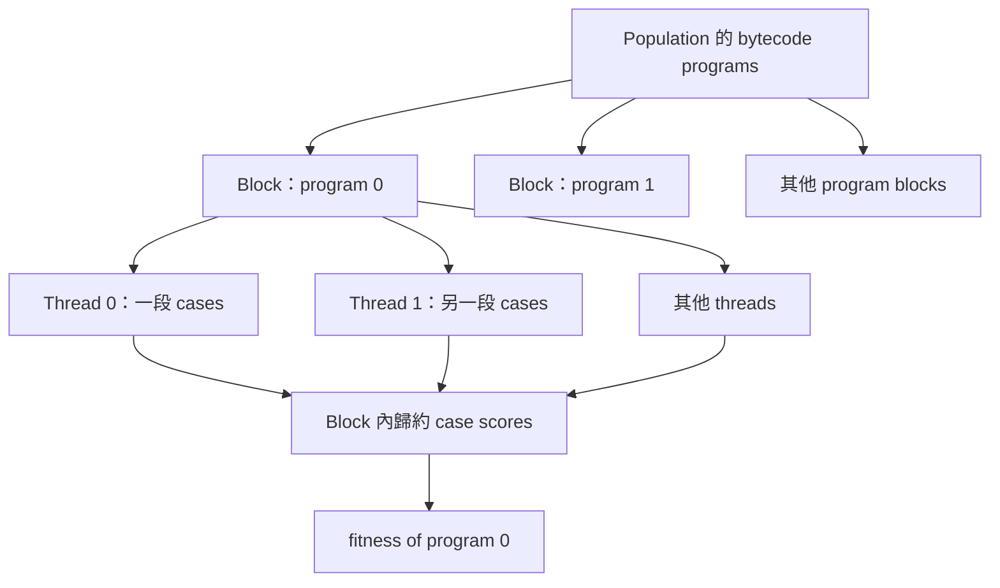

每個 thread 可能處理多個 cases；若 cases 少於 threads，有些 thread 沒有 case 工作。每次 execution 都有獨立的 locals、stack、remaining fuel 和 scratch 狀態。

### 20.2 FitnessSessionGpu 的兩段生命週期

**初始化**：

1. 驗證 cases 數量、expected 數量、blocksize。
2. 選 CUDA device。
3. Pack shared case locals 與初始化狀態。
4. 記錄／準備 shared payload tokens。
5. Upload 可跨 evaluation 使用的 cases 與 expected values。

**每次 eval_programs**：

1. CPU 編譯候選 AST，建立 runtime identities。
2. 驗證與 pack programs、constant pools、region phases、metadata。
3. 收集本批需要的 payload closure。
4. 決定 shared memory 與 region workspace。
5. Upload 本批資料。
6. Launch fitness kernel。
7. Copy back 每個 program 的 fitness。
8. 釋放本批短生命週期資源，保留 session 擁有的可重用資源。

### 20.3 一個 Mixed kernel family

程式可以分類成 None／StringOnly／ListOnly／Mixed payload flavors，但目前 production evaluation 使用 Mixed family 覆蓋完整 accepted population，不是依這四種分類拆成四套正式 dispatch。

有 region 的批次會使用支援 region 的 template instantiation；普通批次不把 region workspace 帶進其 call graph。這不等於存在獨立 DC／DP runtime。

### 20.4 Shared memory 在放什麼

Block 會合作將當前 program 的 root instructions 搬到 shared memory；另有 partial fitness scores 供歸約使用。

概念上 shared bytes 與「這批最大 root bytecode 長度 + blocksize 對應的分數空間」有關。Runtime 會對照裝置 `sharedMemPerBlock`，超出就回報錯誤。

因此，沒有一個對所有 GPU 都通用的「只要 AST ≤ 某值就一定能 eval」結論。Lowering 後指令長度、stack、locals、regions 和裝置 shared memory 都要符合。

### 20.5 Reduction 與分支

每個 thread 先累計自己的 case scores，再由 warp／block 路徑完成歸約。Case 內遇到 runtime error 就扣 penalty 並繼續其他 cases。

不同 cases 可能走不同 branch、loop 次數、錯誤位置或遞迴路徑；不能假定一個 block 裡每個 thread 永遠執行完全相同的工作。Fuel 與 finite state bounds 提供的是可控執行契約，不會消除所有 divergence。

### 20.6 Host 編譯也可能平行

GPU 評估前的 host compilation 可在 population 足夠大時採 operation-owned worker team：目前以最多 128 members 的 batch、至多 20 workers，並受 hardware concurrency 限制；小於 32 members 或不適合的 payload scope 使用序列路徑。

Workers 不能隨便把部分結果直接發布。每批 join 後要驗證 payload read snapshots，再依 population 原順序發布。Read conflict 會回到序列準備；重複 key 可共用已編譯結果，但不刪除 population members 的 fitness 工作。

來源：[GPU fitness session](../../cpp/src/runtime/gpu/fitness_gpu.cu)、[kernel mapping](../../cpp/src/runtime/gpu/device/kernels.cuh)、[host pack](../../cpp/src/runtime/gpu/host_pack_gpu.cu)、[dataflow](../design/dataflow.md#bounded-gpu-evaluation-compilation)。

<a id="c21"></a>
## 21. GPU 上的 bounded recursion 與 memo workspace

### 21.1 用明確 frame stack 取代 device recursion

Frame 保存當前 states、prepared values、child results、continuation index 等。執行器像一個手動管理 call stack 的狀態機，在固定格式資料上前進。

這讓 CPU／GPU 能遵循同一個 request order、base／memo order、fuel schedule 和錯誤規則，也避免依賴任意 device recursive call stack。

### 21.2 每個 thread 有自己的 workspace slice

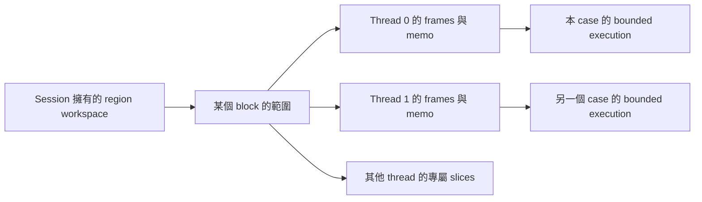

實際 layout 把同一 depth／memo slot 的資料跨 threads interleave，各 thread 以 stride 存取自己那一份。共享配置不等於共享子問題答案。

### 21.3 512 MiB workspace budget 限制的是並行量

Session 根據 batch 中最大 declared frame／memo capacities 估算每 thread、每 block 的 bytes，再決定可同時配置多少 program blocks。

若 program 數超過可同時使用的 blocks，kernel 以 grid-stride program loop 讓同一 block 接續處理更多 programs。因此這個 budget 通常限制**同時活動的 blocks**，不會把某個 plan 的 frames 宣告偷偷砍半。

若連一個 block 的 workspace 都無法配置在這個 budget 內，會明確失敗。每個 region 宣告本身另有 GPU 上限：frames≤128，memo cells≤128。

### 21.4 可重用 allocation，不重用舊答案

同 layout 的 region workspace 可以保留供下一次 evaluation 使用；layout 改變時先釋放舊配置再申請新配置，維持 budget。

但每次 invocation 都要重設 logical frame／memo state。不能把上次 candidate 或上個 case 的 memo results 帶入下一次計算。

### 21.5 Phase 隔離與 payload lifetime

每個 phase invocation 有自己的 operand stack、local state 與 initialized/type masks。Phase 不能重新進入 bounded execution。

Frame 和 memo 存的是 compact Values，不是完整容器。若其中引用字串／串列，對應的 per-invocation payload scratch 必須活到 descendants、memo hit 和回傳值都不再需要它為止。不能因為某個 phase 結束就把其他 frame 還在用的結果清掉。

來源：[GPU region types](../../cpp/include/gagp/runtime/gpu/region_types_gpu.hpp)、[architecture](../design/architecture.md)、[payload ownership](../design/payload.md#bounded-region-results-and-ownership)。

<a id="c22"></a>
## 22. GPU reproduction：哪些事情在 host，哪些在 device

### 22.1 與 GPU evaluation 的工作完全不同

Evaluation 問「這些程式的答案好不好？」；reproduction 問「根據親代和分數，怎麼造下一代？」。

Device 沒有直接讀 grammar JSON，也不在 kernel 中執行完整遞迴 grammar matcher。Host 先將需要的資訊轉為緊湊 tables、candidate sites、compatibility IDs 和 donor pools。

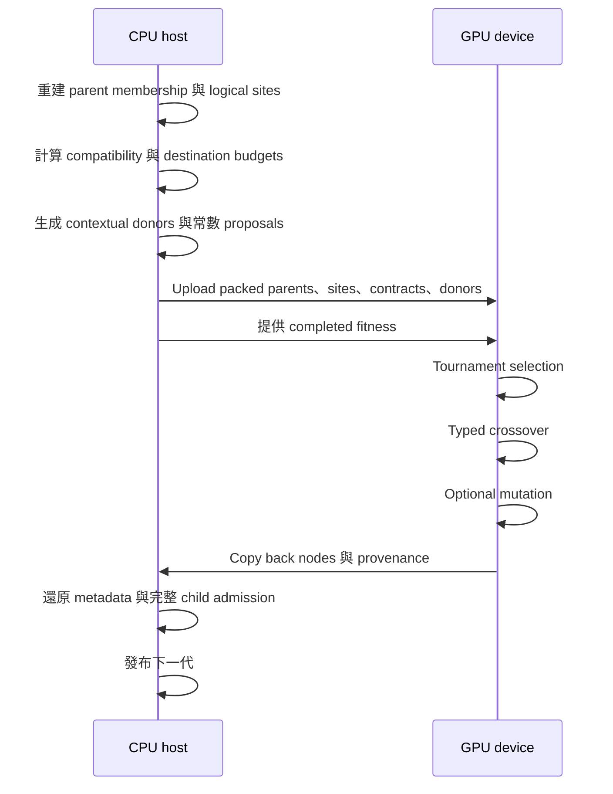

### 22.2 Host preparation 的實際內容

1. 驗證並必要時 compact 親代 name／constant tables。
2. 重建 grammar witnesses，不能依賴 stale attached metadata。
3. 將 repeated-hole occurrences 合併成 logical site。
4. 產生 exact compatibility keys，轉成 dense IDs 供 device 比較。
5. 計算兩方向 replacement budgets。
6. 按 mutation stage 生成帶目的 scope 的 donor pools。
7. 準備常數 domain descriptors 或 sequence proposals。
8. 打包 names、constants、AST nodes 和 region／traversal sidecars。

GPU 使用的是有界候選／donor 資料。CPU 與 GPU 共享契約，不表示兩者 proposal sampling／RNG consumption 完全相同。

### 22.3 Crossover 在 device 上做什麼

Device 選親代和 compatible sites，檢查可在 device 判斷的 budgets，再做 prefix splice。所有 linked occurrences 要一起更新。

Names／constants tables 根據孩子仍引用的內容重建；被剪掉的舊項目不必繼續占用 output slots。浮點常數 identity 保留 signed-zero bits。

複雜 side metadata 的來源資訊會帶回 host，讓 host 能重建 binder mapping、region descriptors 等。這不是在 host 偷偷重新挑一個 crossover site，而是完成 device 已選定操作的表示還原與驗證。

### 22.4 Subtree 與 constant mutation 在 GPU 上不同

| 類型 | Host 提供 | Device 執行 |
| --- | --- | --- |
| Subtree | Contextual donor pools 和契約 | 選 candidate／donor 並 splice |
| Finite scalar | Domain values／policy descriptor | 選值或套用 keep／flip |
| Int／Float range | Numeric sampler／delta descriptor | 在 device 直接抽樣與檢查數值 |
| Sequence constant | 這次 preparation 新抽出的 bounded proposals | 從 proposal 中選值並替換 |

Sequence proposals 不是把整個合法 domain 改成有限集合，也不是一整個 run 永遠使用同一批值。每次 preparation 按 domain 建構新 proposals；多個孩子若選到同一 proposal，可能產生相關性。

GPU `keep` 不需要生成無用 proposal；additive 超出 domain 保留舊值；只有適用的 NoGroups 結果才進入 subtree fallback。

### 22.5 Copyback 後為什麼還要 admission

Device 的局部檢查不能取代完整 grammar membership。特別是 ambiguous derivation、scope remapping、template skeleton 和 projected resource cost，都可能需要 host 的完整重建。

Projected costs 可證明局部不變時，host 可預先打包精確 allowance，讓 device 剪枝；無法證明時，保留 physical-contract 可接受候選，最終在 copyback 檢查，避免錯誤排除合法解。

### 22.6 容量與 fallback

GPU reproduction 目前每個 program 最多 1024 physical AST nodes；name 和 constant tables 各最多 128 entries。這些不是 GPU evaluation 的 stack／local limits。

Packing 檢查來源容量，不截斷 buffers。真實 table exhaustion／非法孩子依契約保留 parent 並記錄 counters，不是改用舊版 CPU reproduction 算一個「看似成功」的孩子。

來源：[GPU reproduction design](../design/gpu-reproduction.md)、[types/capacities](../../cpp/include/gagp/evolution/repro/types.hpp)、[grammar preparation](../../cpp/src/evolution/repro/grammar_prep.cpp)、[GPU launch](../../cpp/src/evolution/repro/gpu/launch.cu)。

<a id="c23"></a>
## 23. Overlap：可以提早做什麼，不能提早做什麼

### 23.1 依賴關係才是核心

Reproduction 的某些前置工作只需要不變的 population 和 grammar，不需要 fitness，例如分析 sites、建立 contracts、生成 donor pools。這部分可以和 evaluation 同時進行。

Selection 要知道誰比較好，必須等 fitness。Crossover／mutation 也必須等 parent choices。因此 overlap 不會讓 selection 用尚未完成的分數。

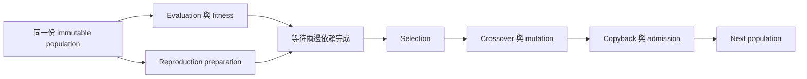

### 23.2 設定條件

主要 overlap 路徑需要：

```text
--engine gpu
--repro-backend gpu
--repro-overlap on
```

單獨把 CPU 路徑的 overlap flag 打開，不會憑空建立一條 GPU overlap pipeline。

### 23.3 為什麼 population ownership 很重要

Evaluation 和 preparation 必須讀同一份不變資料。如果 parent 正在被另一條路徑修改或 payload 已被清掉，準備好的 compatibility／donor 資料就不再可信。

Private overlap continuation 持有它的 immutable population，fitness 完成後只消費一次。若 payload snapshot 改變，需要重新 preparation；外部提供的 prepared replay 也要檢查 identity，不能拿舊 tables 配新 population。

### 23.4 Overlap 的限制

能重疊的是 dependency-independent preparation，不是所有 CPU/GPU 工作；selection、variation、copyback、decode 和 admission 仍有順序。兩條 host 工作也可能競爭 CPU／記憶體，因此不能只看排程圖就宣稱速度一定提高。

本文只解釋機制，不提供未量測的效能結論。

來源：[owned overlap](../../cpp/src/evolution/repro/owned_overlap.hpp)、[lifecycle](../../cpp/src/evolution/lifecycle.cpp)、[dataflow](../design/dataflow.md)。

<a id="c24"></a>
## 24. Payload：字串和串列真正住在哪裡

### 24.1 為什麼 Value 不直接持有 std::string

Value 需要能快速放進 VM stack、constant pool、frame、memo cell，也要能平坦搬到 GPU。`std::string` 或 `std::vector` 內部有 host pointers，不適合原封不動傳到 device。

因此 Value 採 compact、trivially-copyable 表示；目前 static assertion 要求大小不超過 16 bytes。

對容器，`Value.i` 包含高 16 bits 的飽和 length 與低 48 bits 的 deterministic hash；完整內容在另一層儲存。

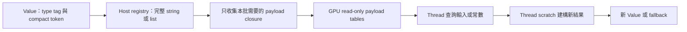

### 24.2 Registry 與 token 的關係

Host registry 以 `(ValueTag, packed token)` 做 key，保存實際 string 或 `vector<Value>`。不同 typed list tag 不會單因 token 相同就當作同一容器。

但是 token 不是不可碰撞的內容地址。48-bit hash 有 collision 可能；若同 tag、length、hash 的不同內容碰撞，registry key 會 alias。這是表示的取捨，不是 cryptographic identity guarantee。

Grammar constants／artifacts／runtime cache 需要真正 decoded content，不能只用這個 token 充當完整語意證據。

### 24.3 Token 活著，不表示內容還活著

清掉 registry 後，原來的 Value token 仍可存在，但 exact payload lookup 已可能失敗。僅用 `shared_ptr` 持有某個 table，也不會自動把 table 引用的 tokens 保留在全域 registry。

`PayloadLifetimeManager` 收集 cases、current population、history best、結果和 GPU run resources 等 roots，`retain_only` 保留可從這些 roots 走到的完整 closure。

StringList 還會引用每個 String 的 token，所以保留外層 list 時也要保留其元素字串。

### 24.4 GPU 不直接讀 host registry

Session 先記 shared case tokens；每次 evaluation 加上本批 program／phase constants，依需要補 host cache，再 pack 成連續 buffers 與 lookup entries upload。

這不是在 session 初始化時把整個 process registry 永久 snapshot 到 GPU。生成新常數之後仍需在下次 evaluation 把所需內容傳入。

### 24.5 Exact path 與 fallback path

| 操作／情況 | 精確內容可用 | 精確內容不可取得或無法 materialize |
| --- | --- | --- |
| String concat／slice／reverse | 建立真實字串 | 可能回傳內部 FallbackToken |
| Typed-list 組合／變換 | 保留真正元素與 tag | 可保留 tag、compact hash／length，但未展開內容 |
| index | 取出真正元素 | 可能回傳 FallbackToken |
| find／contains | 檢查真實字串 | 缺 exact string lookup 時 ValueError |
| Structured exact source access | 讀取合法來源內容 | 規定路徑可報 ValueError |

**Fallback 不等於「換到 CPU 重算」。** 它也不是第九個公開 grammar type。它是目前 runtime 的內部表示／行為邊界，而且不完整保留一般 sequence 語意。

例如先建立一個大 list，只保存 compact representation，再想 index 第 5 個元素，就不能只憑 hash 推導出那個元素。最後 fitness 可能把不同錯誤都視為相同 penalty，因此 fitness parity 不足以證明所有 fallback 行為相同。

### 24.6 平行 donor 的 staged payload transactions

Host workers 若同時生成 string/list constants，會寫入同一 process-global registry。直接邊算邊寫可能造成 read/write interleaving 與碰撞順序差異。

專案使用 thread-local staged writes／captured reads：

1. Worker 先把 payload writes 留在自己的 transaction。
2. Worker lookup 先看私有 writes，再記錄讀到的 committed 值或缺席狀態。
3. 所有 workers join。
4. 單一 lock 下驗證 read dependencies 和 write conflicts。
5. 成功則整批 commit；衝突則全部不發布，按 seed 順序重新序列執行。

這種回退是**host preparation 的一致性恢復**，不是把 GPU reproduction 改成 CPU reproduction。

來源：[payload design](../design/payload.md)、[Value](../../cpp/include/gagp/core/value.hpp)、[registry](../../cpp/src/runtime/payload/payload.cpp)、[lifecycle](../../cpp/src/evolution/lifecycle.cpp)。

<a id="c25"></a>
## 25. 所有重要容量放在同一張表看

這張表說明目前主要可遇到的 limits，不代表所有內部 table 都沒有額外檢查。數字是 implementation profile，未來改版需重新核對。

| 層級 | 目前限制／規則 | 影響 |
| --- | --- | --- |
| Grammar JSON | 每檔 16 MiB；nesting 256；import graph 最多 256 files | 解析／資源管理 |
| Search AST | max_nodes 上限 65,536；max_depth 上限 256 | 通用 construction 上限，不保證 GPU 全可用 |
| Generation | 最多 1,048,576 logical steps | 防止無界推導工作 |
| Membership | 最多 1,048,576 matching steps、4,096 grammar frames | 查詢 exhaustion 是能力上限，不是任意數學不可能性證明 |
| Lowering | 生成 admission 的 lowered instructions 上限 1,048,576 | 包含 root 與 isolated phase code |
| Fuel | 正整數，至多 2,147,483,647 | 每個 case 的 execution allowance |
| Sequence domain | Length endpoints 0–65,536；sample expansion bound 16 MiB | 建構政策；不是 runtime exactness 保證 |
| GPU evaluation stack | 64 Values | Lowered operand stack depth |
| GPU evaluation locals | 每 code object 64 slots | 包含 inputs 與 hidden locals |
| GPU bounded region | 每 region 宣告最多 128 frames、128 memo cells | 超限 before-upload 拒絕，不 clamp |
| GPU region workspace | 512 MiB 預算 | 限制同時配置 blocks；可 grid-stride 處理更多 programs |
| GPU thread payload | 32 entries、512 string bytes、128 list Values | Exact output scratch，不是 shared input 全長上限 |
| GPU shared memory | 裝置能力 + root code + blocksize 所需空間 | 動態檢查，沒有單一跨硬體數字 |
| GPU blocksize | 必須符合 device maxThreadsPerBlock；CLI 預設 1024 | 是 evaluation launch 設定，不是 population size |
| GPU reproduction | 每 program 1024 physical nodes；128 names、128 constants | 與 evaluation 的 64-slot VM 上限不同 |
| Sequence mutation proposals | 至多 1,000,000 prepared values、256 MiB expansion bound | 準備前檢查，不靜默截斷 |
| Population artifact | 1–65,536 members，256 MiB 格式容量 | 特定 artifact 的上限，不是所有 native API 的統一上限 |
| Selected roots | 最多八個、exact result types 不重複 | 保持精確契約，非 Any |

### 25.1 讀表的正確方式

「我的 AST 只有 100 nodes，所以 GPU 一定能跑」是錯的。可能用了太多 simultaneous locals，或 bytecode shared memory 超出，或某個 case 建立太多 payload。

「我的 GPU 很大，能不能把 frames 設一百萬」也不是目前 contract 支援的方式。Device global memory 夠不夠與 descriptor／interpreter profile 支援多少，是不同限制。

### 25.2 設計上還有哪些限制

- Source language 沒有任意函式、class、attribute、I/O、exception、while、break、continue。
- 沒有 generic／heterogeneous／nested lists 或 product types。
- Runtime bodies 不是 first-class closures。
- Bounded phases 不能任意再呼叫 structured recursion。
- 容器 token 有 hash collision／saturated length 的表示風險。
- Payload fallback 不完全保留 exact semantics。
- 字元／字串 Unicode 行為有已知實作落差。
- 相同 seed 的跨 backend evolution trajectories 不作一般相等保證。
- 相同初代重播不等於演化中途 checkpoint／resume。

上述限制有些是語言選擇、有些是格式與實作容量、有些是已知缺口，不能全部歸因為「GPU 本來就做不到」。

來源：[grammar definition](../../spec/grammar_definition.md)、[GPU constants](../../cpp/include/gagp/runtime/gpu/constants_gpu.hpp)、[GPU repro types](../../cpp/include/gagp/evolution/repro/types.hpp)、[GPU reproduction](../design/gpu-reproduction.md)。

<a id="c26"></a>
## 26. Identity、cache 與 RNG：可重現性到底保證什麼

### 26.1 不只一個 hash

| Identity | 必須辨識的內容 | 不應混用 |
| --- | --- | --- |
| Grammar identity | Resolved source content、schema/catalog/normalization 等版本 | 不等於檔案路徑 |
| Generation identity | Grammar、request、scope、stage、limits、input schema、generator/RNG、payload policy | 不只是 seed |
| Runtime compilation identity | 具體 AST 語意、decoded constants、inputs、fuel、compiler/ISA semantics | 不應因無關 package 檔名或 sampling weights 改變 |
| Variation analysis identity | 實际 AST、grammar/request set、scope、destination budgets、payload validity | 不可相信 stale attached witness |
| Payload compact token | Tag、hash48、length | 不可當成 lossless semantic identity |

改一個 production weight，會改 construction identity；如果某個已 materialized AST 完全沒變，它的 runtime behavior 不會因 weight 改變。這就是必須分開 cache 層次的原因。

### 26.2 Compilation cache 不等於 fitness cache

同一個 AST 重複出現，可避免重複編譯，但 population 中每個位置仍存在，fitness vector 仍須與 population 對齊。

也不要假設所有 cache 都跨代永久存在。`compile_population` 接受可選 cache；主路徑未提供共享 cache 時使用該次呼叫的 local cache。Variation／GPU run resources 另有自己的 bounded cache 與生命週期。

### 26.3 RNG 不只有一條

Grammar generation 使用有版本的 `splitmix64-rejection-v1` 取樣契約，当前 native validation 會回報 generator version。演化 orchestration 也有自己的 seed schedule，例如 `std::mt19937_64` 驅動 selection／operator seed 分配。

一般初代每個 member 的 seed 按 base seed 加 index、模 2^64 建立。Contextual donors、operators 和 GPU kernels 另按各自契約消費隨機值。

**同 seed + 不同 backend + 不同候選準備方式，不代表同樣 RNG trajectory。** 即使單次 Float sampler 對同一 RNG word 能 bitwise 一致，整場 evolution 消費的 word 順序仍可能不同。

### 26.4 Overlap on/off 的順序一致性

目前 GPU reproduction 的 direct 與 overlap 路徑都使用 original population order 對齊 raw fitness；排名 view 只用於 reporting 等用途。

否則 direct 先排序親代、overlap 還沒分數先用原順序準備，就會讓同一 tournament index 指到不同 member。這種 ordering 是 reproducibility 的一部分，不是只有 seed 要相同。

### 26.5 三種不同的「一致」

1. **程式語意一致**：同 AST、input、fuel 在支援路徑產生相同 result/error/fuel 行為。
2. **算子契約一致**：CPU／GPU 都遵守型別、scope、budget、membership 等規則。
3. **整個搜尋軌跡相同**：每次 parent、site、donor、constant 都逐項相同。

前兩者是重要契約；第三者不是所有 backend 組合的一般承諾。評估 parity 測試通過，也不能直接延伸成不同 reproduction backend 的完整 RNG identity。

<a id="c27"></a>
## 27. Artifacts、serialization、replay 與 migration

### 27.1 格式總覽

| 名稱 | 內容／用途 | 是否直接代表搜尋空間 |
| --- | --- | --- |
| `grammar-definition-v2` | 規則、domains、templates、limits | 是 |
| `grammar-generated-v2` | 一個 generated member，含 resolved grammar、seed、request、AST 與 provenance | 內嵌生成所需資訊 |
| `grammar-population-v2` | 多個完整 generated members 的初代 population | 以 members 保留 identity |
| `grammar-materialized-v2` | 遷移後具體程式與執行契約 | 不主張能還原舊版生成歷史 |
| `ast-prefix-v2` | 原生程式 AST | 否；需另做 grammar membership |
| `bytecode-json-v2` | Runtime request 與可執行 bytecode | 否 |
| `bytecode-fixture-v2` | Runtime 測試 fixtures，含預期 Value 或 error | 否 |
| `fitness-cases` | 輸入與期待答案 | 定義任務，不定義 grammar |

### 27.2 Generated member 保存哪些資訊

包括 resolved grammar/hash、generator/RNG/runtime versions、seed、ordered input schema/hash、return type、search limits、execution fuel、payload policy、AST shape、detached constants 和 derivation。

Constant pool 使用 decoded、lossless content，而不是將 process-global payload token 存成可攜資料。AST shape 中的 constant table 為空，另有單一 detached constants pool，避免雙重來源。

`domain-only-v1` 表示常數從宣告 domain 取得，expected answers 不會偷偷注入 constant pool。這對資料洩漏與任務設定很重要：cases 定義目標，不自動變成 ERC 候選。

### 27.3 Same-version replay 比 JSON decode 更嚴格

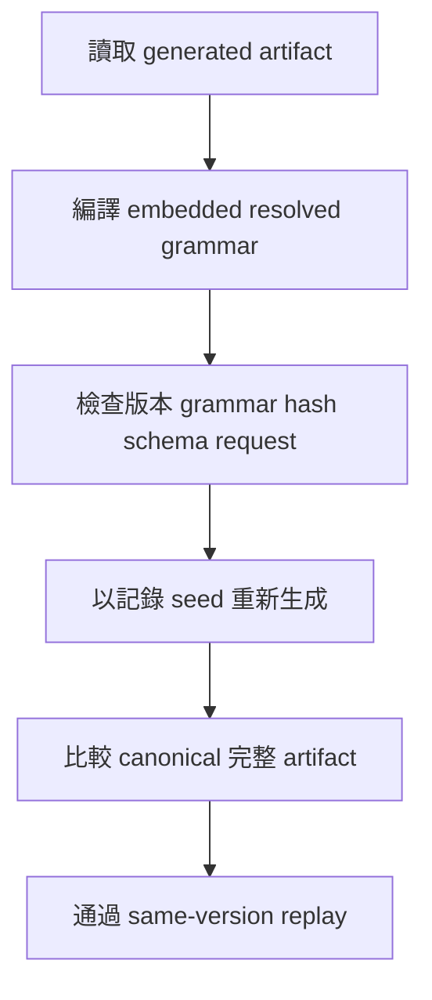

修改 AST 但保留舊 provenance，不能只靠「JSON 還能 parse」就通過 replay。另一方面，replay 證明的是內部可重現，不是數位簽章；一份自行修改但自洽且能重新生成的 request，不等於有來源 authenticity。

### 27.4 Population artifact 是初代 replay，不是任意 checkpoint

`grammar-population-v2` 的 root fields 是 `format_version`、`grammar_hash`、`count`、`members`。Members 是完整 generated artifacts。

此格式重建的是 generated initial population。任意 crossover／mutation 過的 final population 不一定保有可由原 seed regenerate 的 provenance，所以不能把它當作已支援任意 evolution checkpoint／resume 的格式。

要暫存後續 AST 供執行，和要保存完整演化狀態以 resume，是兩個不同功能需求。

### 27.5 Materialized execution 不要求 grammar 檔案存在

單獨 evaluate 一個已保存的 AST／generated／materialized member，只需要能恢复原生程式與正確執行契約，不必重新生成 grammar。

但要把它加入 constrained evolution population，就必須有 active compiled grammar 並通過 membership。**能執行不等於能作為某 grammar 的親代。**

### 27.6 Release-1 migration

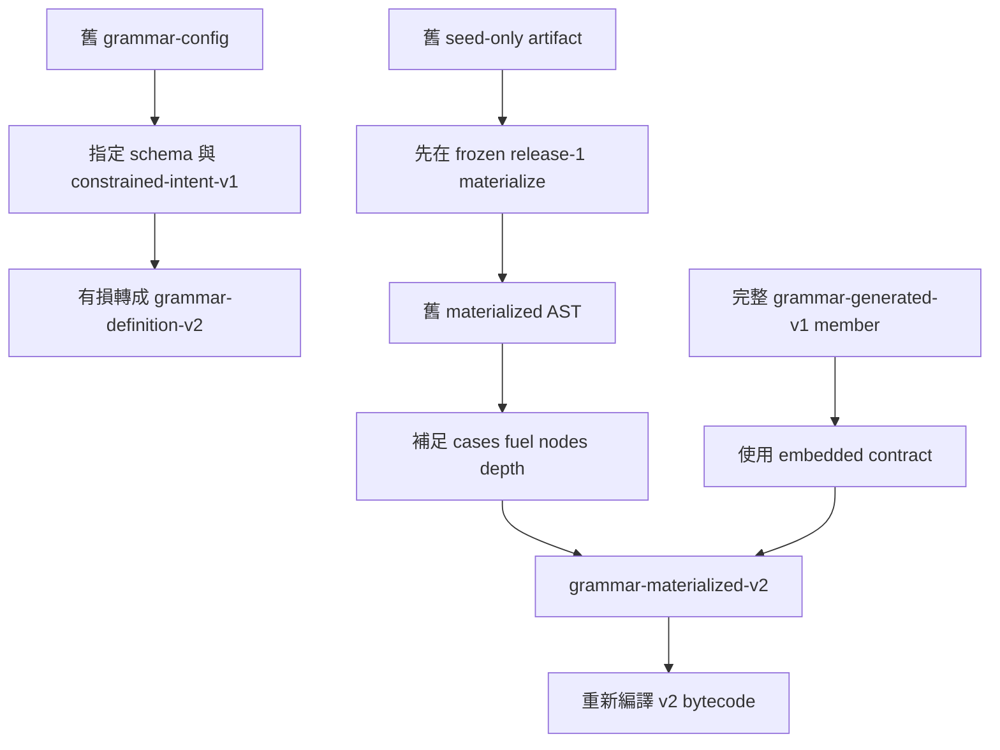

舊 grammar-config 缺少新格式所需的精確 domains、scopes、typed environments 等資訊，因此只保留可表達的 intent，不能主張完全相同的 search process。

舊 bytecode 缺乏源碼 AST、type/scope 與 derivation 資訊，沒有直接轉回完整 v2 AST 的通道。需轉原始 materialized AST 再編譯。V1 population container 則要拆 complete members 各自遷移。

Migration 的 `typed_storage` helper 可做 reaching-definition 分析與名字正規化，但不是 production evolution 的隱式轉換。`cpp/src/transition/`／`migration/` 是離線隔離區，不是常態 runtime 的暗中相容分支。

來源：[artifact spec](../../spec/grammar_definition.md#generated-artifacts)、[grammar artifact guide](grammar-config.md)、[migration spec](../../spec/grammar_config.md)。

<a id="c28"></a>
## 28. CLI：把設定對應到執行行為

### 28.1 四個主要 native commands

| 執行檔 | 用途 |
| --- | --- |
| `gagp_grammar_cli` | validate／inspect／resolve grammar |
| `gagp_generate_cli` | 生成或 same-version replay population |
| `gagp_evolve_cli` | Evolution、固定 population 起跑、單 AST evaluation |
| `gagp_migrate_artifact` | 離線 release-1 轉換 |

注意 `gagp_evolve_cli` 和 migrate CLI 沒有一般 `--help` 模式；查 [維護中的 CLI reference](../reference/cli.md)。Grammar／generate CLI 則支援自己的 help。不要假設所有 binary 的 options 一樣。

### 28.2 常用 evolution 設定

| 選項 | CLI 預設／作用 | 初次使用的判讀 |
| --- | --- | --- |
| `--cases` | 必要 | 定義 task |
| `--grammar-definition` | evolution 必要 | 定義 search space |
| `--population-size` | 64 | 生成初代數量；有 replay artifact 時按該路徑契約處理 |
| `--generations` | 40 | 評估／reproduction 迴圈次數 |
| `--selection-pressure` | 2 | Tournament size |
| `--mutation-rate` | 0.5 | 每個 crossover child 嘗試 mutation 的機率 |
| `--mutation-subtree-prob` | 0.8 | Mutation 裡選 subtree 分支的偏好 |
| `--penalty` | 1.0 | Runtime errors／mismatch 與 numeric error cap |
| `--seed` | 0 | Orchestration RNG seed |
| `--engine` | cpu | Fitness backend |
| `--repro-backend` | cpu | Reproduction backend |
| `--repro-overlap` | off | 符合條件時排程重疊 |
| `--blocksize` | 1024 | CUDA evaluation threads per block |
| `--show-program` | none | 可改 ast／bytecode／both |
| `--retain-final-population` | off | 是否 materialize 完整 final scored population |
| `--skip-final-eval` | off | 是否跳過最後產生的 population 的 evaluation |
| `--out-json` | 未指定 | 可保存結構化結果 |

Native `EvolutionConfig` 的某些預設與 CLI 不完全一樣，例如 native `retain_final_population` 預設為 true，而 CLI 預設 off。嵌入 C++ API 時要讀 header，不要把 CLI table 當成所有 API 的唯一 default。

### 28.3 Grammar limits 是權威

`--fuel`、`--max-expr-depth`、`--max-total-nodes` 若明確傳入，必須與 active grammar 的限制相等，不能把它們當成臨時覆蓋 grammar 的捷徑。

想改合法搜尋範圍，應修改 grammar、重新 validate，並接受 identity 隨之改變。

### 28.4 三種常用 backend 組合

```bash
# CPU evaluation + CPU reproduction
--engine cpu --repro-backend cpu --repro-overlap off

# GPU evaluation + CPU reproduction
--engine gpu --repro-backend cpu --repro-overlap off

# GPU evaluation + GPU reproduction + preparation overlap
--engine gpu --repro-backend gpu --repro-overlap on
```

第二個組合適合先隔離 evaluation backend；第三個才同時走 GPU reproduction。也可關掉第三個的 overlap，觀察相同 GPU 後端的同步流程。

### 28.5 單程式執行與 replay

單 AST／generated artifact evaluation 使用 `--eval-ast-json`，目前該路徑在 CPU 執行。Artifact 的 recorded fuel 會被保留；顯式衝突 fuel 會拒絕。

Population replay 範例：

```bash
cpp/build/release/gagp_generate_cli \
  --replay-json /tmp/gagp-guide.population.json \
  --grammar-definition configs/grammar/examples/authoring/scalar.json \
  --cases docs/presentations/customizable-grammar/double.cases.json \
  --out-json /tmp/gagp-guide.replayed.json

cmp /tmp/gagp-guide.population.json /tmp/gagp-guide.replayed.json
```

Replay 不接受用 size／seed override 把原 artifact 偷改成另一個生成請求。Mixed roots 必須提供相應的 root selection。

### 28.6 結果讀取與診斷

STDOUT 的 GEN／FINAL 讓你看本代與最後結果；JSON metadata 記錄 grammar identity、versions、settings 和 timing 等資訊。`--show-program` 可讓你真正檢查 AST 或 bytecode，不要只看一個 fitness 數字。

Timing 是診斷欄位，本文不比較其數字。重疊階段不能直接相加當 wall time；不同 init、generation、final evaluation scopes 也不能混用。正式欄位說明在 [timing reference](../reference/timing.md)。

### 28.7 實驗性 ablations

`--cpu-repro-ablation` 支援 `none`、`gpu_selection`、`gpu_candidates`、`gpu_coupled_donor`，且要求 CPU reproduction。

它們用於分離 selection、candidate／donor proposals 等影響，不是一般使用者需要開啟的「加速等級」。尤其 coupled-donor subtree mutation 可回到原 parent 的 crossover site，不能誤當與標準 post-crossover subtree mutation 完全相同。

<a id="c29"></a>
## 29. Build、安裝、CUDA 裝置與本機開發

### 29.1 CPU-only 初次建置

沒有 CUDA 時明確關閉，不要期待 configure 靜默跳過 GPU：

```bash
cmake -S cpp -B cpp/build/cpu \
  -DCMAKE_BUILD_TYPE=Debug -DGAGP_ENABLE_CUDA=OFF
cmake --build cpp/build/cpu -j
ctest --test-dir cpp/build/cpu --output-on-failure
```

第 7 章命令的 `B` 要改成 `cpp/build/cpu`。CPU build 不能執行要求 GPU backend 的命令。

### 29.2 CUDA build

```bash
cmake -S cpp -B cpp/build/release \
  -DCMAKE_BUILD_TYPE=Release -DGAGP_ENABLE_CUDA=ON
cmake --build cpp/build/release -j
```

若 nvcc 不在 PATH，另提供你機器上的 `-DCMAKE_CUDA_COMPILER=...`。若設定 CUDA architectures，需匹配實際裝置；本文件不替所有機器固定某個 sm 值。

CUDA 預設啟用，找不到 compiler 時 configure 會失敗，這是避免「以為跑了 GPU tests，實際根本沒建」的明確邊界。

### 29.3 Presets 與選配 targets

| Preset／option | 用途 |
| --- | --- |
| debug | Debug + CUDA parity 開發 |
| release | Release + CUDA |
| cuda-parity | Debug 的 GPU parity gate |
| sanitizer | CPU-only ASan／UBSan |
| fuzz | Clang libFuzzer、CPU-only |
| GAGP_BUILD_BENCHMARKS | 選配 native benchmark binaries |
| GAGP_BUILD_EXPERIMENTS | 選配 diagnostic probes |
| GAGP_ENABLE_OPENSSL_SHA256 | 可使用 system OpenSSL Crypto；沒有時用內建 SHA-256 |

兩種 SHA-256 implementation 必須得到相同 identity，artifact 不因是否裝 OpenSSL 而改變。

### 29.4 裝置選擇

GPU-capable native paths 會選擇較空閒的 visible CUDA device。若想指定可見裝置索引：

```bash
GAGP_CUDA_DEVICE=0 cpp/build/release/gagp_evolve_cli \
  --grammar-definition configs/grammar/examples/authoring/scalar.json \
  --cases docs/presentations/customizable-grammar/double.cases.json \
  --engine gpu --repro-backend gpu --repro-overlap on \
  --population-size 16 --generations 2 --seed 7
```

此索引是當前可見裝置的索引，不必然等於你對實體 PCI 裝置的其他編號。Profile 按 repository 規則使用 `nsys`，不使用 `ncu`。

### 29.5 哪些修改要 rebuild

- C++／CUDA／CMake：需要 rebuild。
- Grammar JSON：重新啟動 validate／generate／evolve 即可，不需要 rebuild。
- Cases JSON：重新讀入命令即可；需符合原 grammar schema。
- Python tools：editable install 下直接使用變更後程式，但語意檢查仍委派 native。

來源：[development guide](development.md)、[CMake presets](../../cpp/CMakePresets.json)。

<a id="c30"></a>
## 30. Python tools、PSB、fixtures 與資料管理

### 30.1 安裝與責任分工

```bash
python3 -m venv .venv-tools
.venv-tools/bin/pip install -e tools
.venv-tools/bin/gagp-tools --help
```

工具是依責任拆成 datasets、experiments、reports、shared 的 Python package，保留的 `tools/*.py` 是相容 entry wrappers，不是另一份重複實作。

| 命令群 | 解決什麼問題 |
| --- | --- |
| grammar init | 複製 checked starter；scalar、sequence、template、memo |
| grammar validate／inspect／resolve | 呼叫 native authoring diagnostics |
| grammar migrate | 呼叫離線 migration |
| psb fetch | 取得上游 PSB 資料 |
| psb convert／materialize | 轉成 exact typed fitness-cases |
| benchmark population | 生成可固定重播的 population artifact |
| psb run | 排程多任務／seed 的 native runs |
| psb compare | 驗證 metadata 相容後做回歸判讀 |
| report ...-manifest | 把 reviewed raw outputs 整理成 compact evidence |

### 30.2 PSB 流程


這裡 PSB 是程序合成任務資料來源。它提供 cases，不會自動決定一份最適合的 grammar。每個不同 input／output schema 要匹配相應 definition。

### 30.3 為什麼 empty list 不能靠猜

Raw JSON 的 `[]` 看不出是 IntList、FloatList 或 StringList；`[1,2]` 也可能是某個問題刻意定義的 FloatList。Converter 必須使用 per-problem schema，不能靠 active grammar 猜值型別。

Cases codec 中 `{"type":"float_list","value":[1,2.5]}` 會把兩個元素都 decode 成 Float；這是 fixture tag 的明確解碼，不是 runtime list 的隱式 promotion。

Generated fixtures 會保留 suite、problem、source files、sampling seed、split、schema hash 和 field schemas 等 provenance。

### 30.4 Train／test 的解讀

Evolution fitness 通常用 train cases。Test cases 是另一套評估，不會因為檔案存在就自動報告；runner 需明確要求 test evaluation 且 schema 相容。

Training solved 不等於 test solved，也不等於 general correctness proof。這個專案的案例分數只回答「在這批指定 cases 上表現如何」。

### 30.5 產物應放在哪裡

| 位置 | 資料角色 |
| --- | --- |
| `configs/` | 版本控制中的輸入政策、grammar 與 schemas |
| `data/psb*_datasets/` | 下載的原始 mirror |
| `data/fixtures/` | Native runtime 能直接讀的 fixtures |
| `logs/` | Raw runs、臨時 grammar、profiler output 等生成物 |
| `benchmarks/` | 精簡、經整理的 manifests 與 spec freeze 資訊 |
| `docs/refactor/`、部分 reference records | 歷史變更證據，不是目前所有介面的權威 |

本文不展開量測比較，但解釋這些工具的存在是為了讓你能辨認完整 repository 的資料流和責任。

來源：[tools README](../../tools/README.md)、[PSB workflow](psb-workflow.md)、[tooling inventory](../reference/tooling.md)。

<a id="c31"></a>
## 31. 測試系統：什麼證據能支持什麼結論

### 31.1 五個測試層

| 位置 | 重點 | 不能取代什麼 |
| --- | --- | --- |
| `cpp/tests/runtime/` | Values、builtins、VM、fuel、codec、CLI、payload | 不等於演化整條路徑已通過 |
| `cpp/tests/evolution/` | Grammar compile/generation/membership、scope、variation、engine | 不等於 device transport／kernel 一定正確 |
| `cpp/tests/gpu/` | GPU execution、splice、mutation、bounded results、payload stress | 不等於所有任意 grammar 都在容量內 |
| `cpp/tests/parity/` | CPU/GPU fitness 與受控 evolution parity | 不等於不同 reproduction RNG 必然相同 |
| `tools/tests/`、`tests/repository/` | 作業工具、metadata、文件連結、layout、spec freeze、核心隔離 | 不執行全部 runtime 語意 |

### 31.2 Contract、property、parity 各在檢查什麼

- **Contract test**：指定輸入必須產生指定結果／錯誤／metadata。
- **Property test**：大量組合下應保持不變條件，例如 progress、scope、合法 splicing。
- **Parity test**：相同被比較物在 CPU／GPU 等路徑的可觀測行為是否一致。
- **Fuzz**：對 decoder／verifier 注入不規則輸入，找 crash、越界與未受控錯誤。
- **Stress**：反覆 evolution／payload churn 後仍維持生命週期與 admission。

### 31.3 常用命令

```bash
ctest --test-dir cpp/build/release --output-on-failure

ctest --test-dir cpp/build/release -L contract --output-on-failure
ctest --test-dir cpp/build/release -L property --output-on-failure
ctest --test-dir cpp/build/release -L cpu_gpu_parity --output-on-failure

ctest --test-dir cpp/build/release \
  -R 'gagp_test_vm_gpu_smoke|gagp_test_fitness_cpu_gpu_parity|gagp_test_evolution_cpu_gpu_parity' \
  --output-on-failure

python3 -m unittest discover -s tools/tests -p 'test_*.py' -v
python3 -m unittest discover -s tests/repository -p 'test_*.py' -v
```

Build directory 要換成實際配置。CPU-only build 沒有某 GPU test，不等於 GPU test 通過。可先用 `ctest --test-dir ... -N` 看已註冊項目。

### 31.4 GPU parity 要看什麼

對純量精確路徑，至少看 value／error；bounded region 再看 fuel、request/error order、phase isolation；sequence 路徑還要看 exact payload 或 fallback 的種類與 tag。

例如兩個後端都得到 fitness=-1，可能是一邊 Timeout、一邊 index fallback。它們在 score 上相等，但不代表 execution behavior 相等。

### 31.5 Spec freeze 的角色

`benchmarks/spec_freeze.json` 保存 normative specs 的 hashes。語意修改應同時更新對應 spec、conformance tests 和 freeze manifest，而不是只改 C++ 再讓舊 spec 漂移。

來源：[development tests](development.md#test-layers)、[native tests](../../cpp/tests/)、[repository checks](../../tests/repository/)。

<a id="c32"></a>
## 32. 故障排查：從症狀找到正確層

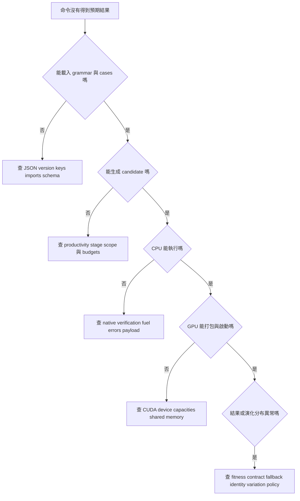

| 症狀 | 常見原因 | 下一步 |
| --- | --- | --- |
| Unknown exact primitive overload | Signature 拼字／型別組合不在 catalog | 查 exact overload，勿只看函式名稱 |
| Missing／unknown hole | Template invocation 沒填齊，或名稱寫錯 | 對照 holes declarations |
| Scope mismatch | Donor 需要不存在的 bound name | 查目的 hole／rule scope 與 bind mapping |
| Cannot fit budget | Envelope／fixed copies／siblings 最低成本超出 | 用 inspect 看 minimum costs，重算完整 AST |
| Grammar hash mismatch | 改了權重、domain、transitive source 或版本 | 不要混用舊 artifact identity |
| Replay rejected | AST／constant／request／provenance 已改或版本不同 | 分清 replay 與 materialized execution |
| Unknown `--grammar-config` | 使用 release-1 介面 | 用 v2 definition；舊資料離線 migrate |
| CUDA configure 失敗 | nvcc 不可用或選錯 toolchain | 明確指定 compiler 或 CPU-only |
| GPU program capacity error | Locals／stack／region／repro 資源超出 | 先確認是 eval 還是 repro 的限制 |
| Shared memory exceeded | Root bytecode／blocksize 所需空間超出裝置 | 查 lowered code 與裝置 profile |
| 許多 Timeout | Fuel、frames 或 memo cells 不夠 | 看是哪種資源；不要一律只加 fuel |
| String/list 結果怪異 | Exact payload 缺失、scratch 滿、Unicode 行為 | 對較小 ASCII case 做 exact result 檢查 |
| Mutation 常常 unchanged | keep、重抽相同值、additive 越界、窄 grammar | 看 domain policy 與 counters |
| GPU 很多 host 工作 | Prepare、pack、compile、admission 本來在 CPU | 沿 eval/repro 分別定位，不把它當作意外 fallback |
| Final best 比歷史某代差 | 無自動 elitism／best-ever 注入 | 同時讀 history，或明確設計 retention policy |
| 換 backend 後軌跡不同 | Proposals／RNG consumption 不同 | 先確認語意／admission，再討論 trajectory |

更完整命令層恢復流程：[Troubleshooting](troubleshooting.md)。

<a id="c33"></a>
## 33. 想改某個功能時，從哪裡讀程式

這張表是讀碼入口，不把所有細節重新複製成第二份規格。

| 想理解／修改 | 主要入口 | 應一起看的測試 |
| --- | --- | --- |
| CLI flags 與命令 dispatch | [options.cpp](../../cpp/src/cli/options.cpp)、[commands.cpp](../../cpp/src/cli/commands.cpp) | test_cli_options、CLI contract |
| Grammar JSON 與 imports | [definition.cpp](../../cpp/src/evolution/grammar/definition.cpp)、[identity.cpp](../../cpp/src/evolution/grammar/identity.cpp) | test_grammar_definition、artifact tests |
| Primitive signatures | [catalog.cpp](../../cpp/src/evolution/grammar/catalog.cpp) | test_grammar_catalog |
| Compile grammar tables | [compiled.cpp](../../cpp/src/evolution/grammar/compiled.cpp) | test_grammar_compiled、request／frame tests |
| 生成與 budget | [generate.cpp](../../cpp/src/evolution/grammar/generate.cpp)、[budget.cpp](../../cpp/src/evolution/grammar/budget.cpp) | generation、sequence constants |
| Membership | [membership.cpp](../../cpp/src/evolution/grammar/membership.cpp) | membership、witness、template／bounded membership |
| AST node 與 verification | [node_descriptor.cpp](../../cpp/src/evolution/node_descriptor.cpp)、[ast_type_verify.cpp](../../cpp/src/evolution/ast_type_verify.cpp) | ast_verify_structure／types／exact_scope |
| Lowering | [compiler.cpp](../../cpp/src/evolution/compiler.cpp) | compiler_lowering、bounded compile、fuel preservation |
| CPU VM | [execute_bytecode_cpu.cpp](../../cpp/src/runtime/cpu/execute_bytecode_cpu.cpp) | runtime scalar／control／region contracts |
| CPU builtins | [builtins_cpu.cpp](../../cpp/src/runtime/cpu/builtins_cpu.cpp) | builtin_arguments、typed values、parity |
| GPU evaluation | [fitness_gpu.cu](../../cpp/src/runtime/gpu/fitness_gpu.cu)、[device directory](../../cpp/src/runtime/gpu/device/) | vm_gpu_smoke、fitness parity、GPU results |
| Selection | [selection.cpp](../../cpp/src/evolution/selection.cpp) | evolution pipeline／parity |
| CPU／通用 variation | [variation.cpp](../../cpp/src/evolution/grammar/variation.cpp)、[crossover.cpp](../../cpp/src/evolution/grammar/crossover.cpp)、[mutation.cpp](../../cpp/src/evolution/grammar/mutation.cpp) | variation_contract、crossover、mutation、fallback |
| GPU preparation | [grammar_prep.cpp](../../cpp/src/evolution/repro/grammar_prep.cpp)、[constant_prep.cpp](../../cpp/src/evolution/repro/constant_prep.cpp) | grammar_repro_prep、constant_prep |
| GPU packing／decode | [pack.cpp](../../cpp/src/evolution/repro/pack.cpp)、[compiled_decode.cpp](../../cpp/src/evolution/repro/compiled_decode.cpp) | compiled transport／splice／backend |
| Device reproduction | [GPU reproduction directory](../../cpp/src/evolution/repro/gpu/) | atomic_splice、compiled_mutation、compiled_variation |
| Evolution／overlap | [evolve.cpp](../../cpp/src/evolution/evolve.cpp)、[owned_overlap.hpp](../../cpp/src/evolution/repro/owned_overlap.hpp) | evolution_pipeline、grammar_reproduction、stress |
| Payload | [payload.cpp](../../cpp/src/runtime/payload/payload.cpp)、[lifecycle.cpp](../../cpp/src/evolution/lifecycle.cpp) | payload_registry／staging、compiled_payload_evolution_gpu |
| Offline migration | [migration directory](../../cpp/src/migration/) | migration boundary、typed_storage、CLI migration |
| Python workflow | [gagp_tools package](../../tools/gagp_tools/) | tools/tests 對應模組 |

### 33.1 只增加一個 grammar package

如果只是把既有 primitives 組成新形狀，通常不需要修改 runtime。新增 package、runnable root、paired cases，驗證 generation／membership／variation／replay 即可。

不要為了「讓某個 package 能跑」在 runtime 加 `if package_name == ...`；這破壞共用語意與 package-independent execution。

### 33.2 新增 primitive

先決定精確參數／result types、錯誤、fuel、payload 行為，再更新 catalog、node／builtin／opcode 對應、AST verification、lowering、CPU／CUDA execution、serialization 和 tests。

不一定每個 primitive 都需要新 opcode；能降低成現有共同操作時，應先評估該方式。但無論採哪種表示，都要有完整 contract，不能只讓 CPU 回傳正確而忽略 GPU／artifact。

### 33.3 修改 reproduction

先問你改的是「合法性」、「proposal distribution」還是「排程」。

- 改合法性：需要更新 grammar／variation contract 與 membership tests。
- 改分布：需要描述 candidate／donor／RNG 意義，即使最後孩子全部合法，也可能改搜尋偏好。
- 改排程：需保留來源順序、seed consumption、snapshot ownership、transaction publication。

看到輸出都通過 type check，還不足以證明 proposal distribution 或 replay behavior 未改變。

### 33.4 修改文件與權威來源

Spec 放語意，design 放實作責任，guide 放使用流程，reference 放已核對的介面／layout。維護新路徑與連結時更新 docs index；不要讓歷史報告成為現行行為的唯一說明。

<a id="c34"></a>
## 34. 三個常被漏掉的系統工程細節

### 34.1 多執行緒工作的提交順序

Host compilation、parent warm-up、child decode、donor generation 都可能平行，但「可以平行算」不代表「可以任意順序提交」。

需要維持：

- Exceptions 依原 population／seed 順序報告。
- 每批完成才發布可見 cache entries。
- Compatibility IDs 依穩定 site order intern。
- Payload reads/writes 經 snapshot／transaction 驗證。
- Call 結束或 exception unwinding 前 join 所有 workers。

這也是為什麼文件中的 host preparation 比單純一個 kernel launch 複雜。

### 34.2 私有 owned 快速路徑與公開 API 邊界

若某個內部 continuation 明確擁有 immutable parents、requests、prepared tables，就能在證據仍有效時重用分析，少做重複工作。

公開 API 面對任意 caller-provided data，不能因為「通常上一步剛驗證」就省略 identity／ownership 檢查。更換 payload、budget、root request 或 grammar，都可能讓舊 prepared resources 無效。

換句話說，效能優化依靠的是**可證明不變的資料生命週期**，不是普遍關閉 validation。

### 34.3 相同輸出不代表相同搜尋算子

CPU／GPU 都產生合法 children、甚至最終 best fitness 一樣，仍可能有不同的 candidate cap、donor correlation、constant sampling law 或 RNG ordering。

對熟悉 GA／GP 的讀者，應把系統分成兩個檢查面：

1. **Semantic correctness**：程式是否合法、執行結果／錯誤是否符合契約。
2. **Search-process characterization**：哪些候選被提議、抽樣機率、fallback 與 seed trajectory 如何形成。

本專案提供 shared contracts 和檢查機制，但不能把 correctness test 通過直接當作所有 backend 的 search distribution 相同。

<a id="c35"></a>
## 35. 再做兩個完整練習：Traversal 與 Template

下面提供兩份完整 grammar。它們使用固定或很小的選擇集合，目的在於把 schema 與執行概念連起來；要變成有意義的 GP 任務，下一步是增加可演化的 alternatives，並用多組 cases 評估。

### 35.1 練習 A：IntList 加總

這份 grammar 只允許一種演算法：從 0 開始，把每個元素加進 accumulator。它示範真正的 traversal signature、bind 和 helper scope。

```json
{
  "format_version":"grammar-definition-v2",
  "entry":{"nonterminal":"Tutorial.Sum","type":"Int"},
  "inputs":[{"name":"xs","type":"IntList"}],
  "search_limits":{"max_nodes":32,"max_depth":12},
  "execution_limits":{"fuel":512},
  "nonterminals":[
    {
      "id":"Tutorial.Sum","type":"Int","scope":[],
      "alternatives":[{
        "id":"fold","weight":1,
        "expression":{
          "signature":"traverse(IntList,Int,Int,Int)->Int",
          "args":[
            {"input":"xs"},
            {"constant":{"type":"Int","values":["0"]}},
            {"constant":{"type":"Int","values":["0"]}},
            {"ref":"Tutorial.Step"}
          ],
          "bind":{"3":["element","index","acc"]}
        }
      }]
    },
    {
      "id":"Tutorial.Step","type":"Int",
      "scope":[
        {"name":"element","type":"Int"},
        {"name":"index","type":"Int"},
        {"name":"acc","type":"Int"}
      ],
      "alternatives":[{
        "id":"add_element","weight":1,
        "expression":{
          "signature":"add(Int,Int)->Int",
          "args":[{"bound":"acc"},{"bound":"element"}]
        }
      }]
    }
  ]
}
```

對應 cases：

```json
{
  "format_version":"fitness-cases",
  "cases":[
    {"inputs":{"xs":{"type":"int_list","value":[2,5,8]}},
     "expected":{"type":"int","value":15}},
    {"inputs":{"xs":{"type":"int_list","value":[]}},
     "expected":{"type":"int","value":0}},
    {"inputs":{"xs":{"type":"int_list","value":[-3,1]}},
     "expected":{"type":"int","value":-2}}
  ]
}
```

四個 args 依序是 sequence、start index、seed、step。Scope 雖包含 index，step 不必用到它；宣告可見，不等於強迫每個名字都被讀取。

想讓 GP 搜尋 step，可以再加入 `acc`、`element` 或 `max(acc,element)` 等 alternatives。要先確認新增的 choice 符合任務意圖；例如 fixed seed=0 的 max fold 不一定適合全部為負值的 maximum 任務。

### 35.2 練習 B：共享 hole 的倍增 template

```json
{
  "format_version":"grammar-definition-v2",
  "entry":{"nonterminal":"Tutorial.Answer","type":"Int"},
  "inputs":[{"name":"n","type":"Int"}],
  "search_limits":{"max_nodes":16,"max_depth":8},
  "execution_limits":{"fuel":64},
  "templates":[{
    "id":"Tutorial.Twice","type":"Int","scope":[],
    "holes":[{"id":"value","type":"Int","scope":[]}],
    "body":{
      "signature":"add(Int,Int)->Int",
      "args":[{"hole":"value"},{"hole":"value"}]
    }
  }],
  "nonterminals":[
    {
      "id":"Tutorial.Answer","type":"Int","scope":[],
      "alternatives":[{
        "id":"twice","weight":1,
        "expression":{
          "template":"Tutorial.Twice",
          "holes":{"value":{"ref":"Tutorial.Value"}}
        }
      }]
    },
    {
      "id":"Tutorial.Value","type":"Int","scope":[],
      "alternatives":[
        {"id":"input","weight":1,"expression":{"input":"n"}},
        {"id":"zero","weight":1,
         "expression":{"constant":{"type":"Int","values":["0"]}}}
      ]
    }
  ]
}
```

使用第 7 章的倍增 cases。這份 grammar 的兩種主要 materializations 是 `add(n,n)` 與 `add(0,0)`；不會獨立抽出 `add(n,0)`，因為兩邊是同一個 hole。

這個例子可以直接觀察「具備同型別的兩個 subtree」和「共享一個 logical hole」的差別。若希望兩邊獨立演化，要宣告兩個不同 hole。

### 35.3 對照 repository 的其他 examples

| 資源 | 適合練習 |
| --- | --- |
| [authoring scalar](../../configs/grammar/examples/authoring/scalar.json) | 最小 recursive expression grammar |
| [authoring sequence](../../configs/grammar/examples/authoring/sequence.json) | Typed-list 轉換與 exact signatures |
| [authoring template](../../configs/grammar/examples/authoring/template.json) | 固定 skeleton 和 repeated hole |
| [authoring memo](../../configs/grammar/examples/authoring/memo.json) | 完整 bounded plan、coordinate rank、phase bank bindings |
| [typed roots](../../configs/grammar/examples/types/) | 八個公開型別的 root 與 paired cases |
| [restricted combine](../../configs/grammar/examples/restricted_combine.json) | Import package 並限制 combine language |
| [source_literals](../../configs/grammar/packages/source_literals.json) | 可重用 literal policy |
| [linear recursion package](../../configs/grammar/packages/linear_rec_intlist_int.json) | 用一般 v2 結構描述相容的線性遞迴 intent |
| [divide-and-conquer package](../../configs/grammar/packages/dc_intlist_int.json) | Sequence progress 與固定分治骨架 |
| [DP1D package](../../configs/grammar/packages/dp1d_int.json)、[DP2D package](../../configs/grammar/packages/dp2d_int.json) | 座標遞迴與 memo template 的組合方式 |

這些 package 不是 runtime 新增了同名 node。閱讀時先找 template holes 與 plan，再看 root 如何填入，會比從大 JSON 第一行一路往下背容易。

<a id="c36"></a>
## 36. 名詞對照與第一次讀完後的自我檢查

### 36.1 名詞表

| 名詞 | 中文理解 | 不要誤認為 |
| --- | --- | --- |
| Grammar | 哪些程式可被建構與接受的規則 | 一個已完成答案 |
| Primitive catalog | 系統實作的基本零件清單與 exact signatures | 任意動態插件 registry |
| Nonterminal | 可重用的生成規則名稱 | Runtime function |
| Production／alternative | 某 rule 的一種展開方式 | 已存在的 population member |
| Terminal | 不再需要展開的輸入／常數等葉節點 | 只能是數字 |
| Signature | 參數與結果的 exact type 描述 | 只要函式名稱相同就能匹配 |
| Scope | 這個位置可看見哪些 lexical bindings | 全域任意資料字典 |
| Binding | 一個值與 declaration 的對應 | 永遠可變的 local |
| Capture | 把外部已宣告資料帶入 region／phase | 任意讀全域狀態 |
| Template | 固定 skeleton 加上 typed holes | 自動產生新 runtime primitive |
| Logical site | 一次 variation 要共同處理的位置群 | 永遠只有一段 physical subtree |
| AST | 已選定的程式結構 | Grammar 本身 |
| Prefix AST | 以父節點先於孩子的陣列表示 AST | 普通線性 bytecode |
| Materialization | 將規則選擇展開成具體 AST | 執行 fitness |
| Lowering | 將 AST 編成較低階指令 | GPU 自動編譯任意 C++ |
| Bytecode | CPU/GPU VM 共同執行的指令表示 | 保有全部 grammar provenance 的源碼 |
| Membership | 證明 AST 屬於指定 grammar | 只有 type check |
| Witness | 可核驗的 derivation 證據 | 不必重驗的信任標記 |
| Donor | 用來替換目的 site 的 subtree | 任意同回傳型別程式 |
| Admission | 完整孩子進入 population 前的檢查 | Kernel 回傳成功就一律收下 |
| Payload | String/list 真正的內容 | Compact hash 本身 |
| Fuel | 語意／指令工作的有限額度 | 毫秒計時器 |
| Region frame | 一個尚未完成子問題的執行紀錄 | GPU thread |
| Memo cell | 已算出的子問題答案 | 所有可能座標都必先配置的 dense table |
| Replay | 同版本 request/seed 的可核驗再生成 | 任意 generation checkpoint resume |
| Parity | 指定範圍內兩路徑可觀測行為一致 | 所有搜尋隨機軌跡必然相同 |

### 36.2 你應該能回答的問題

1. **如果移除 add，倍增任務一定仍能解嗎？** 不一定，要看剩下的語言是否可表達解。
2. **兩個 subtree 都回傳 Int 就能 crossover 嗎？** 不夠，還要 scope、category、role、budget、membership。
3. **Template 同一 hole 出現兩次，可以各填不同值嗎？** 不行；想獨立要用不同 holes。
4. **改 weight 會改已 materialized 程式的 execution semantics 嗎？** 不會，但會改 construction identity／分布。
5. **小 AST 一定很省 fuel 嗎？** 不一定，loop／traversal／bounded requests 可執行很多次。
6. **GPU scratch 滿了，加 fuel 有用嗎？** 沒用，是不同資源。
7. **Fallback 是 CPU 重算嗎？** Payload fallback 不是；prepared-work 的序列重做則是另一種 host 一致性處理。
8. **CPU/GPU 同 fitness 就證明所有語意一樣嗎？** 不夠，還需 value/error/tag/fuel/payload 檢查。
9. **Grammar artifact 改 AST 卻保留 seed 能 replay 嗎？** 不能假定；完整再生成比較會檢查它。
10. **想新增 map/filter 功能一定要加專用 opcode 嗎？** 不一定，先看能否用 traversal、condition、sequence builders 或 templates 組成。
11. **只改 JSON 要 rebuild 嗎？** 不用；native 語意或 CUDA 修改才要 rebuild。
12. **把 best 存到 history 就是 elitism 嗎？** 不是；記錄與繁殖政策不同。

### 36.3 下一次需要查資料時

- 要寫 grammar：先回到第 7–14 章，再查 [authoring guide](grammar-authoring.md) 與 [schema](../../spec/grammar_definition.md)。
- 要理解某個答案怎麼算：第 15–17 章，以及 [ISA](../../spec/bytecode_isa.md)。
- 要追 generation 到 offspring：第 18–23 章。
- 要解釋 GPU 錯誤或限制：第 20–25、32 章。
- 要理解 token、cache、replay：第 24、26–27 章。
- 要修改原始碼：第 31、33–34 章與 [navigation skill](../../.agents/skills/gagp-navigation/SKILL.md)。

<a id="validation"></a>
## 附錄：本文的範例與驗證邊界

2026-09-30 檢查結果：24 項 repository checks 通過；19 張 Mermaid 圖均完成 parse 與 SVG render；3 份完整教學 grammar 均通過 validate、population generation 與 byte-identical replay，並在 CPU、GPU evaluation／CPU reproduction、GPU evaluation／GPU reproduction＋overlap 三種模式各執行兩代。上述 9 次教學執行均達到這些 numeric cases 的 target fitness 0。

本文的數值表格用於說明程式行為和容量，不是效能實驗。Mermaid 圖是控制／資料依賴示意，不代表實測時間比例，也不是精確 CUDA timeline。

教學中的概念程式、概念 AST、pseudo-bytecode 已標示用途；完整 JSON roots 可以交給 native grammar CLI 驗證。JSON 片段是合法 JSON，但不是每段都能單獨當成 root file。

本文件新增時檢查 Markdown 連結、JSON syntax、完整教學 grammars 的 native validation／generation／CPU 執行及 GPU 路徑、population replay，以及 Mermaid 的 parse／render。這些檢查只支持本文提供的具體範例；它們不表示已重新執行整個專案所有 runtime／GPU 測試，也不對任意新增 grammar 保證 correctness 或 convergence。

若規格、實作和歷史說明出現差異，應保留差異並追到實作與測試，不要為了讓介紹「比較簡單」就將限制省略。這也是本文件將 exact payload、Unicode、RNG trajectory 和 capacity 分別說明的原因。
