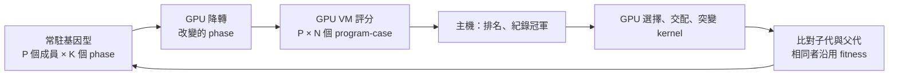
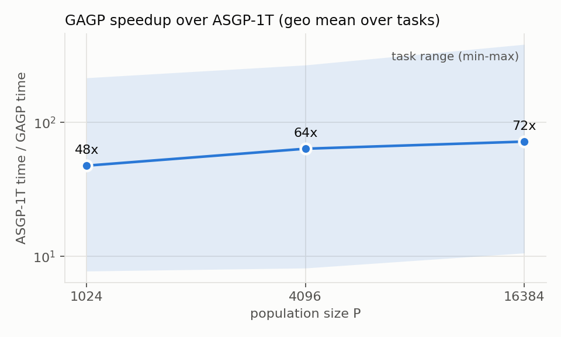
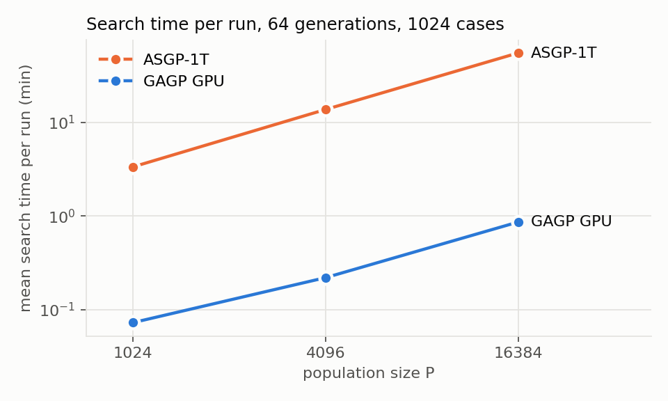
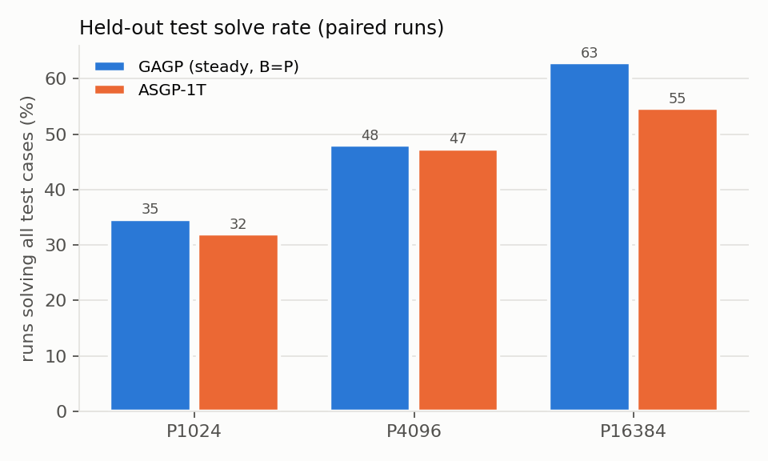

# GAGP 最終研究報告：語意可驗證的 GPU 文法式遺傳規劃

日期：2026-11-03　分支：`research/gagp-final`

本報告整理 GAGP 研究主線的機制、架構、最終實驗結果，以及論文的主軸與發力點。
系統的元件與檔案對照在 [research-mainline.md](../design/research-mainline.md)；
實驗協定、工具與原始數據在
[`benchmarks/final-scale-20261103/`](../../benchmarks/final-scale-20261103/README.md)。

## 摘要

- **速度。** 1024 個訓練案例、64 代、30 題 ASGP 題目上，GAGP（GPU 繁殖＋GPU 評分）比
  ASGP-1T 快 **47.6 倍（P1024）、63.7 倍（P4096）、72.1 倍（P16384）**（各題幾何平均）；
  扣除 ASGP-1T 8 工並行的競爭因子（1.28）後為 37、50、56 倍。比 GAGP 自己的 CPU 參考引擎
  快 **89–106 倍**。族群放大 16 倍時，GAGP 時間只增加 11.1 倍，ASGP-1T 增加 17.1 倍：
  加速比隨規模上升。
- **精確性。** CPU 參考引擎與 GPU 引擎在 90 組 P1024／4096／16384 執行中產出完全相同的
  搜尋（冠軍、每代紀錄）；正式紀錄與以提交版引擎重跑的 450 次搜尋也全部相同。
- **演化能力。** 相同族群下，GAGP 不比 ASGP-1T 差：P1024 52 vs 48／150（p = 0.50）、
  P4096 72 vs 71／150（p = 1），P16384 61 vs 53／97（p = 0.02，GAGP 較好）。以族群換時間時
  差距很大：GAGP P16384 在 ASGP-1T P1024 約四分之一的時間內解出 93／150，ASGP-1T P1024
  為 48／150（p < 1e-13）。
- **受控失真。** steady-state（B = P）比世代式快 1.13–1.30 倍，品質不劣於世代式
  （P16384 時多解 8 次，p = 0.04）。

## 1. 研究問題與主張

程式合成的 GP（genetic programming）幾乎所有時間都花在「把族群裡每支程式在每個
測試案例上跑一遍」。ASGP 是這類工作中有代表性的系統：它用 phase 結構的程式
（固定的根模板，加上最多 8 個可演化的 phase），在 PSB 類題目上有不錯的解題率，
但它是 CPU 程式，族群與案例數一大就慢。

GAGP 要回答的問題是：**能不能把整個演化迴圈搬到 GPU 上，而且證明搬過去之後，
搜尋本身一點都沒變？** 本研究的主張有四點：

1. **使用者可自訂文法。** 搜尋空間是一份編譯後的文法定義，不是寫死的指令集。
   ASGP 式的 phase 程式只是其中一種文法。
2. **GPU 繁殖加 GPU 評分，與 CPU 參考引擎逐位元一致。** 選擇、交配、突變、降轉成
   bytecode、評分全部在 GPU 上；另有一個純 C++ 的 CPU 參考引擎執行同一套算子與
   亂數抽取。相同輸入與種子下，兩者產出完全相同的冠軍、每代紀錄與最終族群。
3. **加速來自精確工程。** 每一項加速都必須通過 CPU 參考引擎的逐位元比對才能成為
   預設；加速不會偷偷改變搜尋。
4. **失真只以宣告的選項出現，並且有正反兩面的證據。** 唯一被採用的搜尋語意改變是
   同步批次 steady-state（批次 = 族群大小），兩個引擎都實作、結果一致，並以消融
   實驗評估。島嶼、非同步、小批次、族群共享計算、LPT 排程都量過，結論是不採用。

## 2. 機制

### 2.1 Phase population：常駐 GPU 的基因型

ASGP 的程式由一個固定的根模板與最多 8 個 phase 組成，每個 phase 是一棵獨立演化的
子樹。GAGP 把這種結構表示為 **phase population**：

- 基因型是 `P × K` 個 phase 列（每列最多 1024 個節點），整個搜尋期間都留在 GPU 記憶體。
- 每個子代只有被交配或突變碰到的 phase 會改變；只有改變的 phase 需要重新降轉成 bytecode。
- 與父代（或任一現存成員）基因型完全相同的子代，直接沿用已算好的 fitness，不再評分。

每一代（或 steady-state 的每一輪）在 GPU 上的流程：

跨 PCIe 的只有 fitness 向量與每代冠軍。

### 2.2 GPU 評分

評分是一台 bytecode 直譯器，在 GPU 上以 (程式, 案例) 為單位平行執行。list／string
值使用 payload arena。每個 lane 先用私有工作區執行；中間結果太大而溢位的程式，
再用較大的全域工作區重跑（replay）。這類可變長度的 list 運算是 SIMT 上最難處理的
部分：最慢的 case 往往是單一 lane 循序處理數萬個 cell。

研究過程中量到的時間組成（正式 P1024 協定）：評分 kernel 約佔 76%，繁殖 kernel
約 2%，初始化與最終評分約 14.5%。這說明繁殖已經不是瓶頸，剩餘的時間幾乎都在
評分。

### 2.3 共用算子：同一份程式碼跑在兩個引擎上

精確性的核心設計是 `phase_operators.cuh`：tournament、site 抽取、交配、突變、子代比對、
降轉這些 per-child 運算，寫成 `__host__ __device__` 函式，同時編進 GPU kernel 與
CPU 參考引擎。兩個引擎也使用相同的亂數流與相同的抽取順序。GPU 版本的加速
（warp 協作的突變、精確門檻表、共用暫存區等）都是在這個介面之下做的等價改寫，
例如：

- **精確門檻表**：主機端用相同的 IEEE 運算順序，二分出 53-bit 抽取值在每個產生式
  之間的切換門檻；GPU 只要比較整數，不必重做浮點累加。結果與逐步累加完全相同。
- **warp 協作變異**：一個 warp 共同處理一個子代，tournament 與亂數冗餘計算，
  site 計數用 ballot，節點複製平行化；依序相依的部分仍依序。
- **首輪即用 replay 容量**：只改物理工作區大小，不改分數；溢位重跑歸零。

### 2.4 搜尋設定與引擎設定分離

所有會改變搜尋結果的參數都在 `gagp-search-config-v1` 搜尋設定檔裡
（[spec](../../spec/search_config.md)），並分成兩類：

- `common`：一般 GP 參數（族群、世代、tournament、交配／突變率、深度限制、懲罰值等），
  與其他系統比較時設成對方的值。
- `gagp`：GAGP 特有機制（基因型表示、site 抽取方式、交配重試、排程），以 GAGP 自己的
  消融實驗評估。

引擎層的選項則全部是精確的（不改變任何結果），它們的預設值集中在
`engine_profile.hpp`（111 個開關）。一般執行不需要設定任何引擎開關；
`GAGP_ENGINE_PROFILE=legacy` 可以一次關掉全部，做消融比較。

### 2.5 同步批次 steady-state（B = P）

最終搜尋設定（[`gagp_final_asgp.json`](../../configs/search/gagp_final_asgp.json)）在
ASGP 對齊的參數之外，只改了一項：排程是同步批次 steady-state。每一輪產生 B 個子代、
一起評分，然後依序放回族群：每個子代與一個 size-2 inverse tournament 的輸家交換，
族群中最好的成員永遠不被替換。B = P 時一輪等於一個世代的工作量，GPU 的啟動形狀
不變。

它是「受控失真」的正面例子：

- 相同子代數下，需要評分的子代比世代式少約 24%（重複的基因型直接沿用分數）。
- 正式 P1024 協定（30 題 × 10 seeds）：解題數 110/300，世代式 104/300，ASGP-1T 105/300，
  差異都不顯著；速度比世代式快 1.15 倍（幾何平均）。
- CPU 參考引擎與 GPU 引擎都實作，並在測試中逐位元比對。

## 3. 架構

| 層 | 元件 | 職責 |
| --- | --- | --- |
| 規格 | `spec/` | 語言、bytecode、內建函式、fitness、文法定義、搜尋設定的規範 |
| 搜尋設定 | `search_config.cpp`、`search_policy.hpp` | 解析與驗證搜尋語意；寫入每份結果的 `search_config` |
| 共用迴圈 | `evolve.cpp`（`run_phase_population`、`run_phase_population_steady`） | 排名、選擇值、history、匯出；兩個引擎共用 |
| 共用算子 | `phase_operators.cuh` | per-child 算子主體，GPU 與 CPU 共用 |
| GPU 引擎 | `phase_population.cu`、`fitness_gpu.cu` | 常駐基因型、繁殖 kernel、GPU 降轉、bytecode VM |
| CPU 參考引擎 | `phase_population_cpu.cpp`、`fitness_cpu.cpp` | 相同算子、CPU 評分、不依賴 CUDA |
| 引擎設定 | `engine_profile.hpp` | 精確引擎開關的預設值 |
| 比較平台 | `src/bench/fixed_asgp/` | 用 ASGP 原始程式碼凍結初始族群與案例，翻譯成 GAGP 文法，三種引擎在相同輸入上執行 |

驗證層：

- `gagp_test_phase_population_cpu_reference`：CPU 參考 vs GPU，涵蓋多種搜尋政策、兩種
  排程、CPU 1／4 執行緒、所有 GPU 引擎變體；最終族群、fitness、錯誤數、冠軍都必須相同。
- `*_mainline` 測試項目用預設引擎設定重跑同一批 parity 測試，其他項目固定在 `legacy`，
  兩種設定都被涵蓋。
- 實驗層：每次研究都把匯出的冠軍與 history 和先前的正式結果逐位元比對（本報告的
  實驗也是，見 4.3）。

本次整理移除的探索設計（程式碼可從 git history `51aa1dc` 取回）：CPU 參考引擎上的
島嶼與非同步模擬、fuel 計量與 phase 共享探針、`benchmarks/fixed_asgp/optimization/`
（約 1700 個檔案的歷次最佳化紀錄）、2026-09 的 quick／tuning 實驗與相關工具。
歷史文件保留在 [fixed-asgp-history.md](../reference/fixed-asgp-history.md)。

## 4. 最終實驗

實驗協定、工具與原始數據在
[`benchmarks/final-scale-20261103/`](../../benchmarks/final-scale-20261103/README.md)，
完整表格在 [`results.md`](../../benchmarks/final-scale-20261103/results/results.md)。

### 4.1 設計

- **題目與資料。** ASGP 論文的 30 題。案例由 ASGP 自己的題目產生器產生；每題 1024 個
  訓練案例，測試集是不在訓練集中的最多 1000 個輸入（有限輸入域的 5 題只有 6–34 個）。
- **族群。** P = 1024、4096、16384；每個 (題目, seed) 先用 ASGP 原始碼凍結一個 16384 個
  程式的初始族群，較小的族群取其前綴。所有 arm 從相同的初始族群與案例出發。
- **比較對象。**
  - `gagp`：GAGP GPU 引擎（GPU 繁殖＋GPU 評分），最終搜尋設定（steady-state，B = P）。
  - `asgp`：ASGP 原始 C++ 求解器，單執行緒（ASGP-1T），世代式。
  - `cpuref`：GAGP 的 CPU 參考引擎，相同設定（P1024 跑完整 64 代；P4096／16384 跑前 8 代）。
  - `gagp_gen`：GAGP GPU 引擎改用世代式排程，其餘相同（排程消融）。
  - `gagp_clean`：用提交版引擎（引擎設定全部取預設值、不開診斷）重跑 `gagp`；必須與
    `gagp` 逐位元相同，速度數字以它為準。
- **共同參數**對齊 ASGP：tournament 2、交配率 0.7、突變率 0.3、每個算子一個 phase、
  深度 7、精英／最佳成員保護 1、ASGP fitness（單一案例誤差上限 1000）、fuel 2,000,000、
  64 代。
- **量測。** 時間是 `evolve_wall_ms`（從初始評分到最終族群，不含讀檔與翻譯），沒有任何
  執行開 profiler。GAGP GPU 一次只跑一個 job，固定在一個核心；ASGP-1T 與 CPU 參考引擎
  是 8 個單執行緒 worker 並行、各自固定核心。所有 arm 都用 `GAGP_HOST_THREADS=1`。
- **品質。** 每次執行匯出最終冠軍，用 CPU 的 `quality-source` 在測試集與訓練集上重新
  計分；「解出」指冠軍在所有測試案例上都正確。成對比較用 exact McNemar 檢定，信賴
  區間以題目為單位做 bootstrap（10000 次）。
- **時間預算。** 24 小時。GPU 部分（5 seeds × 3 P × 30 題，加上消融、重跑與計時重複）
  約 12 小時跑完；ASGP-1T 是瓶頸：P1024 與 P4096 的 5 seeds 全部跑完，P16384 跑完 seeds
  1–3 與 seed 4 的 7 題（共 97 次，每次 0.5–2 小時）。

### 4.2 加速比

ASGP-1T 時間 ÷ GAGP GPU 時間（提交版引擎，64 代）：

| P | 成對執行 | 題目 | 幾何平均（各題） | 總時間比 | 最小（題目） | 最大（題目） |
| ---: | ---: | ---: | ---: | ---: | --- | --- |
| 1024 | 150 | 30 | **47.6×** | 46.2× | grade 7.8× | syllables 216× |
| 4096 | 150 | 30 | **63.7×** | 62.7× | median 8.2× | syllables 269× |
| 16384 | 97 | 30 | **72.1×** | 64.2× | smallest 10.6× | sum_of_squares 384× |

GAGP CPU 參考引擎時間 ÷ GAGP GPU 時間（seed 1）：

| P | 世代 | 題目 | 幾何平均 | 總時間比 | 相同搜尋 |
| ---: | ---: | ---: | ---: | ---: | ---: |
| 1024 | 64 | 30 | **90.9×** | 149.5× | 30/30 |
| 4096 | 8 | 30 | **88.5×** | 168.6× | 30/30 |
| 16384 | 8 | 30 | **106.0×** | 196.0× | 30/30 |

時間隨族群的成長（同一組題目與 seed，相對 P1024 的幾何平均）：

| 引擎 | T(4096) / T(1024) | T(16384) / T(1024) |
| --- | ---: | ---: |
| GAGP GPU | 2.99 | 11.1 |
| ASGP-1T | 4.06 | 17.1 |

解讀：

- **加速比隨族群上升。** 族群大 4 倍，GAGP 時間只多 3 倍；大 16 倍只多 11 倍。小族群
  時 GPU 吃不滿，每代有固定的啟動與同步成本；族群越大越能攤平。ASGP-1T 則略高於
  線性。
- **CPU 參考引擎**慢 89–106 倍，比 ASGP-1T 還慢約 2 倍；它的目的是可讀、可驗證，
  不是速度，所以主要的外部比較對象是 ASGP-1T。
- **各題差異大（8×–384×）。** 加速比最低的是 grade、median、smallest、subregion_sum
  這類程式短、ASGP 每個案例很快就結束的題目，GPU 的固定成本佔比高；最高的是
  syllables、sum_of_squares、fibonacci 這類 list／string 或迴圈較重、CPU 每個案例要跑
  很久的題目。
- **競爭校正。** ASGP-1T 是 8 個 worker 同時跑。實驗結束後把 12 個 job（P1024 與 P4096）
  在沒有其他負載時單獨重跑：並行時間 ÷ 單獨時間的中位數為 **1.28**（1.25–1.30），冠軍
  12/12 相同。用它校正後，加速比為 **37.2×（P1024）、49.9×（P4096）、56.4×（P16384）**。
  這是較保守的數字；P16384 的校正因子沒有直接量測。
- P16384 若只看完整的 seeds 1–3（90 次），幾何平均 72.7×，與全部 97 次一致。
- 正式紀錄的執行另外開了 GPU 診斷與每代 trace，比提交版慢 1.4%（幾何平均）；兩組
  數字都在 `results.md`。

### 4.3 精確性

| 檢查 | 結果 |
| --- | --- |
| CPU 參考引擎 vs GPU，P1024，64 代（seed 1） | 30/30 冠軍匯出逐位元相同，每代紀錄除計時欄位外相同 |
| CPU 參考引擎 vs GPU，P4096／16384，8 代 | 60/60 相同 |
| GPU 8 代紀錄是 64 代執行的前綴 | 60/60 |
| 提交版引擎（預設引擎設定）vs 正式紀錄（明確設定開關） | 450/450 搜尋相同 |
| 提交版引擎的 CPU 參考引擎 vs 正式 GPU 紀錄（P1024，seed 1） | 30/30 相同 |
| 計時重複性（seed 1 的 90 次執行用提交版引擎再跑一次） | 冠軍 90/90 相同；時間比 1.003（幾何平均），偏差中位數 0.4%，最大 9.4% |
| ASGP-1T 單獨重跑（競爭校正） | 冠軍 12/12 相同 |

這表示：(1) 所有 GPU 端加速都沒有改變搜尋；(2) 本報告中 GAGP 與 ASGP 的品質差異，
只可能來自宣告的搜尋設定，不可能來自 GPU 的數值或執行順序；(3) 研究過程中把 111 個
精確開關收斂成引擎預設值，沒有改變任何結果。

### 4.4 演化能力

相同族群、成對比較（同題、同 seed、同初始族群）：

| P | 成對執行 | GAGP 解出 | ASGP-1T 解出 | 只有 GAGP | 只有 ASGP | McNemar p | 差異（pp） | 95% CI（pp） |
| ---: | ---: | ---: | ---: | ---: | ---: | ---: | ---: | --- |
| 1024 | 150 | 52 | 48 | 12 | 8 | 0.50 | +2.7 | [−2.7, +8.7] |
| 4096 | 150 | 72 | 71 | 8 | 7 | 1 | +0.7 | [−4.0, +5.3] |
| 16384 | 97 | 61 | 53 | 9 | 1 | 0.022 | +8.2 | [+3.0, +15.2] |

在所有已判定的執行中，訓練集全對與測試集全對幾乎完全一致（1897 次中只有 4 次在訓練集
全對但測試集錯 1–2 個），所以解題數的結論在兩個 split 上相同。

族群換時間：GAGP 在更大族群下，與 ASGP-1T P1024 比較（150 個 題目×seed）：

| GAGP P | GAGP 解出 | ASGP-1T P1024 解出 | McNemar p | GAGP 總時間 | ASGP-1T P1024 總時間 |
| ---: | ---: | ---: | ---: | ---: | ---: |
| 1024 | 52 | 48 | 0.50 | 662 s | 30190 s |
| 4096 | 72 | 48 | 8.4e-6 | 1985 s | 30190 s |
| 16384 | 93 | 48 | 5.7e-14 | 7677 s | 30190 s |

解讀：

- 在相同族群與相同初始族群下，GAGP 的搜尋品質不比 ASGP-1T 差：P1024／4096 差異在
  ±3pp 內且不顯著；P16384 GAGP 多解 8 次（9 對 1），p = 0.02。這與 4.5 節 steady-state
  在 P16384 優於世代式一致，但 P16384 只有 97 組成對執行，應視為初步證據。GAGP 的主要
  貢獻是速度，不是宣稱搜尋演算法本身更強。
- 速度轉換成演化能力：GAGP 用 ASGP-1T P1024 約 **四分之一的時間**跑 P16384，解題數從
  48 增加到 93（+30pp）。這是「精確加速」最直接的用途：同樣的牆鐘時間可以負擔大
  16 倍以上的族群。
- 30 題中有 9 題在所有 arm 與族群下都沒有任何執行解出（例如 grade、median、syllables、
  scrabble_score）；族群擴大提升的是「偶爾解得出」的題目的成功率。

### 4.5 排程消融：steady-state（B = P）vs 世代式

| P | 成對執行 | 時間比（世代式 ÷ steady） | steady 解出 | 世代式解出 | McNemar p | 差異（pp） | 95% CI（pp） |
| ---: | ---: | ---: | ---: | ---: | ---: | ---: | --- |
| 1024 | 150 | 1.13× | 52 | 53 | 1 | −0.7 | [−7.3, +6.7] |
| 4096 | 150 | 1.25× | 72 | 71 | 1 | +0.7 | [−3.3, +4.7] |
| 16384 | 150 | 1.30× | 93 | 85 | 0.039 | +5.3 | [+0.7, +11.3] |

steady-state 省下的是重複基因型的評分（子代與父代相同時沿用分數），族群越大省得越多。
品質上它在 P1024／4096 與世代式相當，在 P16384 略好。這是本研究唯一採用的語意改變，
兩個引擎都實作並逐位元比對。

### 4.6 執行紀錄與缺漏

- 失敗或逾時的執行：0（全部 1897 次執行都由 `quality-source` 判定，0 錯誤）。
- 缺漏：ASGP-1T P16384 的 seed 4 有 23 題、seed 5 有 30 題沒有在預算內跑（共 53 格）。
  相應的 GAGP 執行都有跑，但只在成對比較中使用有 ASGP 結果的格子；不做插補。
- CPU 佇列在 07:01 重新啟動一次，以便讓 seeds 2–5 先跑完 P1024／P4096 再跑 P16384；
  當時執行中的一個 ASGP-1T 執行（even_squares seed 1 P16384）因此從頭重跑。
- GAGP GPU 執行時，另外 8 個核心上有 ASGP-1T／CPU 參考引擎在跑；GAGP 的時間也包含這個
  背景負載的影響（主機端只用一個核心）。

## 5. 負結果：量過但不採用的設計

| 設計 | 證據 | 結論 |
| --- | --- | --- |
| 島嶼模型（ring 遷移） | CPU 參考引擎模擬，正式 300 次協定：8 島 113/300（+3.0pp，CI [−2.0, +8.3]，p=0.19）；32 島 100/300，未達非劣性；島內同步在模擬中沒有加速 | 不採用 |
| 非同步（無世代屏障）演化 | 相同子代數下品質不變（104/300）；以 GPU 實測校準後，消除屏障與拖尾的速度上界約 1.08–1.3 倍；失去確定性，也就失去 CPU 參考比對 | 不採用；它的工作量減少來自 steady-state 替換，同步版已取得 |
| 小批次 steady-state（B < P） | 每次評分啟動有約 25–30 ms 的下限（replay 拖尾）；B=256 速度是 B=P 的 0.65 倍；相對 B=P 只少約 9% 工作量，也沒有品質優勢 | 不採用；B = P |
| 族群共享計算（跨程式 phase 記憶化） | 70–84% 的 phase fuel 屬於只被單一程式使用的 phase | 主軸 no-go |
| LPT 排程 | 離線模擬整體樂觀估計 +1.6% | 不實作 |
| 限制突變深度／子樹大小 | depth7 快 1.39 倍但會改變搜尋；品質 −0.3pp（不顯著） | 保留為宣告選項，不進入最終設定 |
| CPU 工作執行緒繁殖 | 不是 GPU 主線加速 | 只作對照 |

這些負結果本身也是論文的一部分：它們界定了「精確 GPU GP」的加速從哪裡來、到哪裡為止。

## 6. 論文主軸與發力點

### 6.1 一句話主軸

**GPU 上的文法式 GP，可以做到與 CPU 參考實作逐位元一致的搜尋，同時快一到兩個數量級；
而且族群越大，優勢越明顯。**

### 6.2 發力點

1. **「精確」是主要貢獻，不是附帶條件。** 多數 GPU GP 工作只報告速度，或只說
   「品質相近」。GAGP 能說的是：同一組輸入與種子，GPU 與 CPU 參考引擎產出同一個
   搜尋（冠軍、每代紀錄、最終族群全部相同）。這讓速度比較變得乾淨：加速倍率與
   演化能力可以分開討論，品質差異只可能來自宣告的搜尋設定，不可能來自 GPU 數值
   或排程。實作上靠的是「共用算子主體＋相同亂數抽取順序＋逐位元測試」這套紀律，
   這是可以寫成方法論的部分。
2. **繁殖也在 GPU 上，而且常駐。** 基因型整個搜尋期間都留在 GPU，主機只看
   fitness 向量。量測顯示繁殖只佔約 2% 的時間；瓶頸完全回到評分。這是相對於
   「只把評分丟給 GPU」的設計的明確差異。
3. **規模化。** 本實驗的設計重點是 P = 1024 → 16384：族群大 16 倍，ASGP-1T 的時間
   多 17 倍，GAGP 只多 11 倍；GPU 在小族群時吃不滿，族群越大越能攤平固定成本，
   加速比從 48 倍升到 72 倍（見 4.2）。因此可以用「更短的時間，跑大 16 倍的族群」來談
   演化能力：GAGP P16384 用 ASGP-1T P1024 四分之一的時間，解題數從 48 增加到 93
   （見 4.4）。
4. **使用者可自訂文法。** 搜尋空間是資料（文法定義），不是寫死的指令集；ASGP 的
   30 題只是用文法表達的一種程式家族。這是相對於 ASGP 這類專用系統的泛用性論點。
5. **受控失真的方法論。** 搜尋設定與引擎設定分離：凡是會改變結果的東西都必須是
   搜尋設定的具名成員、兩個引擎都實作、並以消融評估。steady-state B=P 是正例
   （工作量少 24%、速度 +15%、品質不變）；島嶼、非同步、小批次是反例。負結果
   本身說明了加速的邊界在哪裡（評分 kernel 的單 lane list 運算與每次啟動的下限）。

### 6.3 建議的論文結構

1. 動機：GP 程式合成的成本結構；為什麼 GPU 加速常以犧牲可驗證性為代價。
2. 系統：文法定義 → phase population → GPU 評分／繁殖 → CPU 參考引擎。
3. 精確性：共用算子、亂數紀律、逐位元驗證的測試與實驗流程。
4. 實驗：(a) 對自身 CPU 參考引擎與 ASGP-1T 的加速比與規模化；(b) 逐位元一致性；
   (c) 演化能力：相同族群、以及「相同時間下更大族群」。
5. 受控失真與負結果：steady-state、島嶼、非同步、小批次、族群共享計算。
6. 限制與未來工作：評分 kernel 的 list 拖尾、多 GPU、其他文法家族。

## 7. 限制

- **ASGP-1T 的計時環境。** ASGP-1T 與 CPU 參考引擎是 8 個單執行緒工作同時執行
  （各自固定在不同核心）。共用的 L3 快取與記憶體頻寬會讓它們比單獨執行慢；
  4.2 節報告了單獨重跑 12 個 job 得到的校正倍率（1.28，只在 P1024／4096 量測）。
  GAGP GPU 是一次只跑一個 job。
  另外，最早一批 ASGP job 開始時，輸入準備程序有幾分鐘使用了較多核心。
- **ASGP-1T 是單執行緒。** 比較對象是論文作者的 C++ 原始碼在單執行緒下的表現，
  不是多執行緒版本；ASGP 的多執行緒效率不在本研究範圍。
- **搜尋設定不完全相同。** 共同參數已對齊，但 GAGP 使用 steady-state（B=P），
  ASGP 是世代式；site 抽取、文法節點上限、tie break 等 GAGP 機制也與 ASGP 不同。
  品質比較是「兩個系統各自的最佳對齊設定」之間的比較。
- **有限輸入域的題目。** fibonacci、tribonacci、even_squares、sum_of_squares、
  fibonacci_array 的測試集只有 6–34 個 case，解題判定比較寬鬆。
- **CPU 參考引擎的完整長度只跑了 P1024。** P4096／16384 用 G8 量速度；G8 的 GPU
  history 驗證為 G64 執行的前綴。
- **時間預算。** ASGP-1T 在大族群下非常慢；P16384 只跑完 97／150 格，未跑的 53 格
  列為缺漏，不做插補。P16384 的成對品質比較因此樣本較小。
- **單一機器、單一 GPU（RTX 3090）。**

